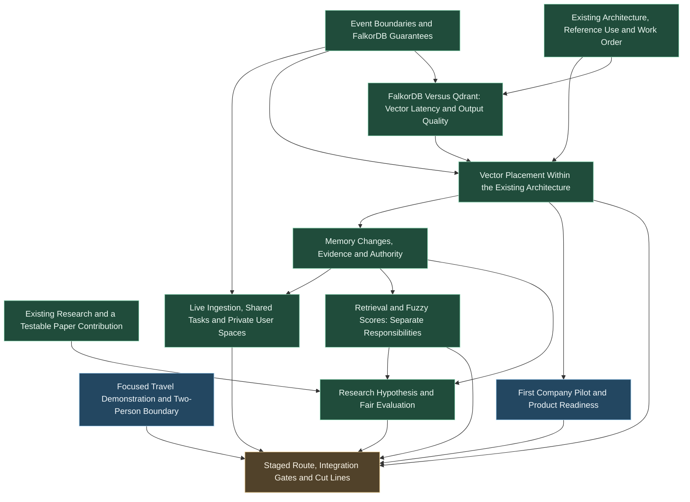

# Next Work and Decisions

Generated snapshot of the local Wayfinder tracker. The map and individual tickets remain canonical; this file stores no decision answers.

[Shared Agent Memory: Hackathon, Research and Reuse](map.md)

## First memory-core task

The first memory-core contract and local verification are complete. See the [shared-service guide](../../docs/shared_memory_service.md), [actual two-agent demo](../../report/shared_memory_20261014_final/results.json), and [delivery route](../../docs/memory_delivery_route.md). The remaining map decisions need the real teammate application/ownership and actual pilot partner. Larger blind/model-driven research and event submission remain future execution gates.

## Available now

- [Focused Travel Demonstration and Two-Person Boundary](issues/03-focused-demo-and-team-boundary.md)
- [First Company Pilot and Product Readiness](issues/09-first-company-pilot-and-product-readiness.md)

## Other open work and decisions

| Work or decision | Waiting on |
| --- | --- |
| [Staged Route, Integration Gates and Cut Lines](issues/10-staged-route-and-cut-lines.md) | [Focused Travel Demonstration and Two-Person Boundary](issues/03-focused-demo-and-team-boundary.md); [First Company Pilot and Product Readiness](issues/09-first-company-pilot-and-product-readiness.md) |

## Decision relationships

Arrows mean “this result or decision is needed before the next one.” Green items contain completed research or user decisions, blue items are available work/discussions, and orange items wait on prerequisites.

To work a ticket, claim it before investigating. Human decisions remain open until the live discussion resolves them. Execution status and evidence live in the individual tickets.
