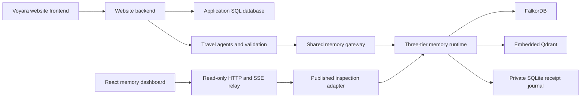

# Iron Web

Iron Web is an agent memory infrastructure project demonstrated through the Voyara travel website and a separate live memory dashboard. The system stores source evidence, builds scoped context for specialized agents, detects outdated requirements, and makes memory use visible during execution.

The **website** handles travel discovery, trip conversations, planning, saved drafts, Travel Book PDFs and booking requests. The **dashboard** monitors the memory system, its graph, vectors, receipts, captured contexts and agent activity. The dashboard is a separate application connected through a read-only relay.

The development sequence below follows the retained source history and dated implementation reports. Earlier prototypes and historical measurements remain available in the archive.

## Demo (2:58)

[Watch the narrated walkthrough](youtube-upload/ironweb-voyara-2m58-final.mp4) · [Matching subtitles](youtube-upload/captions-voice-matched.en.srt) · [All 14 screenshots](docs/screenshots/demo-2026-10-18/README.md)

The final export is exactly 178 seconds with the supplied voice retained and captions transcribed from that voiceover. [Transcript](youtube-upload/voiceover-transcript-reviewed.txt) · [Video verification](youtube-upload/voice-matched-verification.json). Earlier render variants and duplicate media were removed from the repository.

The walkthrough tours the dashboard, introduces Voyara, and shows the website beside the live agent activity during a real trip request. It then changes the budget from INR 200,000 to INR 120,000, inspects the revised context and provenance, and shows the regenerated current plan. Accelerated waiting is labeled.

| Voyara travel website | Live memory graph |
| --- | --- |
|  |  |
| **Agent wiring** | **Context X-ray** |
|  |  |

The same Budget agent's captured context before and after the requirement update:

| Before: INR 200,000 | After: INR 120,000 |
| --- | --- |
|  |  |

These are actual local demonstration screenshots. Context allocation uses UTF-8 bytes; provider-reported model token usage is shown separately. The travel catalog and cost estimates remain illustrative.

## Development history

### 1. Memory engine and initial storage

The initial foundation combined text records, vector retrieval and graph relationships. Embedded Qdrant stored vectors and record payloads; the earlier graph implementation used Kùzu. A Python facade exposed ingestion, retrieval, updates, deletion, temporal validity and maintenance.

The core established stable memory identifiers, source metadata, importance values, validity intervals and entity associations. A standalone local interface provided memory search, ingestion and device/status inspection. The original project snapshot was preserved before the subsequent cleanup.

### 2. Correctness, consistency and cleanup — 12 October 2026

The next stage corrected storage and retrieval behavior before application integration:

- Coordinated graph/vector writes gained compensation for caught failures, including restoration of original records and relationships.
- Extraction became explicit. Missing or failed extraction no longer produced fabricated entities.
- Temporal filtering, supersession direction, graph candidate ranking and duplicate handling were corrected.
- Maintenance retained distinct facts, contexts and episodes rather than deleting records solely because of similarity.
- Status and evaluation screens distinguished observed results from unavailable measurements.
- Application code, research experiments, older designs and retained evidence were separated.

The resulting memory layer supports source-aware retrieval and controlled updates. Its compensation protocol is not a durable crash-atomic transaction spanning both databases.

### 3. Reproducible evaluation — 12–13 October 2026

Evaluation workflows were added for DMR, LoCoMo and LongMemEval. Versioned question slices retain complete selected conversation histories. Results include input/configuration fingerprints, retrieval metrics, failure records and resumable checkpoints.

Project-owned research mechanisms were kept separate from optional adapters that call genuine external packages. Local retrieval scoring and first-context-line answer generation are documented separately from official benchmark evaluation protocols. Historical results are tied to their source revisions and experimental conditions.

### 4. FalkorDB migration and graph optimization — 13 October 2026

FalkorDB replaced Kùzu as the active graph backend while Qdrant remained embedded. The migration utility preserved the legacy source, verified imported graph contents and refused to overwrite a different populated destination.

The graph layer then gained batched seed lookup, revision-aware caches, bounded traversal and retry handling around graph-copy startup. A pinned Docker Compose service supplied the local graph database.

Vector-placement experiments retained Qdrant. Comparative graph, ingestion and retrieval reports recorded both improvements and tradeoffs; faster warm hybrid retrieval did not establish universally faster ingestion, updates or reranking.

### 5. Voyara website and profiling — 13–14 October 2026

The travel application introduced destination discovery, stays, food, experiences, sample flights, favorites, saved itineraries, profiles and booking requests. The website was consolidated under `stitch_ai_travel_booking_platform/` with a FastAPI backend, SQLAlchemy application database and Vite frontend.

Profiling separated embedding, reranking, vector search, graph copying, Redis communication and lock waits. Additional reports examined candidate limits and optional GPU execution. These measurements describe specific retained experiments, rather than general performance guarantees.

### 6. Three-tier context and memory lifecycle — 15 October 2026

A three-tier context layer was built around the durable memory stores:

| Tier | Purpose | Implementation |
| --- | --- | --- |
| Tier 1: hot context | Agent instructions and current traveler essentials | Separate bounded agent/traveler text blocks, with equal configured limits. |
| Tier 2: context cards | Task-specific and explicit mood context | Source-derived Markdown cards, bounded host caching and optional CUDA vector matching. |
| Tier 3: durable evidence | Retained facts, relationships, source records and lifecycle state | FalkorDB, embedded Qdrant and the private receipt journal. |

Structured claims retain exact scopes, provenance, confirmations, disputes, corrections and supersession. Protected rules are distinct from ordinary ranking scores. Work records cite the claim versions and prerequisites used during execution, allowing relevant changes to flag dependent work for review.

Context proofs identify the relevant memory state. Missing, disputed, pending or unsupported mandatory requirements block readiness. Consumers revalidate after generation so an old budget or changed restriction cannot silently remain authoritative. Forgetting invalidates derived contexts and prevents replay of a redacted source from recreating its memory.

Optional CUDA matching operates on card retrieval vectors. It is not a generative model KV cache. The connected application uses a declared UTF-8-byte consumer profile by default; that accounting is separate from hosted prompt tokens and provider billing.

### 7. Travel agents and application integration — 15–16 October 2026

The agent package added typed contracts, LangGraph orchestration, a shared memory gateway, allowlisted tools, validation and bounded revision. Authenticated trip conversations then connected the website to the existing three-tier memory runtime.

| Functional role | Responsibility |
| --- | --- |
| Trip consultant | Structured requirements and clarification. |
| Explore agent | Destination and activity discovery. |
| Stay agent | Accommodation choices and tradeoffs. |
| Tour guide agent | Attractions and experiences. |
| Food guide agent | Food options and supported dietary requirements. |
| Itinerary planner | Day-by-day sequencing and timing. |
| Budget reviewer | Exact listed-cost calculations and exclusions. |
| Travel support agent | Packing and disruption guidance when requested. |
| Orchestrator | Routing, context coordination and result validation. |

A complete tested planning run uses seven hosted specialists. Support is routed when needed; nine registered memory actors do not imply nine simultaneous model calls.

The website binds identity and trip ownership on the server. Agents access memory through the gateway rather than opening stores directly. Independent research tasks can run in parallel, followed by itinerary construction, cost checks and current-state validation.

Hosted execution uses NVIDIA NIM with schema-validated JSON actions and bounded tool loops. The documented defaults for `NIM_MODEL` and `NIM_AGENT_MODEL` are `openai/gpt-oss-20b`. Explicit offline mode supports deterministic testing and is labeled separately. Failed hosted execution is not replaced with fabricated model success.

The connected hosted specialists have no booking or payment tool. Authenticated website checkout creates a booking request with `status="requested"`.

### 8. Frontend authentication and demonstration access — 16 October 2026

The website frontend was connected to application APIs, private trip conversations and Google sign-in configuration. Cookie-based sessions and ownership checks protect private records.

**The local demonstration uses Login with Developer.** The current website labels this control **Continue as Demo Traveler**. The control signs in to a dedicated ordinary developer account, `voyara_local_developer`, without entering external account credentials. This account supplies the local dashboard's demonstration publication scope.

Developer login is explicitly enabled by the local launcher and restricted to direct loopback access. Non-loopback hosts, forwarded requests and invalid origins are refused. It is a local demonstration mechanism, not a public authentication deployment. Google sign-in is a separate configured path; the recorded developer-login demonstration does not establish a completed Google OAuth acceptance test.

### 9. Independent live memory dashboard — 17 October 2026

The dashboard began as an event-driven visualizer using `events.json` to develop graph layout, selection and replay interactions. The fixture remains for compatibility tests. The current React entry point reads the actual memory feed and never substitutes demo events when the source is unavailable.

A separate FastAPI relay reads an explicitly published website memory scope over HTTP and forwards snapshots through HTTP and Server-Sent Events. It never opens the embedded stores or becomes a second memory writer.

The interface includes a memory explorer, central stage, inspector and unified replay dock. Five views expose different aspects of the same system:

| View | Contents |
| --- | --- |
| Memory graph | Actual FalkorDB relationships and explicitly derived captured-context nodes, tier colors, access sizing and selection. |
| Agent wiring | Registered actors, memory/tool connections and event-linked activity. |
| Activity | Agent rows, event timing, selection and navigation. |
| Architecture | All three memory tiers, their roles and captured contexts. |
| Resources | Available context/cache accounting, provider usage, latency and supported RAM/VRAM observations. |

The inspector exposes observed differences, history, links and provenance. Source inspection includes actual Qdrant payloads/numeric vectors and receipt state. Provider identity and credential fingerprints are masked; full keys are not displayed.

Selection synchronizes across views. Replay controls, follow-live, shortcuts, URL state, responsive drawers and reduced-motion support coordinate the interface. Context history is captured per event; graph/store and resource aggregates remain latest snapshots rather than reconstructed historical databases.

The current observation window retains up to 500 events and 256 latest contexts and resets on memory-owner restart. Graph/vector/receipt inspection is paginated and bounded. The published scope is one selected account, optionally restricted to a trip, rather than a cross-tenant administration console.

### 10. Conversational travel workflow and regional catalogs — 17–18 October 2026

The travel experience expanded to conversational discovery, editable trip details, shared manual selections, saved plan versions and private Travel Book PDF export. Plan freshness and evidence checks remain part of generation and editing.

Kashmir and Kerala received unified catalogs, illustrated SVG maps and booking-review presentation. The maps and supplier listings are illustrative synthetic catalog data. They do not establish live routing, availability, taxes, accessibility or confirmed supplier inventory.

Hosted catalog review uses one model and is labeled separately from supplier verification. Missing or partial review output produces a visible unavailable response; a canned successful assessment is not substituted.

### 11. Security, startup hardening and recovery — 18 October 2026

Finalisation removed maintained secret literals, added a repository/history scan, introduced viewer access controls for remote HTTP/SSE, strengthened developer-login restrictions and corrected website response/validation defects. Referenced legacy interfaces, fixtures, research adapters and historical reports were retained; nine verified unused import names were removed.

Startup preflight checks dependencies, ports, graph connectivity, the FalkorDB module and required configuration. A clean-source check found a missing default SQLite directory; the launcher now creates it before seeding. Fresh-source startup subsequently passed using the installed Python environment, isolated stores and no copied private configuration.

Resource reporting was corrected to avoid summing overlapping CUDA captures. A stalled-stream check found that a proxy could leave a dead SSE connection open while the UI still reported live status. A ten-second heartbeat timeout now marks retained data stale and reconnects the stream.

A persistence drill exposed a FalkorDB `GRAPH.EFFECT` replay crash on fixture graph keys. Recovery was investigated on verified copies. Approved fixture-only log exclusions produced a working copy, followed by a separately approved live activation. The original volume and a byte-identical pristine backup remain preserved. Controlled restart, relay reconnect and fresh hosted acceptance passed on the activated copy; an underlying engine durability fix is not claimed.

Detailed evidence and remaining actions are recorded in the [finalisation report](report/finalisation_20261018/README.md) and [recovery record](report/finalisation_20261018/RECOVERY.md).

## Current architecture



The website backend owns the connected embedded runtime. A single worker/process owns each Qdrant/journal directory. The relay receives only published read access and has no embedded-store ownership. Application SQL records, memory receipts, vectors and graph evidence have different responsibilities and require coordinated operational backups.

### Technology

| Area | Stack |
| --- | --- |
| Memory core | Python, embedded Qdrant, FalkorDB, FastEmbed/ONNX Runtime and optional reranking. |
| Agent execution | LangGraph, typed schemas, NVIDIA NIM and allowlisted Python tools. |
| Website backend | FastAPI, SQLAlchemy and local SQLite by default. |
| Website frontend | HTML, JavaScript, CSS and Vite. |
| Dashboard frontend | React, Vite, Tailwind, d3-force and framer-motion. |
| Dashboard relay | FastAPI, HTTPX and Server-Sent Events. |
| Export | ReportLab Travel Book PDFs. |
| Verification | pytest, frontend unit tests and Edge/Playwright browser tests. |
| Deployment preparation | Docker/Railway relay configuration and Vercel frontend configuration. |

## Local setup and startup

### Dependencies

Python 3.12+, Node.js 22.12+, npm and Docker Desktop or a reachable FalkorDB service are required. Existing usable environments can be retained. A fresh CPU environment can be prepared from the repository root:

```powershell
py -3.12 -m venv .venv
.\.venv\Scripts\python.exe -m pip install -r requirements.txt -r requirements/nim.txt -r requirements/application.txt -r dashboard/backend/requirements.txt -r requirements/dev.txt
npm --prefix stitch_ai_travel_booking_platform/frontend ci
npm --prefix stitch_ai_travel_booking_platform/frontend run build
npm --prefix dashboard/frontend ci
```

CPU and optional GPU dependency profiles belong in separate environments. Model files may download when an operation first requires them. Package import or a status request alone does not establish neural/GPU execution.

### Private configuration

`NVIDIA_API_KEY` belongs in the server process environment or the supported ignored environment-file configuration. The local website launcher loads `stitch_ai_travel_booking_platform/backend/.env`; agent configuration also supports its documented environment sources. No credential value belongs in the README, tracked files or a frontend build.

| Setting | Purpose |
| --- | --- |
| `NVIDIA_API_KEY` | Server-side hosted model credential. |
| `NIM_MODEL`, `NIM_AGENT_MODEL` | Model overrides; documented defaults are `openai/gpt-oss-20b`. |
| `VOYARA_AGENT_MODE` | `auto`, required `nvidia`, or explicitly labeled `offline` mode. |
| `DATABASE_URL`, `AGENT_MEMORY_PATH` | Application SQL and private memory runtime locations. |
| `FALKORDB_HOST`, `FALKORDB_PORT`, `FALKORDB_GRAPH_NAME`, `FALKORDB_TLS` | Graph connection overrides. Credentials use separate environment variables. |
| `DASHBOARD_PUBLISH_TOKEN` | Website-side publication grant. |
| `DASHBOARD_SOURCE_URL`, `DASHBOARD_SOURCE_TOKEN` | Relay's server-side connection to the published source. |
| `DASHBOARD_USER_ID` / `DASHBOARD_USER_USERNAME`, `DASHBOARD_TRIP_ID` | Intended published account and optional trip restriction. |
| `DASHBOARD_VIEWER_TOKEN` | Separate remote viewer secret, at least 32 random characters. |
| `DASHBOARD_CORS_ORIGINS` | Exact permitted dashboard origins. |
| `VITE_DASHBOARD_API_URL` | Public relay origin for a separately hosted dashboard frontend. |

The local launchers generate private publication/session values under ignored `.scratch/ironweb-live/`. Developer access is enabled only for the loopback demonstration. Public deployment requires separate authentication, HTTPS and environment configuration.

### Start the database

For a fresh installation with a new database:

```powershell
docker compose up -d --wait falkordb
```

The existing recovered workstation requires the explicit override instead:

```powershell
docker compose -f compose.yaml -f compose.recovery.yaml up -d --wait falkordb
```

The override selects `iron_web_falkordb_recovered_live_20261018`. It requires the prepared external volume and does not reconstruct it from a fresh checkout. Base Compose still names the preserved original volume on the recovered workstation. The original and pristine backup must remain preserved; switching volumes after new writes can disagree with the embedded stores. The [recovery record](report/finalisation_20261018/RECOVERY.md) documents the operational boundary.

### Start the website and dashboard

Before starting application services:

```powershell
.\.venv\Scripts\python.exe scripts/preflight.py --mode start
```

Each launcher runs in a separate terminal from the repository root:

```powershell
.\.venv\Scripts\python.exe scripts/run_live_dashboard.py website
```

```powershell
.\.venv\Scripts\python.exe scripts/run_live_dashboard.py dashboard
```

```powershell
.\.venv\Scripts\python.exe scripts/run_live_dashboard.py frontend
```

After startup:

```powershell
.\.venv\Scripts\python.exe scripts/preflight.py --mode running
```

| Service | Local address |
| --- | --- |
| Voyara website | [http://127.0.0.1:8000](http://127.0.0.1:8000/) |
| Memory dashboard | [http://127.0.0.1:5174](http://127.0.0.1:5174/) |
| Read-only relay | [http://127.0.0.1:8200](http://127.0.0.1:8200/) |
| FalkorDB | `127.0.0.1:6379` |

Start-mode preflight expects application ports to be free; running mode expects active listeners. The frontend launcher explicitly loads the React Vite configuration and refuses an occupied port instead of silently moving to another address. A relay `/health` response establishes process health, not complete memory health.

## Demonstration flow

1. Open the website and dashboard side by side.
2. Sign in through **Continue as Demo Traveler**, the local developer-login control used for the demonstration.
3. Create a structured Kerala trip, for example 1 December 2026, three days, two travelers, INR 200,000 and relaxed pace.
4. Generate the trip outline and inspect the seven specialist results, current saved plan and matching dashboard events.
5. Export the Travel Book PDF and inspect the Kashmir/Kerala regional catalogs.
6. Review a synthetic selection and submit a booking request. Its state remains `requested`; no supplier reservation or payment occurs.
7. Change the budget and inspect stale-plan detection and current-context revalidation. Unsupported hard requirements or conflicts must pause planning.
8. Inspect a source event, forget it through the website and check the next dashboard refresh. Exact same-ID replay protection is covered through the service tests; arbitrary ID injection is not a website control.
9. Inspect the three tiers, captured contexts, actual provider usage and explicitly unavailable measurements.

The relay emits snapshots every two seconds and can cache a read for 1.5 seconds. A stopped or stalled feed displays stale/unavailable state; fixture data is not substituted. The [demo guide](DEMO.md) provides the expanded procedure.

## Verification

Recorded finalisation results on 18 October 2026:

| Check | Result and scope |
| --- | --- |
| Core backend and agents | 397 passed, 2 skipped, 6 deselected; offline provider fixtures and actual isolated stores. |
| Website backend | 51 passed with the backend/root import paths configured. |
| Dashboard frontend | 13 unit tests passed. |
| Browser suite | 3 passed, including real-feed interactions, responsive/reduced-motion behavior and a stalled-stream regression. |
| Production builds | Website and dashboard passed. |
| Live preflight | 28 checks passed. |
| Hosted acceptance | Seven NVIDIA specialists, saved current plan, Travel Book PDF, regional catalogs and requested booking passed. |
| Consistency | Budget invalidation/rebuild, conflict pause, authenticated isolation, forgetting and isolated same-ID replay passed. |
| Recovery | Approved copied-volume restart and actual relay disconnect/reconnect passed. |
| Fresh-source startup | Passed with cached npm installs and the installed Python environment; no private configuration copied and no hosted requests in that check. |

These results are dated evidence, not a substitute for rerunning checks after code/configuration changes. Browser verification used local Edge/Playwright after the browser plugin failed to start. Fresh Python dependency installation, cloud cookie/SSE behavior and deployed GPU execution were not established by these runs.

### Offline regression commands

Tests require a separate disposable FalkorDB instance, such as port 6389, plus temporary embedded stores. The live demonstration database must not be used for the full test workload. Offline overrides belong in a separate test terminal:

```powershell
$env:FALKORDB_PORT='6389'
$env:VOYARA_AGENT_MODE='offline'
.\.venv\Scripts\python.exe -m pytest tests agents/tests -q
$env:PYTHONPATH="$PWD\stitch_ai_travel_booking_platform\backend;$PWD"
.\.venv\Scripts\python.exe -m pytest stitch_ai_travel_booking_platform/backend/tests -q
npm --prefix dashboard/frontend test
npm --prefix dashboard/frontend run build
npm --prefix stitch_ai_travel_booking_platform/frontend run build
Remove-Item Env:FALKORDB_PORT, Env:VOYARA_AGENT_MODE, Env:PYTHONPATH
```

`tests/test_offline_smoke.py` covers authenticated planning, all seven specialists, saved output, PDF export, a requested booking and the actual relay with isolated stores. Dataset, neural, GPU and hosted-provider checks remain separate from ordinary offline control-flow tests.

### Live browser acceptance

The live flow requires the running services and configured NVIDIA access. It makes real provider requests and creates a synthetic booking request. Each run requires a fresh evidence directory:

```powershell
$env:IRONWEB_ACCEPTANCE_REPORT_DIR='report/local_acceptance_new'
node dashboard/frontend/tests/live-flow.mjs
$acceptance=Get-Content "$env:IRONWEB_ACCEPTANCE_REPORT_DIR/acceptance.json" -Raw | ConvertFrom-Json
$env:IRONWEB_TEST_TRIP_ID=$acceptance.trip_id
$env:IRONWEB_TEST_DESTINATION='Kerala'
$env:IRONWEB_LIVE_REPORT_DIR="$env:IRONWEB_ACCEPTANCE_REPORT_DIR/layout"
npm --prefix dashboard/frontend run test:browser
```

## Interfaces and repository layout

| Interface | Role |
| --- | --- |
| `MemoryEngine` / `MemoryToolAdapter` | In-process memory API and Python tool dispatch; no MCP transport is implied. |
| Website `/api/auth`, `/api/profile`, `/api/assistant/conversations` | Identity, preferences and owner-scoped trip workflows. |
| Website catalog, booking and export routes | Synthetic discovery, saved selections, requests and PDFs. |
| Website `/api/dashboard/*` | Explicitly published read-only inspection source, protected by the publication grant. |
| Relay `/api/dashboard/*` and `/api/dashboard/stream` | Published snapshots and SSE under the configured viewer policy. |
| Relay `/viewer/session` | Viewer-secret exchange for a signed HttpOnly session cookie. |
| `server.py` / `web/` | Retained standalone local memory interface, normally port 8080. |
| `shared_server.py` | Separate authenticated shared-memory/context service. |

Standalone/shared interfaces are optional and are not required for the connected website demonstration. Concurrent services require separate embedded-runtime ownership.

```text
memory/                                  Memory engine, graph/vector stores, lifecycle and context
agents/                                  Orchestration, specialist roles, gateway, tools and validation
stitch_ai_travel_booking_platform/
  backend/                               Website APIs, identity, SQL state and memory ownership
  frontend/                              Travel website source and Vite build
dashboard/
  backend/                               Independent read-only relay and viewer gate
  frontend/                              React visualization and browser/unit checks
  inspection/                            Retained plain diagnostic interface
scripts/                                 Launchers, preflight, diagnostics, migration and evaluation
tests/                                   Core, integration, lifecycle, security and regression tests
requirements/                            CPU, GPU, hosted, application and research profiles
research/                                Optional mechanisms and genuine external-package adapters
datasets/                                Dataset acquisition and provenance documentation
docs/                                    Specifications, decisions and integration guides
report/                                  Dated results, diagrams, screenshots and system reports
archive/                                 Preserved earlier designs, source and experiments
data/                                    Ignored local application and memory data
```

### Standalone memory and migration

The optional standalone interface starts with `.\.venv\Scripts\python.exe server.py` after database/dependency setup. The main facade supports `add`, `add_batch`, `get`, `search`, `update`, `delete`, maintenance and status operations. Vector, graph, hybrid and explicitly selected ablation modes have separate semantics.

The legacy importer is `scripts/migrate_kuzu_to_falkordb.py`, with optional dependencies in `requirements/migration.txt`. It opens the old source read-only and verifies the destination rather than silently replacing populated graphs. The [migration guide](docs/falkordb_migration.md) records the procedure.

### Evaluation workflows

```powershell
.\.venv\Scripts\python.exe scripts/evaluate.py locomo --inspect
.\.venv\Scripts\python.exe scripts/evaluate.py locomo --run-id local_example --modes vector hybrid
.\.venv\Scripts\python.exe scripts/export_slice.py locomo data/benchmark_slices/v2/locomo
```

Evaluation requires the declared local inputs, compatible configuration and isolated stores. Profiling and genuine external-package comparisons have separate dependency profiles. Historical Kùzu results do not measure FalkorDB, and local retrieval/answer scoring is not official upstream benchmark certification.

## Security, deployment and remaining limits

Remote dashboard HTTP and SSE require a configured viewer secret. Only direct loopback can omit it. The browser receives a signed HttpOnly viewer cookie rather than the publication grant; CORS uses exact origins and does not replace authorization. The publication scope remains deliberately selected account/trip data.

Maintained exposed credential literals were removed, but historical Git blobs still require owner-side revocation/rotation and a separately approved history-cleanup decision. Secret values, grants, session files and active databases remain excluded from documentation and ordinary commits. Referenced historical Markdown under `.scratch/` is a documented tracking exception, not evidence that private runtime files are public.

Railway backends and Vercel frontends are intended deployment targets. The relay Dockerfile, Railway configuration and dashboard Vercel configuration are prepared; cloud deployment is not established by the local checks. Deployment requires persistent SQL/vector/journal storage, reachable authenticated FalkorDB, one memory owner, HTTPS, exact origins and tested viewer-cookie/SSE behavior. `VITE_DASHBOARD_API_URL` is public configuration; provider keys, viewer secrets and publication grants are server-only.

The main remaining boundaries are:

- Cross-store compensation covers caught failures, not a durable transaction across graph and vector storage.
- The original persistence failure is preserved; successful repaired-volume drills do not prove the engine defect resolved.
- Supplier data, maps and prices are synthetic or indicative. Availability, accessibility, complete quotes, reservations and payments are not verified.
- Captured replay is bounded and resets on owner restart. Historical database states are not reconstructed from missing observations.
- Unmeasured GPU utilization, no-memory savings, cache-token breakdowns and unsupported quotas remain unavailable.
- Optional GPU capability does not establish GPU use in every application run or deployment.
- Representative hosted reliability, multi-replica embedded-store operation and general scalability remain unproven.

## Documentation and evidence

- [Complete system report](report/system_overview_20261018/report.md) and [PDF](report/system_overview_20261018/report.pdf)
- [Finalisation results and commit map](report/finalisation_20261018/README.md)
- [Demonstration guide](DEMO.md)
- [Implementation specification](docs/specification.md) and [architecture decisions](docs/architecture.md)
- [Three-tier context guide](docs/three_tier_memory_usage.md) and [memory lifecycle](docs/memory_evolution.md)
- [Connected application guide](docs/application_memory_integration.md) and [Travel Book/catalog guide](docs/travel_chat_catalog.md)
- [Dashboard guide](dashboard/README.md) and [relay/viewer configuration](dashboard/backend/README.md)
- [Graph migration report](report/falkordb_migration/report.md), [graph comparison](report/full20_graph_analysis_20261013/report.md), [latency breakdown](report/latency_breakdown_20261014/report.md) and [reranker diagnosis](report/reranker_diagnosis_20261014/report.md)
- [Vector-placement comparison](report/vector_placement_20261013_p5_paired/REPORT.md), [dataset notes](datasets/README.md) and [research workflows](research/README.md)

## Hosted website deployment

The deployment branch is integrated into `main`. See [Vercel/Render setup and recorded deployment endpoints](deploy/voyara/README.md) for the hosted website, isolated judge sign-in, single-worker ownership and ephemeral-storage limits. The local dashboard remains a separate application. This merge does not run a new cloud deployment.
