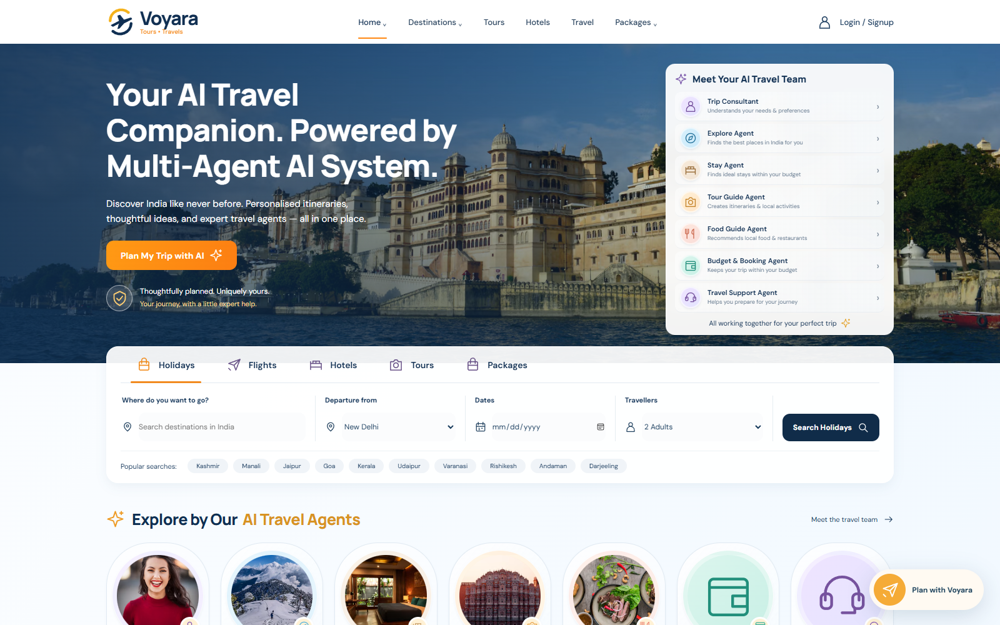
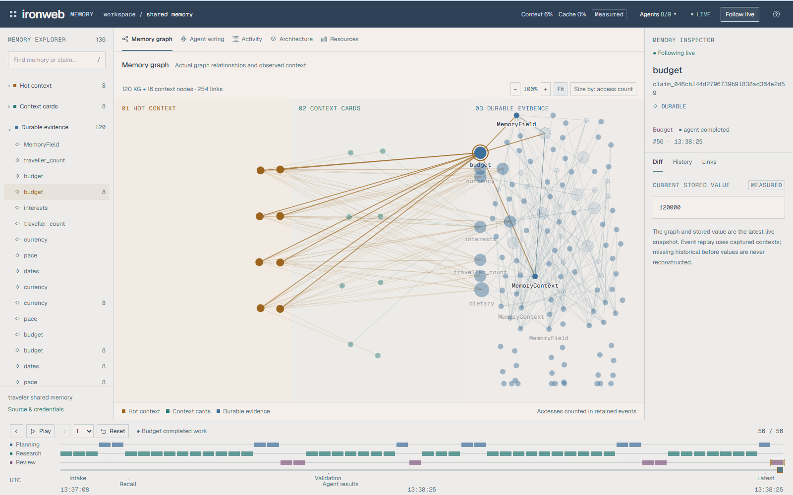
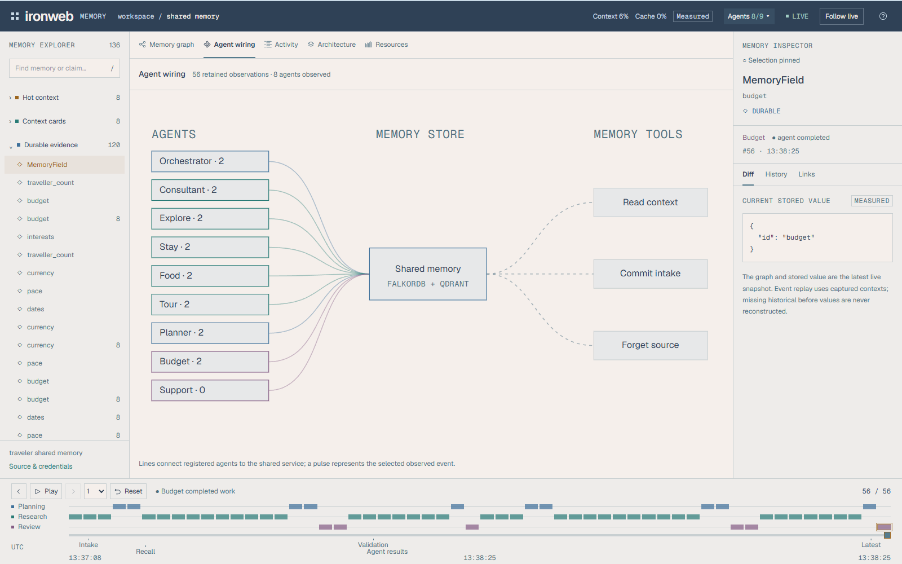
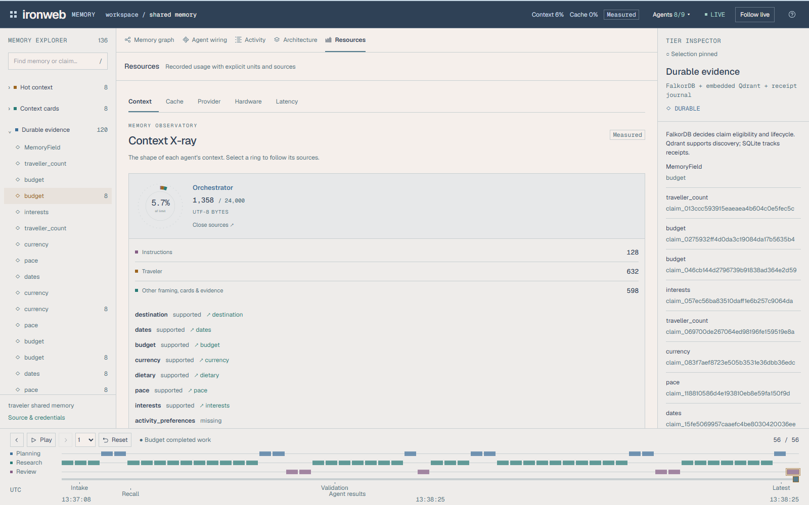
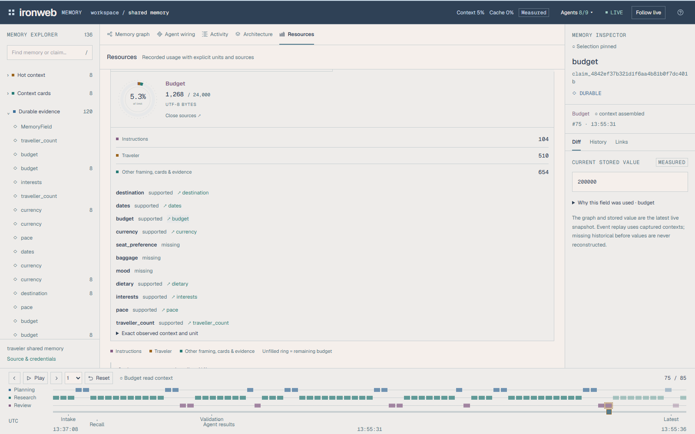
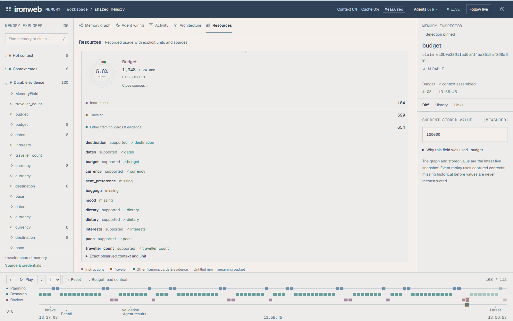

# Iron Web memory

Finalisation status, 18 October 2026: a persisted FalkorDB `GRAPH.EFFECT` replay
crash required recovery. With explicit approval, a tested fixture-filtered copy
is now active; the original and pristine backup are preserved. Fresh hosted
planning, booking requests and consistency checks passed after cutover. Use the
explicit recovery override on this workstation; plain Compose still names the
failing original volume. Do not delete either volume or reset its AOF. See the dated
[finalisation report](report/finalisation_20261018/README.md),
[system report](report/system_overview_20261018/report.md), and [demo guide](DEMO.md).

Text memory backed by embedded Qdrant and a FalkorDB graph service. The application saves, updates, deletes and retrieves memories, supports explicit validity intervals, and exposes a local dashboard and an in-process Python tool adapter.

The supported application is in `memory/`, `server.py`, and `web/`. Optional experiments are in `research/`. Earlier designs, phase scripts, reports and unused source are preserved under `archive/2026-10-12/`; they describe the earlier implementation.

## Three-minute demo

[Watch the narrated walkthrough](report/video_demo_20261018/ironweb-voyara-3min.mp4) · [Subtitles](report/video_demo_20261018/captions.srt) · [All 14 screenshots](docs/screenshots/demo-2026-10-18/README.md)

A [silent copy without subtitles](report/video_demo_20261018/ironweb-voyara-3min-silent.mp4) is also available with a separate [companion transcript](report/video_demo_20261018/transcript.md) ([plain text](report/video_demo_20261018/transcript.txt)).

The walkthrough tours the dashboard, introduces Voyara, and shows the website beside the live agent activity during a real trip request. It then changes the budget from INR 200,000 to INR 120,000, inspects the revised context and provenance, and shows the regenerated current plan. Accelerated waiting is labeled.

| Voyara travel website | Live memory graph |
| --- | --- |
|  |  |
| **Agent wiring** | **Context X-ray** |
|  |  |

The same Budget agent's captured context before and after the requirement update:

| Before: INR 200,000 | After: INR 120,000 |
| --- | --- |
|  |  |

These are actual local demonstration screenshots. Context allocation uses UTF-8 bytes; provider-reported model token usage is shown separately. The travel catalog and cost estimates remain illustrative.

## Run

Use Python 3.12 and Docker Desktop (or an existing FalkorDB service). For a new CPU environment:

The following base Compose command is for a fresh installation. On the recovered
workstation use `docker compose -f compose.yaml -f compose.recovery.yaml up -d --wait falkordb`
instead, and keep the override on subsequent database operations.

```powershell
py -3.12 -m venv .venv-cpu
.\.venv-cpu\Scripts\python.exe -m pip install -r requirements.txt -r requirements/dev.txt
docker compose up -d --wait falkordb
.\.venv-cpu\Scripts\python.exe server.py
```

Open `http://127.0.0.1:8080/`. Model files may download on the first operation that needs them. Importing the public API, reading device status, and graph-only searches do not initialize neural models.

The default graph service is `127.0.0.1:6379`, graph `iron_web`. Compose stores its data in the persistent `iron_web_falkordb_data` volume and binds the database port to the local computer. Connection settings live under `falkordb` in `config.yaml`; credentials come from `FALKORDB_USERNAME` / `FALKORDB_PASSWORD`. `FALKORDB_HOST`, `FALKORDB_PORT`, `FALKORDB_GRAPH_NAME` and `FALKORDB_TLS` override configuration. Python callers can select an isolated graph with `MemoryEngine(graph_name="my_graph")`.

For an existing Kùzu installation, preserve its file and run the verified importer once:

```powershell
.\.venv\Scripts\python.exe -m pip install -r requirements/migration.txt
.\.venv\Scripts\python.exe scripts/migrate_kuzu_to_falkordb.py --source data/kuzu/memory.db --graph-name iron_web
```

The importer opens the legacy database read-only, compares all nodes/relationships/properties, and refuses to overwrite a different populated target graph. Kùzu is required only by this optional import utility. See [migration details](docs/falkordb_migration.md).

The existing `.venv` launcher was repaired and its installed packages were preserved. The CPU and GPU dependency profiles are intended for separate environments. Hosted extraction additionally uses `requirements/nim.txt`, `extraction_policy: nim`, and the process environment variable `NVIDIA_API_KEY`. The default extraction policy is `none`, which saves text without inventing entities.

## Verify

```powershell
.\.venv\Scripts\python.exe -m pytest
.\.venv\Scripts\python.exe -m pytest -m dataset
.\.venv\Scripts\python.exe -m ruff check memory server.py tests research scripts datasets/acquire_datasets.py --select F
.\.venv\Scripts\python.exe scripts/diagnose.py
```

Ordinary tests use declared offline models and actual temporary databases. Dataset tests require the original local inputs. `diagnose.py --models` initializes real models, and `--nim` makes a hosted extraction request; those checks are selected explicitly.
The FalkorDB service must be running for integration tests. Tests use isolated named graphs and remove only their own test graphs.

## Evaluate

```powershell
.\.venv\Scripts\python.exe scripts/evaluate.py locomo --inspect
.\.venv\Scripts\python.exe scripts/evaluate.py locomo --run-id local_example --modes vector hybrid
.\.venv\Scripts\python.exe scripts/export_slice.py locomo data/benchmark_slices/v2/locomo
```

The runner uses local retrieval metrics and a first-context-line answer generator. It records corpus coverage, source/configuration fingerprints, failures, and resumed results. It does not implement the official upstream answer-scoring protocols. New slices retain complete selected conversation histories and cannot overwrite an existing version.

See [current specification](docs/specification.md), [architecture decisions](docs/architecture.md), [dataset notes](datasets/README.md), [research workflows](research/README.md), and [cleanup implementation report](report/cleanup_implementation_report.md).

## Graph backend performance report

The [full 20% analysis](report/full20_graph_analysis_20261013/report.md) compares Kùzu, the initial FalkorDB migration, and the optimized integration on DMR, LoCoMo and LongMemEval. The [PDF](report/full20_graph_analysis_20261013/report.pdf) and CSV tables include fresh ingestion, retrieval metrics, latency distributions, concurrency and memory scope. Optimized warm hybrid search is faster in these cohorts; full-graph copying makes ingestion and frequent updates expensive. Vector-only and reranked latency are not universally improved.

The [latency breakdown](report/latency_breakdown_20261014/report.md) separates local model work, vector search, Redis round trips, graph copying and lock waits on the same evaluated revision and 20% cohorts. It includes individual timing records, all quality metrics, bounded write probes, concurrency measurements and the observed socket timeout. [PDF](report/latency_breakdown_20261014/report.pdf).

The [reranker diagnosis](report/reranker_diagnosis_20261014/report.md) profiles tokenization and inference, compares candidate limits and an optimized FP16 model on every retained 20% question, and lists the measured quality tradeoffs. [PDF](report/reranker_diagnosis_20261014/report.pdf). Converted models remain in ignored profiling data; production model settings are unchanged.

Optional profiling dependencies are in `requirements/profiling.txt`; legacy comparisons additionally use `requirements/migration.txt`. The full test command is `python scripts/full_graph_analysis.py --run-id NEW_RUN_ID --report report/NEW_REPORT`. Retained inputs and the recorded CUDA runtime are required. Do not reuse a completed run ID for different source/configuration settings.

## Connected travel application

For the website and separate dashboard, install the application/relay requirements
and both frontend dependency sets, then build the website:

```powershell
.\.venv\Scripts\python.exe -m pip install -r requirements/application.txt -r dashboard/backend/requirements.txt
npm --prefix stitch_ai_travel_booking_platform/frontend ci
npm --prefix stitch_ai_travel_booking_platform/frontend run build
npm --prefix dashboard/frontend ci
```

Python 3.12+ and Node 22.12+ are required. Configure `NVIDIA_API_KEY` privately
in `stitch_ai_travel_booking_platform/backend/.env` for hosted execution. The
unchanged default is NVIDIA NIM `openai/gpt-oss-20b`; `NIM_MODEL` and
`NIM_AGENT_MODEL` override their respective model settings. Never put keys or
publication grants in `VITE_` variables. Revoke any key exposed by the historical
imported guide, even though the maintained file has been redacted.

On the recovered workstation use these commands from the repository root;
each launcher needs its own terminal. The external activation volume must already
exist; the override does not reconstruct data in a fresh checkout:

```powershell
docker compose -f compose.yaml -f compose.recovery.yaml up -d --wait falkordb
.\.venv\Scripts\python.exe scripts/preflight.py --mode start
.\.venv\Scripts\python.exe scripts/run_live_dashboard.py website
.\.venv\Scripts\python.exe scripts/run_live_dashboard.py dashboard
.\.venv\Scripts\python.exe scripts/run_live_dashboard.py frontend
```

Then run `scripts/preflight.py --mode running`. Ports are website 8000,
dashboard 5174, relay 8200, and FalkorDB 6379. Preflight checks dependencies,
expected port states, the graph module, connectivity and configuration presence;
it does not certify credential validity or successful agent execution. `--offline`
only skips its hosted-key presence check. Local launchers create private grant
and session values under ignored `.scratch/ironweb-live/`; do not export them.

The website is the only embedded memory owner. Keep one worker/replica per
Qdrant/journal directory. The relay reads the website over HTTP and never opens
those stores. Remote relay HTTP/SSE requires `DASHBOARD_VIEWER_TOKEN`; only direct
loopback can omit it. See [viewer/deployment configuration](dashboard/backend/README.md).
The supplier catalog is synthetic, and checkout saves a booking **request**.

Run integration tests against a separate disposable FalkorDB instance, not the
demo database. The finalisation test instance uses port 6389 and no persistence:

```powershell
$env:FALKORDB_PORT='6389'
$env:VOYARA_AGENT_MODE='offline'
.\.venv\Scripts\python.exe -m pytest tests agents/tests -q
$env:PYTHONPATH="$PWD\stitch_ai_travel_booking_platform\backend;$PWD"
.\.venv\Scripts\python.exe -m pytest stitch_ai_travel_booking_platform/backend/tests -q
npm --prefix dashboard/frontend test
npm --prefix dashboard/frontend run build
Remove-Item Env:FALKORDB_PORT, Env:VOYARA_AGENT_MODE, Env:PYTHONPATH
```

These environment overrides apply to the current shell only; use separate
terminals for the hosted demo. The isolated offline smoke is
`tests/test_offline_smoke.py`. Dataset/GPU/live-provider checks are separate.

The Voyara application now uses the travel agents and three-tier memory through
authenticated trip-scoped chat. See the [startup and integration guide](docs/application_memory_integration.md).

The [conversational catalog and Travel Book guide](docs/travel_chat_catalog.md)
covers the NVIDIA chatbot, Kerala discovery, shared manual selections and private
branded PDF export for the local hackathon demo.

The [hackathon build plan](docs/hackathon_travel_plan.md) documents the report-based
ROI decisions, stochastic NVIDIA specialists, editable plan versions and validation.

## Separate memory dashboard

The [memory dashboard](dashboard/README.md) connects the React visualizer to the
website's actual memory through a separate read-only HTTP/SSE relay. It shows
FalkorDB relationships, captured agent contexts, Qdrant inspection, receipt status,
resources, masked provider identity, and event replay. The normal UI never loads
mock events. See the [live browser verification](report/dashboard_live/README.md).
