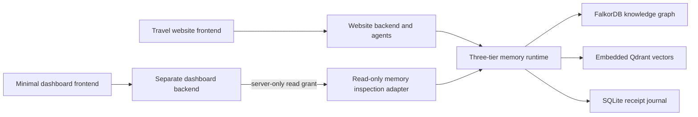

> The React dashboard now uses this live read-only backend. See
> [the dashboard guide](../README.md) for the current UI and local launcher.
> The original plain inspection page remains in `dashboard/inspection/`.

# Memory dashboard backend

**Website** = Voyara travel application. **Dashboard** = this independent, read-only memory monitor. The dashboard does not run travel agents, book trips, generate replies, mutate memory, or host website pages. The supplied frontend is only a plain inspection page; the final UI is intentionally deferred.

## How it connects

### Viewer access (18 October 2026)

`DASHBOARD_VIEWER_TOKEN` is a separate server-side secret of at least 32 random
characters. Remote HTTP and SSE reads fail closed if it is absent. Only direct
loopback peers with a loopback hostname and no forwarded headers may read without
a configured viewer secret. If configured, it is required locally too.

The React dashboard accepts the viewer secret through a password form and posts
it to `/viewer/session`; the relay issues an eight-hour signed HttpOnly cookie.
It never puts the secret in a URL, Vite variable, localStorage, or memory feed.
API clients can use `Authorization: Bearer <viewer secret>` for HTTP/SSE.
Stream authorization is rechecked before each snapshot, including after expiry
or token rotation. The upstream publication grant remains separate and private.

Use HTTPS for remote viewer sessions. Set exact dashboard origins in
`DASHBOARD_CORS_ORIGINS`; CORS is not viewer authorization. Cross-site cookies can
be blocked by browser privacy policy: prefer a same-site API origin or same-origin
reverse proxy and verify it in the target browser. A deliberately sanitized demo
traveler/trip can still be published using the existing scope settings; remote
publication does not bypass the viewer gate. Do not publish real traveler data.



The source adapter runs inside the process that already owns the memory stores. This matters because embedded Qdrant and the receipt journal have a single owner. The separate dashboard backend communicates over HTTP; it has no database write credentials, no website authentication session, and no dependency on the travel application or memory packages. It can be deployed independently. For the current connected system, the website backend is the memory owner.

The current implementation publishes **one explicitly chosen traveler's shared-memory namespace**, covering all its trips by default. Set `DASHBOARD_TRIP_ID` to restrict graph, vector and captured-context inspection to one trip plus inherited profile data. This is not a system-wide cross-tenant administration console. Store counts cover that traveler's whole database; cache totals cover the application context runtime. Every response labels its scope.

## Local start

From the repository root, use the existing Python environment. The dashboard backend itself needs only:

```powershell
.\.venv\Scripts\python.exe -m pip install -r dashboard/backend/requirements.txt
```

1. In `stitch_ai_travel_booking_platform/backend/.env`, add:

   ```dotenv
   DASHBOARD_PUBLISH_TOKEN=<a-random-secret-with-at-least-32-characters>
   DASHBOARD_USER_ID=<the-demonstration-traveler-user-id>
   DASHBOARD_TRIP_ID=
   ```

   The website's `/api/auth/me` response contains the signed-in user's `id`. Trip IDs come from `/api/assistant/conversations`. Use a demonstration account whose memory you intend to show. The selected account must exist and be active. Restart the website backend after configuration.

2. Copy `dashboard/backend/.env.example` to `dashboard/backend/.env`. Set `DASHBOARD_SOURCE_URL` to the **website backend origin** and `DASHBOARD_SOURCE_TOKEN` to the same value as `DASHBOARD_PUBLISH_TOKEN`.

3. Start the separate dashboard backend:

   ```powershell
   .\.venv\Scripts\python.exe -m uvicorn dashboard.backend.main:app --host 127.0.0.1 --port 8200 --workers 1 --env-file dashboard/backend/.env
   ```

Open [the inspection page](http://127.0.0.1:8200) or [interactive API docs](http://127.0.0.1:8200/docs). Leave its backend URL blank when served by this backend. Use the website normally in another tab; memory activity appears as the agents read and update it. If the source is unavailable, the dashboard reports an error and marks displayed data stale.

## Read APIs

All paths below belong to the **dashboard backend**. They expose only the configured monitoring scope. There are no memory mutation endpoints.

| Endpoint | Contents |
| --- | --- |
| `GET /health` | Dashboard process health and whether a source is configured; does not assert database health. |
| `GET /api/dashboard/snapshot` | Combined live snapshot for an initial UI render. |
| `GET /api/dashboard/overview` | Actual database status/counts, local models, cache accounting, scope and limits. |
| `GET /api/dashboard/agents` | Registered agents, observed distinct agents, agents reading memory, activity in the last 60 seconds and per-agent read/cache counts. |
| `GET /api/dashboard/shared-memory?offset=0&limit=120` | Claim content, provenance IDs, validity, protected rules and lifecycle history. |
| `GET /api/dashboard/graph?offset=0&limit=120` | FalkorDB nodes/relationships. Without a trip restriction this browses every node type; a restricted graph follows that trip's claims and their neighbors. |
| `GET /api/dashboard/vectors?limit=25` | Actual Qdrant point IDs, payloads, collection, dimensionality and cursor. |
| `GET /api/dashboard/vectors?include_values=true&limit=1` | Includes actual numeric vector values. Pass `after=<next_cursor>` for another page. |
| `GET /api/dashboard/tiers` | Three-tier architecture, configured budgets, card templates, and the latest actual contexts/cards each observed agent used. |
| `GET /api/dashboard/events?after=0&boot=<boot-id>` | Incremental observations and recent durable receipts. Returns `reset` on a runtime restart and `gap` if the bounded observation window dropped earlier events. |
| `GET /api/dashboard/credentials` | Provider/configuration metadata and masked credential fingerprint. |
| `GET /api/dashboard/stream` | SSE snapshots every two seconds. Events are `snapshot` and `feed_error`; browsers automatically reconnect. |

Graph/claim limits are 1–120; vector limits are 1–100. Follow `next_offset`/`next_cursor`. Graph edges are bounded to 600 per page and include only displayed endpoints; the response identifies truncation. Node-offset pages are live views and may shift during concurrent writes. Snapshot defaults are bounded, not a full database export.

Captured contexts are observations of actual agent execution. Inspection does not compile new contexts, warm caches, or invoke embedding/LLM inference. Changes and deletion invalidate captured views. Context proof tokens, device handles, bearer tokens and full API credentials are removed. The connected website can use NVIDIA tool agents. Provider metadata reports its configured mode and observed HTTP calls, successful responses, and provider-reported input/output tokens. Counts cover the website process since startup; a configured credential alone does not establish use. Context-packet units remain separate from hosted token usage.

Agent counts and per-agent counters refer to the retained in-memory observation window, not lifetime analytics. Observations retain 500 events per traveler and at most 256 latest context entries, then reset on process restart. Memory databases and receipts remain durable. `reading_memory` describes an outstanding context read seen within the last 60 seconds. No historical counter or GPU activity is invented.

## Deployment preparation

Deployment is deferred. The intended four services are:

| Service | Host | Configuration |
| --- | --- | --- |
| Website backend | Railway | Existing application + memory runtime; add `DASHBOARD_PUBLISH_TOKEN`, `DASHBOARD_USER_ID` and optional `DASHBOARD_TRIP_ID`. Keep its memory files on a persistent volume and its existing single-worker ownership. |
| Dashboard backend | Railway | Build from repository root with `dashboard/backend/Dockerfile`; use `dashboard/railway.toml` as the service config path. Set `DASHBOARD_SOURCE_URL`, `DASHBOARD_SOURCE_TOKEN` and exact dashboard Vercel origin in `DASHBOARD_CORS_ORIGINS`. The Docker command binds `0.0.0.0:$PORT`. |
| Website frontend | Vercel | Existing website project, managed separately. |
| Dashboard frontend | Vercel | Root directory `dashboard/frontend`; `npm run build`; output `dist`; public build variable `VITE_DASHBOARD_API_URL=https://<dashboard-backend>`. No frontend dependency installation is needed. |

The backend grants are **server-only**. Never put either publication token into Vercel frontend variables. The dashboard's own read API is intended as the demonstration viewing surface: anyone who can reach it can read the configured memory scope. CORS controls browser origins, not viewer authentication. The publication grant deliberately selects a demonstration account; the default with no grant/user is closed. Do not point it at unrelated users' private memory.

Railway Dockerfile/config references: [Dockerfiles](https://docs.railway.com/builds/dockerfiles), [volumes](https://docs.railway.com/volumes). Vercel setup references: [monorepos](https://vercel.com/docs/monorepos), [environment variables](https://vercel.com/docs/environment-variables).

## Verify

```powershell
.\.venv\Scripts\python.exe -m pytest tests/test_memory_dashboard.py tests/test_application_integration.py -q
node --check dashboard/frontend/app.js
node dashboard/frontend/build.mjs
```

Integration tests use real temporary Qdrant stores and isolated FalkorDB graphs with the repository's declared offline embedding fixture. They verify actual vector values, graph/claim paging, tenant/trip isolation, deletion, read-side noninterference, credential redaction, and the separate dashboard HTTP relay. They are not live hosted-inference or deployed Railway/Vercel measurements.

Additional regression note: standalone `agents/tests/test_orchestration.py` currently
fails seven tests before workflow execution because the installed
`JsonPlusSerializer` rejects `allowed_msgpack_modules` in the existing
`agents/orchestration/checkpointing.py`. The connected website uses
`checkpoint=False`; the dashboard does not use LangGraph. This unrelated
checkpoint compatibility issue is outside the dashboard implementation.
