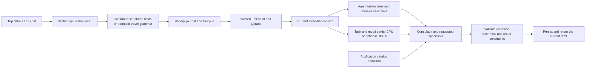

# Connected Voyara application, agents and memory

Implemented 2026-10-16. The signed-in travel helper calls the existing LangGraph
travel agents through the current three-tier memory core. It no longer returns
the old catalog keyword reply.



## Start the connected application

From the repository root, using the existing memory environment:

```powershell
docker compose up -d falkordb
.\.venv\Scripts\python.exe -m pip install -r requirements/application.txt
cd stitch_ai_travel_booking_platform/frontend
npm ci
npm run build
cd ../..
.\.venv\Scripts\python.exe scripts/run_voyara.py
```

Open `http://127.0.0.1:8000`, register/sign in, open **Search & chat → AI advice**,
expand **Trip details**, and confirm a destination, exact dates, total INR budget
and traveler count. Ask **Plan my trip**. The trip selector resumes saved chats;
**New trip** creates a separate trip while retaining saved profile preferences.

The launcher seeds the application's explicitly synthetic demonstration catalog.
Its default SQL database is `data/voyara_app/travel.db`. User-specific memory
journals/vectors live under `data/voyara_memory/`; named FalkorDB graphs use the
`voyara_` namespace. These paths are excluded from Git. Existing standalone
memory data is preserved; unscoped research/demo records are not automatically
assigned to application users.

The application backend owns the agents and stores in one process. Do not also
run `agents.api` for this flow or start multiple web workers against the same
memory path. The single-process hackathon runtime admits up to 32 active
travelers; it is not a many-user deployment design.

## What is connected

- Application identity binds the tenant and agent principals on the server.
  Message payloads cannot supply a user, actor, tenant or booking confirmation.
- A conversation is an explicit trip scope. Dates/budget/party requirements are
  read from current exact-trip fields, rather than inferred from old chat text.
- Saved profile dietary restrictions/accessibility requirements and supported
  preferences are synchronized into durable profile memory. Explicit `dietary`,
  `pace` and `interests` keys in saved memory snapshots are also supported.
  Other snapshot JSON remains application/catalog data rather than instructions.
- Every participating specialist obtains a profiled current context; planner
  and budget nodes also request context. The brief is compiled from its structured
  evidence. Generated/inferred preferences are not written back as user facts.
- Each workflow uses its own execution state and public database catalog snapshot.
  Tool workers do not share an SQL session or a mutable user bearer token.
- Context proofs are checked after the workflow, including a refresh of saved
  profile preferences. An outdated response is discarded and rebuilt at most
  twice. Repeated change, pending memory, insufficient budget, unsupported hard
  requirements, or result errors produce a visible pause rather than an approved
  plan. Removing a field does not restore an older superseded value.
- Conversation deletion forgets its memory sources before deleting the SQL chat.
  Profile preferences are independent and remain until changed/removed in the
  application profile or saved snapshot. Memory event deletion is also available
  for clearing an unclear/failed source.

## Intake and model behavior

The connected catalog specialists are deterministic Python agents. This path
does not fabricate an LLM answer and needs no provider credential. Free-text
intake uses the core's conservative `TravelInterpreter`; unsupported wording asks
for structured Trip details instead of silently accepting only part of a message.
The existing standalone agents' optional NIM extraction is not used to override
the confirmed application brief.

Recognized examples:

```text
Please plan a trip to Goa from 1 to 5 December 2026 for 2 adults; My budget is INR 100000 total; We need vegetarian food; Make it relaxed
Lower my budget to INR 80000
Show my budget
Show stays
Plan my trip
```

The default context accounting is exact UTF-8 bytes for the deterministic Python
consumer, identified as `voyara-deterministic-utf8-v1`; it is not an estimate of
hosted model tokens. A future generating model must supply its own tokenizer and
chat-template/tool accounting. Set `CONTEXT_TOKENIZER_PATH` and
`CONTEXT_TOKENIZER_ID` to configure an actual local tokenizer. Both must be set.

Tier 1 still has equal bounded agent/traveler halves. Tier 2 uses the existing
source-derived task/mood cards. Set `CONTEXT_USE_GPU=true` with the optional
`requirements/context-gpu.txt` environment to request real CUDA card matching;
CPU is the default and GPU failures are reported through residency diagnostics.
This change's end-to-end tests exercise the CPU path; previous GPU verification
does not by itself establish this application's GPU behavior.

The seeded catalog does not prove wheelchair/step-free access, walking distance,
or arbitrary user rules. Such mandatory requirements stop for review. The current
validated dietary catalog supports vegetarian food; unsupported dietary claims
also pause. The travel helper produces indicative drafts and never books or pays.
Use the application's authenticated checkout to request bookings. Availability,
opening hours, room occupancy and complete transport/meal costs still need supplier
confirmation; an indicative budget is not a full supplier quote.

## API and verification

All conversation endpoints require the verified owner:

| Endpoint under `/api/assistant` | Behavior |
| --- | --- |
| `POST /conversations/{id}/messages` | Persist the message; run agents; return `reply`, `connection_status`, and structured `orchestration`/memory diagnostics. |
| `PUT /conversations/{id}/requirements` | Confirm typed fields; replace active values using lifecycle changes. |
| `GET /conversations/{id}/requirements` | Inspect current fields, missing/disputed requirements and selected cards. |
| `DELETE /conversations/{id}/requirements/{field}` | Retract an exact-trip field. |
| `GET /conversations/{id}/memory-events?after=0` | Read owner-scoped event receipts with pagination. |
| `DELETE /conversations/{id}/memory-events/{event_id}` | Forget one source, including a failed/unclear update. |
| `DELETE /conversations/{id}` | Forget trip sources and delete the chat/messages. |

`AGENT_MEMORY_PATH` overrides the default private runtime directory. Credentials
and context proof tokens are never sent to the browser. Browsing remains available
when memory fails; chat reports `unavailable` and preserves the user's question.

Run from the root:

```powershell
.\.venv\Scripts\python.exe -m pytest tests/test_application_integration.py -q
.\.venv\Scripts\python.exe -m pytest -q
```

The integration suite drives actual auth/HTTP endpoints, the real LangGraph
workflow, the current context compiler, temporary Qdrant stores and isolated
FalkorDB graphs. Ordinary tests use explicitly declared offline embedding fixtures;
they are not live NIM or neural-answer-quality measurements.
