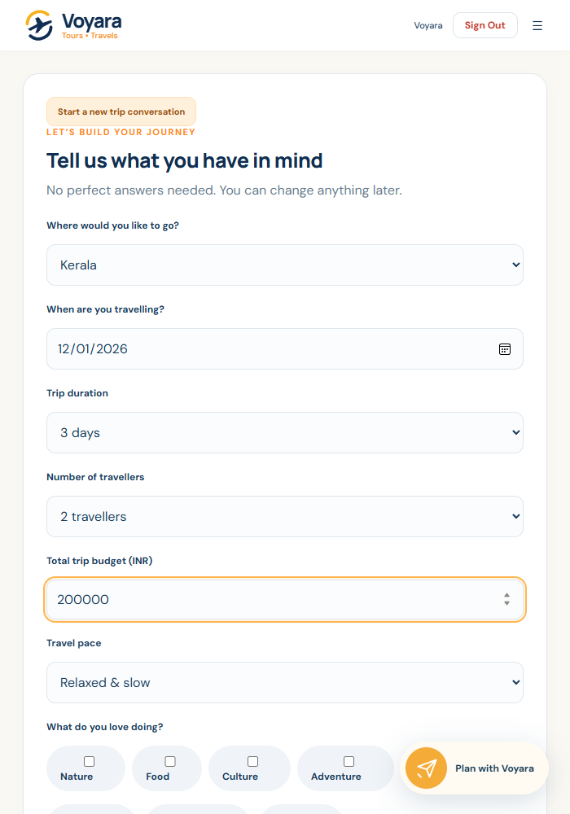
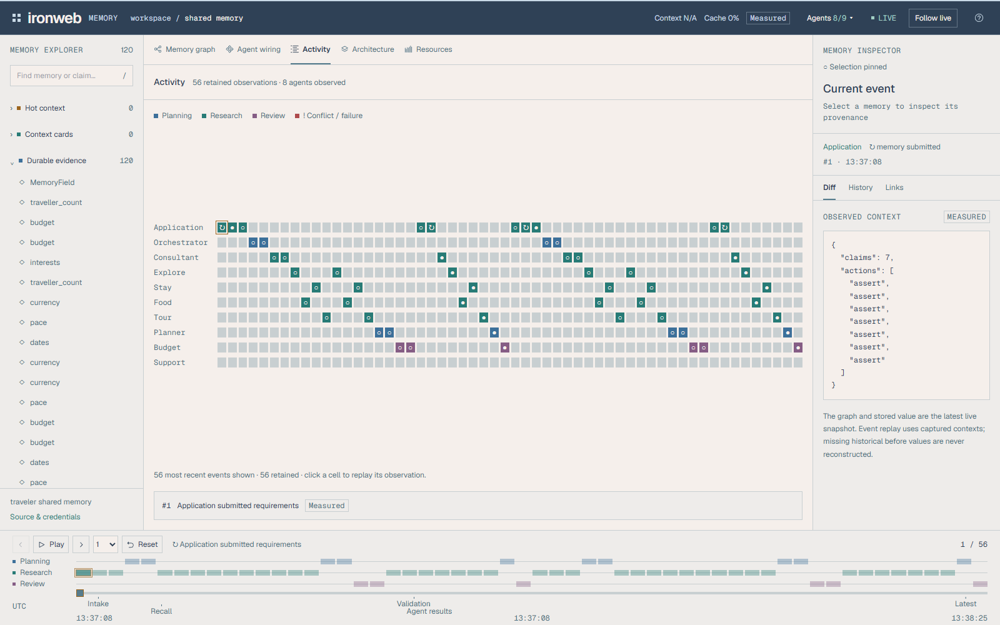
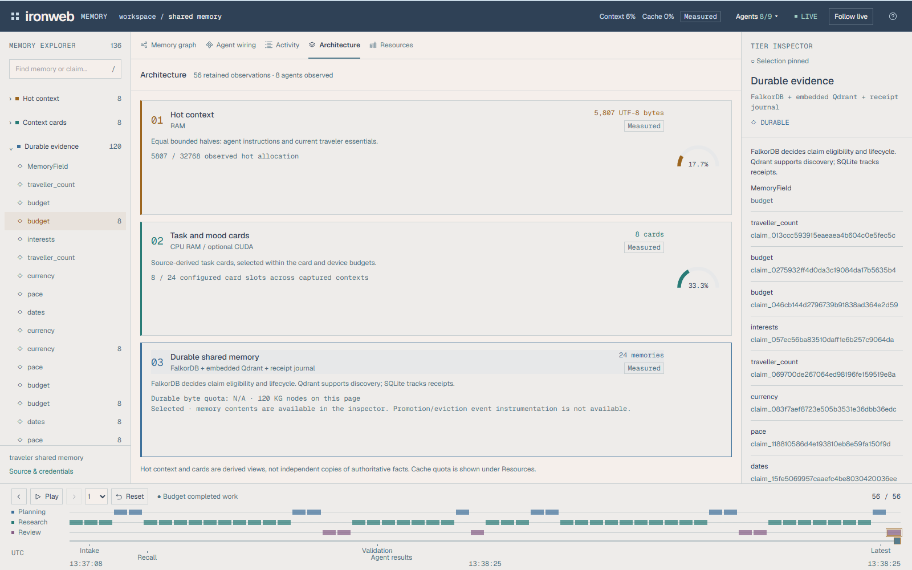
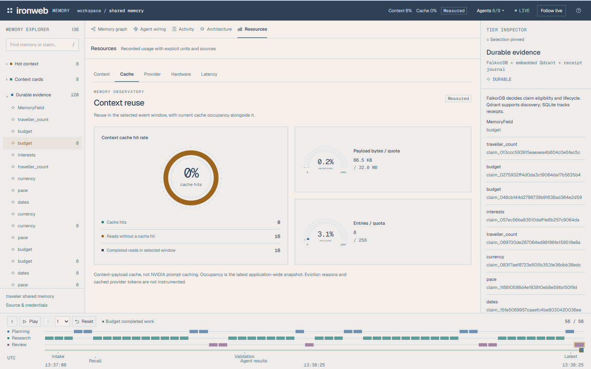
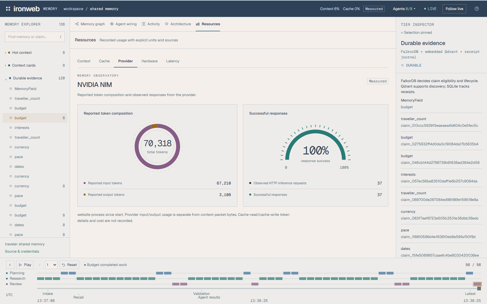
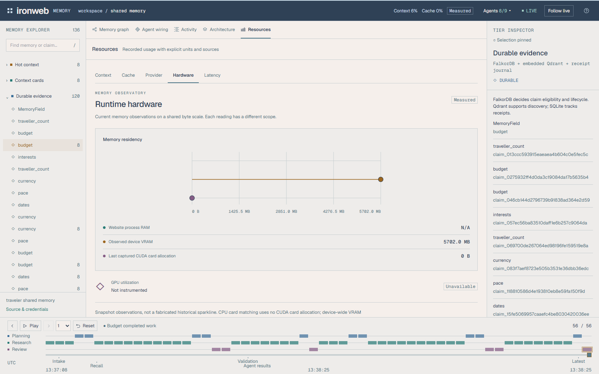
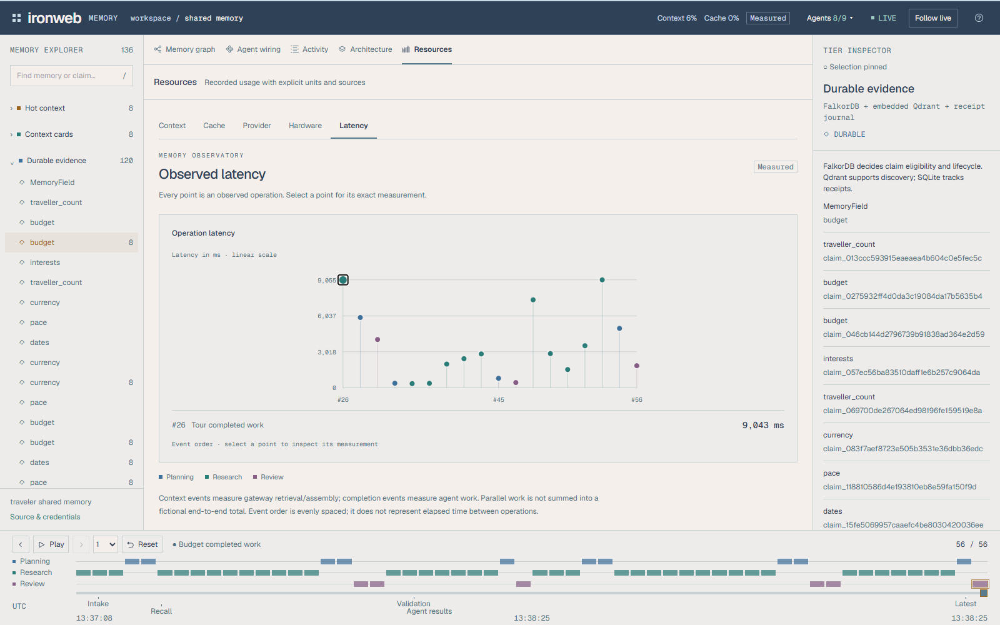
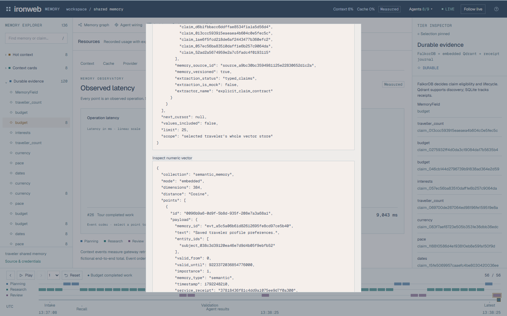

# README screenshots

Captured from the actual local Voyara website and Ironweb dashboard on 18 October 2026. The images contain no video titles or subtitle overlays. The dashboard publishes the ordinary demo traveler; it is not a view across all users.

Context allocation uses UTF-8 bytes. Provider input/output token accounting is a separate measurement.

## Voyara travel website

Destination discovery and the entry to trip planning.

## Trip request

Kerala, 1–3 December 2026, two travelers and relaxed pace.

## Memory graph

Explorer, graph relationships, Inspector and replay dock.

## Agent wiring

Registered actors and their shared memory connections.

## Activity

Actual events separated by actor.

## Three-tier architecture

Hot context, context cards and durable evidence.

## Context X-ray

Captured context, allocation and supporting fields.

## Cache

Measured context reuse and cache capacity.

## Provider

Recorded model requests and reported input/output tokens.

## Hardware

Available memory observations and unavailable measurements.

## Latency

Measured context and agent-operation latency.

## Source inspection

Qdrant numeric vectors and source metadata.

## Budget context before

INR 200,000 and its supporting claim/source.

## Budget context after

INR 120,000 with revised supporting evidence.

