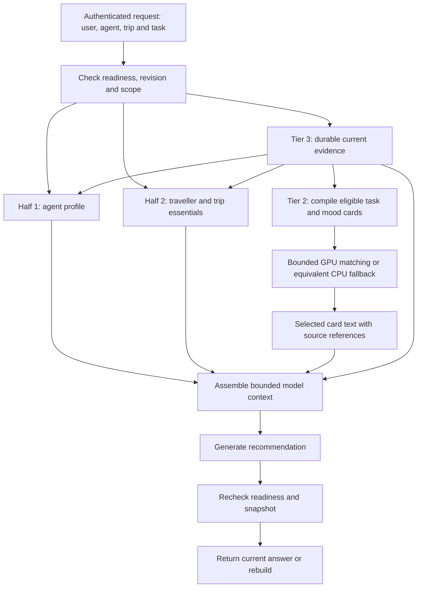

# Three-Tier Memory Before Travel Site Integration

Architecture decisions resolved on 2026-10-14 using Wayfinder. **The first core implementation was built and tested incrementally on 2026-10-15**, following the user's instruction to test each part while building. See the [usage and verification guide](three_tier_memory_usage.md). The canonical architecture decisions live in the [resolved map](../.scratch/three-tier-memory/map.md); actual travel-site integration remains separate.

| Tier | What it holds | How it is used |
| --- | --- | --- |
| 1: hot cache | Equal halves for agent role/style and essential traveller/current-trip information | Two 1024-token caps in host RAM; evidence/scopes remain attached |
| 2: task/mood cards | Richer `persona.md`-style cards for flight planning, accommodation, itinerary or explicitly stated mood | Structured evidence-backed cards; bounded embeddings in GPU VRAM select cards; selected text enters model context |
| 3: durable memory | Existing Qdrant, FalkorDB claims/relations/history, receipt journal and recoverable card artifacts | Authoritative evidence and readiness checks; rebuilds evicted/stale views |

The equal split is a logical token budget, not half the computer's CPU cache or VRAM. A card is a view of supported memory, not another source of truth. General travel preferences, trip requirements and temporary mood remain distinct.

**The main problem is stale personalization.** A luxury card warmed under an INR 100,000 budget must stop being usable when the user lowers the budget to INR 60,000. It must block while that change is pending, then rebuild from the accepted replacement. A fast cache hit cannot bypass the existing memory checks.

Other problems are trip/user leakage, turning a temporary mood into a permanent persona, prompt overflow, old derivatives surviving deletion, and a GPU allocation that the model never consumes. [Concrete problem cases](../.scratch/three-tier-memory/problem-view.md) show the failures and expected behavior.

The implemented card adapter uses actual CUDA-resident retrieval vectors with CPU fallback and numerical parity checks. A hosted generator receives selected text; local GPU retrieval vectors do not become its attention memory. [GPU feasibility evidence](../.scratch/three-tier-memory/gpu-card-research.md) records the earlier investigation. The initial card budget is 64 MiB for accounted tensors/provider arena, with separate device headroom. The [real-model check](../report/three_tier_20261015_verified/results.json) found similar warm CPU/GPU times and substantially larger first GPU setup cost for its small catalog; CPU remains the default.

The build followed **card/profile contracts → coherent snapshots and invalidation → RAM cache/context assembly → GPU residency and CPU fallback → correctness/latency measurements**. [Incremental verification](../.scratch/three-tier-memory/implementation.md) records the checks and problems caught at each stage. Consumer-model binding and actual site integration remain next; this work preserved existing user data and production configuration.

Detailed decisions: [existing core](../.scratch/three-tier-memory/issues/01-existing-core.md), [GPU representation](../.scratch/three-tier-memory/issues/02-gpu-card-feasibility.md), [tier contracts](../.scratch/three-tier-memory/issues/03-tier-contracts.md), [freshness and authority](../.scratch/three-tier-memory/issues/04-freshness-and-authority.md), [routing and resource budgets](../.scratch/three-tier-memory/issues/05-routing-and-budgets.md).
