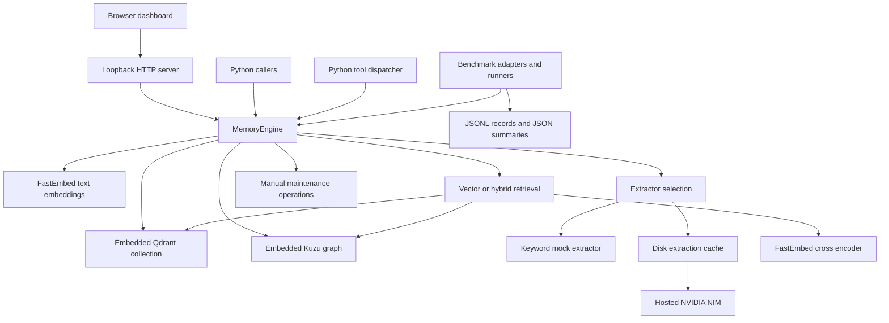

# Iron Web — Software Specification Report

**Review date:** 12 October 2026  
**Workspace:** `D:\Opencode_\reserchpaper`  
**Specification basis:** source code and local artifacts present at review time  
**Package version declared in code:** `1.0.0`

## 1. Scope and evidence

This document describes the implemented Iron Web / Hybrid Long-Term AI Memory application. It records the system's features, interfaces, data structures, algorithms, configuration, evaluation workflows, operating behavior, and implementation constraints. It describes existing behavior without prescribing changes or assigning comparative product ratings.

The implementation review covers all 69 project source files in `memory/`, `scripts/`, `tests/`, and `web/`, plus `server.py` and `datasets/acquire_datasets.py`: 15,752 physical lines, including comments and blank lines. Python files were also parsed into an inventory of classes, functions, methods, imports, line locations, and SHA-256 hashes.

The workspace additionally contains independent upstream checkouts under `datasets/letta`, `datasets/locomo`, and `datasets/longmemeval`. Their inventories contain 878, 17, and 15 Python files respectively. These external codebases were inventoried and their relationship to the application examined; they were not reviewed line by line as part of Iron Web's implementation. The main application reads benchmark data from these directories and does not import their server, model-training, or evaluation implementations. Installed dependencies in `.venv`, compiled bytecode, database files, model engines, screenshots, and research-paper PDFs are outside the application source review.

The report uses three evidence categories:

| Category | Meaning |
|---|---|
| Source behavior | Behavior established by reading an executable implementation. |
| Verified local behavior | Behavior additionally checked during this review using tests or isolated diagnostics. |
| Stored artifact | A value or assertion recorded in an existing document or result file; it was not reproduced as a new benchmark measurement. |

Existing phase documents, roadmaps, and generated research reports include proposed code, numerical targets, historical measurements, and claims that differ from current executable code. Their completion labels are not used as proof of functionality. No new cloud extraction, upstream-service ingestion, paid API call, or benchmark experiment was performed for this report. Credentials were not inspected or included.

Supporting files:

- [Source inventory](D:/Opencode_/reserchpaper/report/source_inventory.json): files, hashes, imports, and symbol locations.
- [Source reference](D:/Opencode_/reserchpaper/report/source_reference.md): file and symbol index.
- [Verification results](D:/Opencode_/reserchpaper/report/spec_verification.json): isolated behavior checks and frozen-slice coverage.
- [Test output](D:/Opencode_/reserchpaper/report/spec_test_output.txt): output from the offline test attempt.
- [Inspection script](D:/Opencode_/reserchpaper/report/spec_inspection.py): reproducible inventory and diagnostic checks.

## 2. System purpose and boundary

Iron Web stores textual memories and retrieves records relevant to a text query. It represents memories in a vector collection and an entity/observation graph. Retrieval can use similarity, graph connectivity, time validity, importance, recency, and optional neural reranking.

The system consists of a Python library, a loopback HTTP dashboard, a Python tool-dispatch adapter described as MCP, and research evaluation utilities. It is organized as a single-machine application with embedded storage. A hosted NVIDIA NIM endpoint is used when real extraction is selected. Local storage and local retrieval do not establish that every application operation is offline: extraction and some consolidation/judging operations can transmit text to a remote model.

`MemoryEngine.search()` returns memory records and scores. It does not generate a conversational answer. Answer generation is a separate evaluation-stage function, whose default behavior is extractive.

The project does not contain an implemented LangGraph checkpoint layer, LangSmith tracing integration, autonomous agent loop, background maintenance service, user-account system, or application-level tenant isolation. References to these facilities exist in documentation and configuration.

## 3. Architecture and component relationships



`MemoryEngine` is a coordinating facade. It owns or receives injected vector storage, graph storage, an embedder, a reranker, and an extractor. Storage wrappers expose operations directly, so callers can bypass the facade and its compensating-write behavior.

Default construction creates the vector store and graph store immediately. Although the embedder is accessed through a lazy property, vector-store initialization requests that property, which normally loads the embedding model during construction. The reranker and extractor are initialized on first access. Factories named `get_embedder()` and `get_reranker()` create new model instances; they do not implement global model caching.

The retrieval and maintenance pipelines run sequentially in Python. The HTTP server handles requests using threads, but the source does not implement an engine lock, a synchronized singleton initializer, a work queue, or per-thread database connections.

Sources: [engine](D:/Opencode_/reserchpaper/memory/engine.py:49), [server](D:/Opencode_/reserchpaper/server.py:44), [package exports](D:/Opencode_/reserchpaper/memory/__init__.py:1).

## 4. Feature inventory

| Feature | Implementation and access |
|---|---|
| Add memory | Python `add()`, HTTP `/api/add`, tool `add_memory`; vector point plus graph entities, relations, and observations. |
| Add multiple memories | Python `add_batch()`; sequential per-item writes. |
| Read by identifier | Python `get()`, tool `get_memory`; vector lookup first, limited graph fallback. |
| Update memory | Python `update()`; content, metadata, importance, and validity bounds. |
| Delete memory | Python `delete()`, tool `delete_memory`; vector deletion and graph observation cleanup. |
| Vector retrieval | Dense similarity search with optional validity filtering. |
| Hybrid retrieval | Deterministic routing, vector candidates, optional graph expansion, pre-scoring, optional accelerated reranking, conflict signals, and final weighted scoring. |
| Graph-only retrieval | A mode within the hybrid retriever; still subject to route gating and graph seed/traversal requirements. |
| Time-aware retrieval | Explicit `auto`, `now`, and `historical` modes and optional Python/tool query time. |
| Contrastive retrieval | Separate lower-level implementation and experiment framework; disabled by the main engine search path. |
| Conflict detection | Optional `ContradictionDetector` and ingestion-pipeline integration; not automatically invoked by `MemoryEngine.add()`. |
| Conflict storage | Observation-to-observation `CONTRADICTS` and `SUPERSEDES` edges. |
| Decay | Manual importance recalculation, with optional dry run. |
| Deduplication | Manual DBSCAN clustering, temporal/explicit-conflict checks, canonical selection, and duplicate deletion. |
| Consolidation | Manual skill extraction or heuristic synthesis with source-memory provenance. |
| Device telemetry | ONNX provider inspection and `nvidia-smi` memory readings. |
| Dashboard | Live status, search, ingestion, and static benchmark/comparison/tool-information tabs. |
| Benchmark harness | DMR, LoCoMo, LongMemEval adapters; ingestion, retrieval, extractive answer generation, scoring, and JSONL persistence. |
| Comparison modes | Internal Mem0-, Zep-, and MemPalace-inspired retrievers, plus a separate upstream-SDK script. |
| Ablation and tuning | Component-toggle configurations, ratio sweeps, bootstrap intervals, and optional Optuna weight optimization. |
| Report generation | Markdown and simplified LaTeX templates populated from supplied result structures. |

## 5. Data contracts

### 5.1 Public models

The models use Pydantic. Most public memory fields have defaults, but the code does not apply a complete shared input-validation policy to engine method arguments.

| Model | Fields and defaults |
|---|---|
| `MemoryMetadata` | Optional `source`, `session_id`, `user_id`; `tags=[]`; `custom={}`. |
| `MemoryRecord` | Required `memory_id`, `content`; metadata and entity lists; validity `0` to `2147483647`; importance `1.0`; timestamp `0`; optional `created_at`; storage flags default true. |
| `MemorySearchResult` | Required identifier, content, score; metadata, entities, retrieval method; optional timestamp/validity/importance; superseded flag; retrieval trace. |
| `SearchFilter` | `k=10`, temporal mode `auto`, optional query time, retrieval mode `hybrid`, optional score threshold. This model is not accepted or applied by the engine's search method. |
| `DeviceStatus` | Requested GPU state, provider availability/list, component providers, optional total/used/free VRAM, budget, buffer, execution mode, notes. |
| `EngineStorageError` | Runtime exception with `memory_id` and `rolled_back` attributes. |

The public metadata model is available for callers, but CRUD methods accept ordinary dictionaries. `user_id` and `session_id` are stored attributes rather than access-control boundaries.

Source: [public models](D:/Opencode_/reserchpaper/memory/models.py:10).

### 5.2 Identifiers

The engine generates IDs as `mem_` followed by 12 hexadecimal characters. Callers may supply their own IDs. A Qdrant point ID is a deterministic UUIDv5 of the supplied memory ID under a fixed namespace. Reusing a memory ID upserts its vector record.

An entity-associated graph observation is named `obs_{memory_id}_{entity_id}`. When extraction returns no entities, the engine creates `obs_{memory_id}` with `entity_id=memory_id`. That path does not create a matching Entity node, so the observation can exist without an ABOUT edge.

Graph observations include `source_memory_id`, but several retrieval, conflict, and deletion methods still identify records through observation IDs rather than this field. Graph expansion returns observation IDs as result memory IDs. Consequently a single source memory can appear once as a vector result and again as one or more graph observations, and a graph result ID is not necessarily accepted by vector CRUD operations as the original memory ID.

Extractor-generated entity IDs are normalized within an extraction. The implementation does not perform global entity identity resolution. Both the mock extractor and the NIM prompt use IDs such as `ent_1`, which can be reused for unrelated entities in different documents. Entity upsert updates names and descriptions at an existing ID.

### 5.3 Vector payload

Every standard vector upsert creates these payload fields:

| Field | Meaning |
|---|---|
| `memory_id` | Caller-facing memory identifier. |
| `text` | Original stored text. |
| `entity_ids` | Associated entity identifiers. |
| `valid_from`, `valid_until` | Unix-second validity bounds. |
| `importance` | Numeric ranking/maintenance signal. |
| `memory_type` | Defaults to `semantic`; consolidation writes `procedural`. |
| `timestamp` | Caller timestamp or current time. |

Metadata is merged into the top-level payload after the standard fields. A metadata dictionary can therefore override standard payload fields, including text, memory ID, timestamp, and memory type. The point UUID remains derived from the method's memory-ID argument even if metadata overrides payload `memory_id`.

Maintenance adds fields including `initial_importance`, `last_decay_time`, `merged_from`, `merged_at`, `skill_data`, and `provenance`.

Source: [vector payload construction](D:/Opencode_/reserchpaper/memory/vector_store/qdrant_store.py:135).

### 5.4 Graph schema

| Table | Direction / primary key | Properties |
|---|---|---|
| `Entity` | Node; primary key `id` | `id`, `name`, `entity_type`, `description`, `importance`, `created_at`, `updated_at`. |
| `Observation` | Node; primary key `id` | `id`, `entity_id`, `content`, JSON-string `embedding`, validity bounds, importance, source, created time, source memory ID. |
| `RELATES` | Entity → Entity | Relation type, confidence, validity bounds, created/updated times, JSON-string metadata. |
| `ABOUT` | Observation → Entity | Relevance. |
| `CONTRADICTS` | Observation → Observation | Confidence, detection time, resolved flag, resolution text. |
| `SUPERSEDES` | Observation → Observation | Confidence, supersession time, reason. The store writes old observation → new observation. |

The store creates tables on initialization and attempts to add `Observation.source_memory_id` for older databases. Migration exceptions are suppressed. It attempts several indexes and suppresses index-creation failures; one attempted entity-type index references `type` while the node property is `entity_type`. The YAML schema version is not used to coordinate migrations.

Source: [graph schema](D:/Opencode_/reserchpaper/memory/graph/kuzu_store.py:53).

## 6. Engine lifecycle and CRUD behavior

### 6.1 Construction and configuration loading

`MemoryEngine` accepts a configuration dictionary, a configuration-file path, or no configuration. A supplied dictionary is used directly. A valid file path is parsed as YAML. Otherwise the loader attempts `config.yaml` under the process working directory. Errors in that default-file fallback are suppressed and an empty dictionary is returned.

GPU preference is resolved in this order: explicit `use_gpu` argument, `USE_GPU` environment variable, top-level YAML `USE_GPU`, then false. The environment variable is true only when its lowercased value equals `true`.

The vector and graph paths can be overridden by constructor arguments. A graph path not ending in `.db` has `memory.db` appended. Default engine collection name is `semantic_memory`; direct `QdrantVectorStore` construction defaults to `memory_semantic`.

The engine supports context-manager use. `close()` attempts to close both stores and suppresses close exceptions. It does not explicitly dispose of neural models or guarantee GPU-memory release. The HTTP shutdown path closes its server but does not explicitly call engine close.

### 6.2 Add

`add(content, metadata=None, entity_ids=None, timestamp=None, valid_from=0, valid_until=2147483647, importance=1.0, memory_id=None) -> str`

Execution order:

1. Reject empty or whitespace-only content.
2. Select an ID and timestamp, and copy metadata.
3. Compute the text embedding.
4. If a nonempty explicit entity list is supplied, create Concept entity descriptions from those IDs and bypass extraction. No relations are inferred in this path.
5. Otherwise request entity/relation extraction. Extracted validity and importance replace the respective caller values only when those values equal the method defaults.
6. If extraction raises, attach a fallback GeneralMemory entity specific to the memory.
7. Write the Qdrant record.
8. Upsert entities and their extracted relations, then create one observation per entity with the complete memory content and embedding.
9. Return the memory ID.

Graph-write failure triggers an attempted vector deletion and graph observation cleanup, followed by `EngineStorageError`. This is compensating cleanup across separate writes. It is not a transaction covering both stores. Entities and entity relations already written are not fully rolled back. If the ID previously existed, cleanup can delete an existing vector record instead of restoring its prior content.

`MemoryEngine.add()` does not call `ContradictionDetector`; normal ingestion therefore does not automatically populate observation-level conflict edges.

### 6.3 Batch add

`add_batch(contents, metadatas=None, timestamps=None) -> list[str]`

Items may be strings or dictionaries. Dictionary items support content/text, metadata, timestamp, entities, validity bounds, importance, and memory ID. Without explicit metadata, other item fields are gathered into metadata. The implementation uses `zip()` over contents, metadata, and timestamps, so shorter supplied companion lists shorten processing silently.

Each item calls `add()` sequentially. The method does not batch neural inference, implement a whole-batch transaction, or roll back previously completed items when a later item fails. An empty contents list returns an empty ID list.

### 6.4 Get

`get(memory_id) -> MemoryRecord | None`

The method queries Qdrant first and constructs a public record from its payload. It sets both storage flags to true without checking graph presence. The returned `created_at` field remains unset.

If the vector record is unavailable, it checks only the exact graph observation `obs_{memory_id}`. It does not search all entity-associated observations or use `source_memory_id`. Graph fallback returns observation source, content, validity, importance, and creation time. It cannot reconstruct all arbitrary metadata from the vector payload.

### 6.5 Update

`update(memory_id, content=None, metadata=None, importance=None, valid_from=None, valid_until=None) -> bool`

A missing vector record returns false. Content is re-embedded only if it changes; otherwise the existing vector is reused. Metadata is merged, entity IDs are retained, and the original vector timestamp is preserved. Extraction is not repeated, so changing text does not update its entities or entity relations.

After vector upsert the method updates known graph observations. Existing graph creation time is retained by the graph wrapper. Because update calls omit `source` and `source_memory_id`, those graph fields become `user` and an empty string. This was verified locally.

If a graph update raises, the method attempts to restore the prior vector text, vector, validity, importance, and timestamp. Its restoration call uses the newly merged metadata, so metadata changes are not fully reverted. Graph observations successfully updated before the failure are not restored. Rollback status is reported as true without verifying complete cross-store restoration.

### 6.6 Delete

`delete(memory_id, clean_orphaned_entities=False) -> bool`

Vector deletion and graph cleanup run sequentially. The return value is true when either wrapper reports success. Qdrant deletion returns true for a successful deletion request and does not first establish that the point existed.

Graph cleanup scans observation IDs and selects an exact observation ID equal to `memory_id` or IDs starting with `obs_{memory_id}_`. It does not select the entityless exact name `obs_{memory_id}`; an isolated check confirmed that such an observation remains. Prefix-based matching also does not provide a dedicated source-memory equality check.

Observation deletion detaches its ABOUT and conflict edges. Entities are retained by default. Optional orphan cleanup deletes associated entities with no remaining ABOUT observations, detaching their entity relations. Entity relations are not independently associated with the deleted source memory. The facade has no compensating rollback for partial deletion.

Source: [CRUD implementation](D:/Opencode_/reserchpaper/memory/engine.py:200).

## 7. Extraction subsystem

### 7.1 Selection and fallback

The engine's extractor property checks `NVIDIA_API_KEY`. If present, it constructs `CachedNIMExtractor` using the configured extraction model and cache directory. If initialization fails, or the key is absent, it selects `MockNIMExtractor`. Warnings are printed, but the engine does not enforce a benchmark prohibition on mock extraction.

The engine and HTTP entry point do not call `load_dotenv()`. Some scripts explicitly load the root `.env`. Consequently the existence of a `.env` file alone does not populate credentials for every entry point.

### 7.2 Validation

The extraction schema contains entities, relations, validity bounds, importance, extractor name, and mock status. Validation lowercases IDs, trims them, replaces spaces with underscores, removes duplicate IDs, and inserts `ent_memory` when no entity remains. It drops relation endpoints missing from the extraction and self-relations, and clamps confidence and importance to `[0,1]`.

Negative validity starts become zero. An end at or before the start becomes `2147483647`. This is normalization of extraction output; explicit engine arguments do not receive the same validation.

### 7.3 NVIDIA NIM

`NIMExtractor` uses the OpenAI Python client with `NVIDIA_API_KEY`, an explicit base URL or `NVIDIA_NIM_URL`, and default endpoint `https://integrate.api.nvidia.com/v1`. Its constructor model default is `meta/llama-3.1-70b-instruct`; root YAML selects `meta/llama-3.2-11b-vision-instruct` for engine extraction.

Entity/relation extraction uses a combined prompt, temperature `0.0`, and a 4,096-token generation limit. It attempts direct JSON, fenced JSON, a large brace-delimited object, and truncated-output salvage. If parsing fails, it returns an empty extraction structure that validation converts into a generic entity.

The salvage array parser searches balanced objects after an array start without a strict array-end stop. It can encounter objects beyond the intended array. Normalization rejects relation-shaped objects in the entity array and keeps relations whose endpoints are known before final validation.

Extraction, answer judging, contradiction judging, supersession judging, and skill extraction use three-attempt exponential retry decorators. Constructor timeout defaults to 60 seconds. Judging methods request JSON-object output and parse JSON directly. They use the extractor instance's model, rather than separate configured answerer/judge model fields.

Skill extraction considers at most the first 20 supplied texts. Its prompt asks for a JSON array, while the response parser expects an object containing a `skills` list. This contract depends on the returned response shape.

### 7.4 Cache

Cache keys hash model name, input text, and optional context using SHA-256. Entries are model-prefixed JSON files written through a temporary file and replace operation. A cached record is accepted only when `is_mock` is exactly false. Corrupt entries cause another extraction attempt. Generic fallback-only output is not written unless it includes a meaningful entity or relation.

Only entity/relation extraction is cached. Contradiction, supersession, skill extraction, and answer judging delegate directly. Cache keys do not incorporate the prompt implementation, endpoint URL, or a schema version. No cache expiration or file-level concurrency lock is implemented.

### 7.5 Mock extraction

The mock uses substring matching against a fixed technology/concept list, assigns sequential entity IDs, and connects consecutive entities with RELATED_TO relations at confidence `0.7`. If no keyword matches, it uses a Document entity. Importance is `0.8` and validity is unbounded by the default sentinel.

Its answer judge returns fixed scores; contradiction and supersession methods always return false; skill extraction returns an empty list. These outputs are deterministic fixtures and are marked `is_mock=True`.

Sources: [validation](D:/Opencode_/reserchpaper/memory/ingestion/extractor.py:80), [NIM](D:/Opencode_/reserchpaper/memory/ingestion/nim_extractor.py:21), [cache](D:/Opencode_/reserchpaper/memory/ingestion/cached_nim_extractor.py:23), [mock](D:/Opencode_/reserchpaper/memory/ingestion/mock_nim_extractor.py:7).

## 8. Separate ingestion pipeline

`IngestionPipeline` exists alongside `MemoryEngine.add()` and is exported publicly. It embeds text, extracts structured data, writes the vector record, writes graph entities/relations/observations, and optionally invokes a supplied contradiction detector. It also supports precomputed extraction, sequential batch ingestion, and file ingestion with character chunks.

This path does not implement the engine's compensating rollback. It does not populate observation `source_memory_id`. Conflict candidates are observation IDs, but the newly ingested identifier passed to detection is a memory ID; its self-removal comparison also compares observation IDs with a memory ID. These representations do not consistently identify the actual new observation.

File ingestion defaults to 1,000 characters per chunk and 200 characters of overlap, with a preferred period boundary. The chunk loop updates `start=end-overlap` after the final chunk. With positive overlap, it can repeat the final segment rather than terminate. A source-isolated check of a short input at the defaults exceeded 200 executed source-line steps and was stopped. The source also does not validate overlap against chunk size.

Source: [pipeline](D:/Opencode_/reserchpaper/memory/ingestion/pipeline.py:15).

## 9. Storage behavior

### 9.1 Qdrant

The wrapper creates a file-backed `QdrantClient(path=...)`. It creates a collection when missing, uses cosine distance by default, and declares vector HNSW settings and optional scalar INT8 quantization. Direct-wrapper defaults include dimension 384, HNSW M 16, construction ef 100, and full-scan threshold 10,000.

It requests payload indexes on identifier, entity IDs, validity, importance, memory type, and timestamp. The installed local client emits a warning that payload indexes have no effect in local Qdrant. The report therefore treats these as requested collection settings, not verified local indexing or compression guarantees.

Search uses `query_points()` with payloads, an optional filter and score threshold, and no returned vectors. ID lookup includes vectors. The wrapper also exposes text search, point count, paginated scroll, deletion, close, and context-manager methods. Retrieval exceptions during ID lookup are suppressed and returned as a missing record; deletion exceptions become false.

The engine exposes neither a remote Qdrant URL nor API-key construction path. Existing collections are opened without explicit dimension/distance migration or validation against the current embedding model.

### 9.2 Kuzu

The wrapper owns one embedded database and connection. Entity upsert creates or updates its properties, retaining initial creation time. Relation upsert identifies an edge by endpoints and relation type; new facts using the same tuple overwrite confidence/validity/metadata rather than create a version history.

Observation upsert stores embeddings as JSON text. If no new embedding is supplied, an existing embedding is retained. Existing observation creation time and scalar `entity_id` are not updated. ABOUT linking only occurs if the corresponding entity exists.

Observation and relation reads apply inclusive validity intervals at the supplied time, or current time if absent. Observations are ordered by importance. Entity-name search uses CONTAINS and importance ordering. An in-process ID/name cache is invalidated by wrapper entity upsert, deletion, and orphan cleanup. Raw Cypher mutations through `execute()` do not automatically invalidate that cache.

Graph expansion implements either a one-edge path or an exact two-edge path. The two-edge path is not a union of all one- and two-hop neighbors. It excludes seed IDs at the final node. Its optional two-hop relation filter refers to `r` instead of `r1`/`r2`; normal hybrid calls do not supply that filter. Some traversal filters construct literals from IDs without the escaping used by entity description writes.

Node and edge counts are available. Edge counting uses directed patterns, and regression tests verify that stored edges are counted once. No graph-vector search or full-text extension is initialized by this wrapper.

Sources: [Qdrant wrapper](D:/Opencode_/reserchpaper/memory/vector_store/qdrant_store.py:24), [Kuzu wrapper](D:/Opencode_/reserchpaper/memory/graph/kuzu_store.py:10).

## 10. Retrieval specification

### 10.1 Engine search interface and modes

`search(query, k=10, temporal_mode="auto", query_time=None, retrieval_mode="hybrid") -> list[MemorySearchResult]`

Blank queries return an empty list. Query time defaults to current Unix seconds. Retrieval mode is lowercased. Unknown mode strings fall through to hybrid behavior; invalid modes are not explicitly rejected.

| Mode | Main behavior |
|---|---|
| `no_memory`, `none` | Empty retrieved context. |
| `vector` | Embedding and vector lookup; optional temporal filter controlled by the cached retriever. |
| `graph`
| Vector search off, reranking off, temporal-filter toggle off; graph expansion still requires a routed non-simple query. |
| `hybrid_no_rerank` | Hybrid pipeline with neural reranking off. |
| `hybrid_no_graph` | Hybrid pipeline with graph expansion off; entity linking and routed conflict lookup can still use the graph. |
| `hybrid_no_temporal` | Explicit candidate temporal filtering off; graph reads still apply their query-time validity rules. |
| `hybrid` or fallback | Routed hybrid pipeline with reranker gate applied. |
| `mem0` | Internal dense/entity-observation comparison model. |
| `zep` | Internal dense/keyword RRF comparison model. |
| `mempalace`, `temporal_mempalace` | Internal time-bucket comparison model. |

Every engine-created hybrid config sets `use_contrastive=False`. Most candidate limits and scoring weights come from dataclass defaults, rather than the corresponding YAML fields. The engine accesses `self.reranker` even when a requested mode disables reranking, so graph/no-rerank searches can still initialize the neural model.

### 10.2 Vector path

The vector retriever embeds the query and requests the top `k` Qdrant records, using temporal range filters when enabled. It does not rerank, expand the graph, or automatically detect temporal intent in text.

The engine caches its first VectorRetriever. `use_temporal_filter` is set from the first vector search's temporal mode and is not updated later. If the first call uses auto, a later now/historical vector search can remain unfiltered. If the first call enables time filtering, subsequent explicit-time calls use it; auto produces no filter through the helper.

### 10.3 Entity linking and deterministic routing

Query entity linking matches entity ID or nonempty entity name as a case-insensitive substring in the query. It uses the cached graph name index by default. It does not call a query-understanding model. The matching entity set is deduplicated through a Python set, so ordering is not explicitly stabilized.

Router precedence is contradiction, temporal, multi-hop, then simple:

| Route | Trigger |
|---|---|
| Contradiction | Regex terms such as `not`, `instead`, `rather than`, `contradict`, `conflict`, `switched`, `changed`. |
| Temporal | A non-auto temporal mode or regex terms including `currently`, `current`, `now`, `today`, `before`, `previously`, `used to`, `formerly`, `past`, `when`. |
| Multi-hop | More than one linked entity or terms including `connected`, `related`, `depend`, `dependency`, `dependencies`, `project`, `stack`, `using with`, `works with`. |
| Simple | No preceding trigger. |

Routing chooses stages; it does not convert auto into an explicit validity-filter mode. A query containing temporal words with `temporal_mode=auto` remains unfiltered at the explicit candidate-filter stage.

### 10.4 Hybrid execution sequence

1. Link query entities and choose the route.
2. Retrieve unfiltered vector candidates: 20 for simple queries, 50 for temporal/multi-hop queries, and configured width, normally 100, for contradiction queries.
3. For graph-enabled non-simple routes with no vector candidates, expand the graph before ranking.
4. Lower-level contrastive retrieval, when enabled, runs only on the contradiction route.
5. Combine candidates by exact `memory_id`, preserving vector-first content and merging retrieval-method labels and graph-relevance signals for matching IDs.
6. Apply explicit validity filtering if enabled.
7. Calculate the inexpensive weighted score and sort candidates.
8. If reranking is enabled and the reranker reports acceleration, rerank only the first 15 candidates and replace the candidate list with that shortlist. On CPU, retain the scored list and annotate the first 15 with a skipped-reranker reason.
9. For vector-backed graph routes, expand from the shortlisted candidates and query entities after reranking. Add graph observations to the candidate list. Newly added graph observations are not cross-encoder reranked.
10. For temporal/contradiction routes, resolve conflict signals on the first 15 combined candidates. This slices the candidate list before final scoring and can omit graph candidates appended later.
11. Recompute weighted scores and sort.
12. Calculate RRF scores for available streams and attach trace metadata.
13. Return the first `k` candidates.

RRF values are recorded, but they are not added to the weighted final score and do not reorder the final result list. Calling this pipeline RRF-ranked retrieval would therefore describe the tracing calculation rather than the selection mechanism.

The accelerated path can return fewer than `k` results when `k>15`, unless post-rerank graph additions survive later processing. The CPU bypass can retain more vector candidates, so its candidate ceiling differs from the accelerated path.

### 10.5 Graph expansion limits and temporal interaction

The retriever uses up to 20 seed entity IDs and clamps hops to one or two. It materializes expanded entity rows, then consumes at most 10 entities and three observations per entity, yielding at most 30 graph observations. The query itself does not include a corresponding global node LIMIT, so the consumption cap does not guarantee bounded traversal work on a dense graph.

Seed entities are not themselves returned as an observation stream unless encountered by the traversal. With explicit entity IDs but no inferred relations, the graph can contain observations while expansion yields none. Simple-route graph-only search also yields none; this was verified locally.

Graph observation reads always require validity at `query_time`, even when the engine temporal-filter toggle is off. Vector-backed graph expansion runs after the explicit filter, and that filter is not reapplied to newly added candidates. Historical mode requests expired vector memories but graph reads request observations valid at the query time. The graph path therefore does not implement the same expired-record semantics as the vector filter.

### 10.6 Weighted ranking

The executable score is:

```text
S = 1.0 * semantic
  + 0.5 * graph_relevance
  + 0.3 * exp(-age_days / 90)
  + 0.2 * importance
  + 0.4 * entity_overlap
  + 0.3 * relationship_strength
  + 0.2 * historical_relevance
  - 0.5 * contradiction_penalty
  + 0.2 * contrastive_margin
```

These are dataclass defaults used by engine-created retrieval configurations. The semantic term is the vector score unless a rerank score exists. Entity overlap is the number of matching entity IDs divided by at least one query entity. Graph observations receive graph relevance `1.0`, semantic score `0.0`, and no timestamp in their synthesized payload; missing timestamp defaults to query time, producing recency `1.0`.

The recency expression uses 90 days as an exponential time constant: at 90 days it equals `exp(-1)`, approximately 0.3679. It is not a mathematical half-life. Future timestamps are not clamped in this scorer and can produce recency greater than one. The separate temporal utility does clamp negative ages.

Relationship strength and contrastive margin are available score fields but are not populated by the normal engine path. Scores are not constrained to `[0,1]`. Reranker scores are used directly, without an application-level sigmoid or calibration step.

### 10.7 Retrieval traces

Hybrid traces include source method, vector score, rerank score, graph relevance, entity overlap, linked entity IDs, importance, contradiction penalty, supersession flag, final score, RRF score, selection rank, route, stage durations, and elapsed retrieval time.

The `vector` duration includes entity linking and routing because the shared stage timer starts before them. Temporal filtering and both scoring passes have no separate duration fields. The trace describes returned candidates rather than a full log of rejected candidates or extraction provenance. A result's method may be `vector` or `graph` even when requested through hybrid mode.

Sources: [engine dispatch](D:/Opencode_/reserchpaper/memory/engine.py:446), [hybrid retrieval](D:/Opencode_/reserchpaper/memory/retrieval/hybrid.py:35), [vector retrieval](D:/Opencode_/reserchpaper/memory/retrieval/vector.py:13), [scoring](D:/Opencode_/reserchpaper/memory/ranking/scorer.py:96).

## 11. Temporal and conflict semantics

Validity is represented by Unix-second start and end bounds, with inclusive endpoints. Auto imposes no interval filter; now retains `valid_from <= query_time <= valid_until`; historical retains `valid_until < query_time`. Historical therefore means expired before a reference time, rather than all records known by a historical assertion time.

The default end sentinel `2147483647` corresponds to 19 January 2038 UTC. It is finite despite comments referring to it as forever. Timestamp and validity fields distinguish recorded time from valid time, but the code does not retain transaction-time versions or expose a query for what the database believed at an earlier assertion time. Updates overwrite records.

`ContradictionDetector` compares candidate observations sharing an entity. It re-embeds text pairs and computes cosine similarity. Similarity above `0.85` invokes contradiction judging. Otherwise similarity above `0.6` invokes supersession judging. The constructor's `contradiction_threshold=0.3` is not used in these decisions.

Without a usable contradiction judge, a negation-substring mismatch returns a heuristic contradiction with confidence `0.5`. Without a supersession judge, the detector reports no supersession. Full-graph scan methods compare pairs of observations and return findings; they do not automatically persist every scan result. Supersession scans use iteration order as old/new ordering without explicitly sorting timestamps.

Conflict storage helpers operate on observation nodes. The resolver recognizes exact observation IDs or `obs_{id}`; it does not map a memory ID to all `obs_{memory_id}_{entity_id}` observations. An isolated check confirmed a real supersession edge was returned for exact observation IDs but not for its source memory IDs.

The batched conflict query reads SUPERSEDES edges without direction. Hybrid resolution marks either connected endpoint as superseded and does not inspect supersession time or the contradiction's resolved status. Each contradiction adds a penalty of `0.25`, capped at `1.0`; now-mode supersession imposes at least `0.7`; historical mode adds historical relevance `1.0`.

`SupersessionResolver.get_current_version()` expects `from_id` and `to_id` in supersession records, while `get_supersessions()` returns `id` and a direction label. A local two-observation check returned no newer version. `get_version_chain()` returns immediate graph records and does not itself walk a complete chain. The graph store does not enforce acyclicity despite some documents describing a DAG.

The standalone temporal module provides filtering, recency weight, historical relevance, and per-entity candidate selection. Those helpers are public utilities; the main hybrid path implements its own interval logic and does not call the utility conflict resolver.

Sources: [conflict detector and resolver](D:/Opencode_/reserchpaper/memory/contradiction/detector.py:11), [conflict storage](D:/Opencode_/reserchpaper/memory/graph/kuzu_store.py:767), [temporal utilities](D:/Opencode_/reserchpaper/memory/temporal/filter.py:9).

## 12. Contrastive retrieval and internal comparison modes

### 12.1 Contrastive module

The lower-level contrastive module requests positive vector candidates and a wider vector result list, then selects a slice beginning at `contrastive_offset`, normally 100. Count is `int(vector_candidates * contrastive_ratio)`, normally 10 for ratio 0.1. It annotates selected records as contrastive and returns sampling information.

`compute_contrastive_margin()` computes query similarity minus maximum similarity to a contrastive text. The hybrid pipeline does not call it to fill candidate margin fields. The separate contrastive `retrieve()` combines positive and contrastive results and optionally constructs a new default reranker. It does not train a model or implement contrastive loss optimization.

Source: [contrastive module](D:/Opencode_/reserchpaper/memory/retrieval/contrastive.py:16).

### 12.2 Internal comparison retrievers

These classes are project implementations, not calls to installed upstream products:

| Retriever | Implemented mechanism |
|---|---|
| `Mem0Retriever` | Fetch `2*k` dense hits; collect their entity IDs; read up to three observations for each of up to 10 entities; graph-only additions get score 0.45 and matching observation IDs get a 0.25 bonus; sort by score. It reads ABOUT observations, not a traversal over entity RELATES edges. |
| `ZepRetriever` | Fetch `2*k` dense hits; count query-term substrings within those same dense hits; rank a lexical stream and combine with dense rankings using RRF constant 60. It does not search an independent BM25 index or fetch graph context. |
| `MemPalaceRetriever` | Fetch `4*k` dense hits; bucket them by `timestamp // 86400`; sum similarity by bucket; choose the two highest-scoring buckets; return their highest-scoring records. It does not require chronological adjacency between selected buckets. |

These comparison methods accept query time but do not apply it as a shared validity filter. Missing or zero timestamps put records in bucket zero, reducing the temporal comparison's distinction from vector ranking.

Source: [internal comparison retrievers](D:/Opencode_/reserchpaper/memory/retrieval/competitors.py:23).

## 13. Maintenance specification

All maintenance calls execute synchronously when invoked. `MaintenanceScheduler` selects and runs operations; it does not maintain a timer or schedule future runs. YAML interval values are not wired to a scheduler.

### 13.1 Decay

`decay_memories(half_life_days=90.0, min_importance=0.1, batch_size=100, current_time=None, dry_run=False)`

The operation scrolls the entire vector collection, gathering payloads and vectors in memory, then computes:

```text
importance = max(initial_importance * exp(-max(age_days, 0) / configured_days), minimum)
```

The stored initial importance is reused after the first mutating decay, preventing compounded decay at the same reference time. A change threshold of `1e-4` controls writes. Importance `1.0` is not exempt from decay. The field named half-life has the exponential-time-constant interpretation described earlier.

The operation updates vector payload importance and corresponding graph observation importance. Graph writes omit source and source-memory provenance, so those defaults replace existing values. Errors are counted without restoring earlier writes. Dry run computes proposed statistics without storage writes.

### 13.2 Deduplication

`deduplicate_memories(eps=0.15, min_samples=2, limit=1000, dry_run=False)`

The operation reads up to 1,000 points by default and clusters their stored vectors with DBSCAN using cosine distance. `eps=0.15` is a cosine-distance setting, not the YAML similarity threshold 0.95. HDBSCAN is not selected by this implementation.

Within a cluster, a greedy member filter excludes records temporally disjoint from accepted members or explicitly contradicted in the graph. Graph-query errors are suppressed, so the explicit-conflict check can be bypassed on failure. It does not ask a model to determine whether unlinked texts conflict.

The canonical record has the highest importance, then latest timestamp. Its text, embedding, validity, and importance remain canonical; entity IDs are unioned and metadata merged. It records merged IDs and time, updates the canonical vector record, and deletes duplicate vectors and observations.

It does not create canonical graph observations or ABOUT links for newly merged entity IDs, so vector entity associations and graph associations can diverge. There is no whole-merge transaction. Dry-run cluster detection avoids writes, while its merged-record count remains zero because incrementing occurs in the mutation block.

### 13.3 Consolidation

`consolidate_memories(window_days=30, min_episodes=3, start_time=None, end_time=None, dry_run=False)`

The operation scrolls all vector payloads and selects records whose timestamp falls in a time window. It does not restrict selection to `memory_type=episodic`, so procedural or semantic records can also become source episodes.

It requests extractor skills when supported. If that returns none or raises, it applies fixed keyword rules for Python development, Java DSA, data pipelines, and web development; a generic pattern is available as fallback. The NIM implementation sees at most the first 20 episode texts, while stored provenance lists all selected source IDs.

A skill becomes a new `skill_` ID, a procedural vector memory with importance 0.9, and a graph Entity of type Skill. It does not create an Observation, ABOUT link, or HAS_SKILL relation. Conditions, actions, and source-window provenance are retained in metadata. Repeated consolidation generates new skill IDs rather than updating a stable synthesis.

Dry run can still invoke remote skill extraction; it prevents stored writes, not every external operation.

### 13.4 Combined operation

`run_maintenance(tasks=None, dry_run=False)` invokes recognized task names `decay`, `dedup`, and `consolidate` in that order. A missing or empty task list runs all three because the scheduler uses a truthiness fallback. The combined operation constructs its helpers using class defaults rather than the root maintenance YAML.

Source: [maintenance implementation](D:/Opencode_/reserchpaper/memory/maintenance/maintenance.py:16), [engine maintenance methods](D:/Opencode_/reserchpaper/memory/engine.py:771).

## 14. Neural models, GPU selection, and telemetry

The embedding wrapper uses FastEmbed TextEmbedding and produces float32 NumPy arrays. Its default model is `BAAI/bge-small-en-v1.5`. It stores dimension 384 regardless of a configured alternative model, including for empty result shapes. The quantization flag is passed to FastEmbed, but this wrapper does not independently quantify compression or quality loss.

The embedding provider preference is CUDA, then DirectML, then CPU when GPU use is requested and providers are available; otherwise CPU. Initialization failure triggers an explicit CPU retry only when the error string contains CUDA or Dml. The `get_embedder()` batch-size argument is unused, and its provider-list argument is converted into a CUDA-presence boolean rather than preserved as an exact provider configuration.

The reranker uses FastEmbed TextCrossEncoder, default model `BAAI/bge-reranker-base`, and batch size 16. Documents are truncated to 256 whitespace-delimited words, not a guaranteed 256 model tokens. The wrapper queries the live ONNX session provider list after initialization. Acceleration includes TensorRT, CUDA, or DirectML. Its direct `score_pairs()` method passes a pair list to the underlying rerank method; that alternate calling convention was not validated against the installed model API in this review.

With TensorRT preference enabled, the reranker requests TensorRT → CUDA → DirectML → CPU among available providers. TensorRT engine/timing cache environment variables are set and a local cache directory created. The embedding wrapper does not request TensorRT.

Windows initialization registers installed NVIDIA/TensorRT DLL directories, retains DLL-directory handles, and adds directories to PATH. Hardware memory telemetry runs `nvidia-smi` with a two-second timeout and reads the first GPU's total, used, and free memory. These are device-level readings, not process-specific model usage.

The device constants are 6,141 MB total profile, 1,024 MB reserved buffer, 5,117 MB operational budget, embedding batch reference 32, and rerank batch reference 16. These values are reported; the source does not allocate a reserved buffer, reject inference above the budget, or enforce a live aggregate VRAM ceiling. CPU fallback is provider/error driven rather than budget driven.

Telemetry reports TensorRT as a component provider when active, but overall execution-mode selection has CUDA and DirectML branches and no TensorRT-specific branch. `active_providers` reports available ONNX providers, while component fields attempt to report selected providers. Hardware-name notes are written for the RTX 4050 profile rather than queried as a GPU-name measurement.

Sources: [device handling](D:/Opencode_/reserchpaper/memory/device.py:1), [embedder](D:/Opencode_/reserchpaper/memory/embeddings/embedder.py:21), [reranker](D:/Opencode_/reserchpaper/memory/ranking/reranker.py:21).

## 15. HTTP API

`python server.py [port]` starts a `ThreadingHTTPServer` on `127.0.0.1`, default port 8080. Static files are served from `web/`. A process-global engine is initialized on demand with `use_gpu=True`, overriding the normal environment/YAML GPU preference for that construction.

| Method and path | Input | Response and behavior |
|---|---|---|
| GET `/` and static paths | None | Dashboard HTML and assets through SimpleHTTPRequestHandler. |
| GET `/api/status` | None | Timestamp, device telemetry, server status and uptime. Calls hardware memory telemetry again after engine device status. |
| GET `/api/results` | None | `metrics/comprehensive_benchmark_report.json` when present; otherwise most recently modified Phase 6 report under `data/results`; 404 if unavailable. |
| GET `/api/ablations` | None | Most recently modified Phase 7 report under `data/results/ablations`; fallback constructed from Phase 6 values plus fixed graph/no-rerank/no-memory values. |
| GET `/api/competitors` | None | Hardcoded architecture/comparison dictionary from `baselines_comparison.py`. |
| POST `/api/search` | `query`; optional `k=5`, retrieval mode hybrid, temporal mode auto | Query, mode, requested k, elapsed milliseconds, result count, records with scores rounded to four decimals and retrieval traces. |
| POST `/api/add` | `content`; optional entities, importance 1.0, metadata | Success flag and memory ID. Default metadata source is web_dashboard. |

The search endpoint does not pass a request query-time value to the engine. The add endpoint does not expose explicit memory ID, timestamp, or validity fields. HTTP update/get-by-ID/delete/maintenance endpoints do not exist.

Empty query/content returns HTTP 400. Unknown POST paths return 404. Malformed JSON becomes an empty dictionary. Numeric conversions, model initialization, and engine exceptions are not wrapped by a general JSON-error handler. The module's `Any`/`Dict` annotations rely on postponed evaluation despite missing typing imports.

JSON responses include wildcard CORS and no-store headers. No authentication, authorization, request-body size limit, rate limit, TLS configuration, OPTIONS implementation, or application input schema is provided. Query parameters are not used by these routes.

The status field `gpu_utilization_pct` is calculated as used VRAM divided by total VRAM, rather than GPU compute utilization. The startup message states GPU acceleration is active before verifying the engine's selected providers.

Source: [HTTP implementation](D:/Opencode_/reserchpaper/server.py:52).

## 16. Dashboard behavior

The UI is plain HTML, CSS, and JavaScript with no frontend build tool or package manifest. It loads Inter and JetBrains Mono through Google Fonts. CSS defines a dark layout, status badges, panels, forms, result cards, tables, and grids. At viewport width below 900px the two-column grid becomes one column. Tabs scroll horizontally. No persistence of tab/form state is implemented.

Five tabs are present:

| Tab | Live or static behavior |
|---|---|
| Live memory query | Posts query, retrieval mode, top-k, and temporal mode; displays memory text, IDs, entities, scores, and selected trace values. Enter and quick-query buttons trigger search. |
| Memory ingestion panel | Posts text, comma-separated entities, and importance. Clears text/entity fields after successful add. |
| Official benchmarks | Static HTML values and category summaries. |
| Ablations and baselines | Static HTML hierarchy and metrics. |
| Competitor comparison | Static capability descriptions and numerical comparison tables. |
| MCP and API | Static tool descriptions. |

The JavaScript polls `/api/status` initially and every three seconds. It does not fetch `/api/results`, `/api/ablations`, or `/api/competitors` to populate the tables. The benchmark tabs therefore do not automatically reflect newly written reports.

The HTML starts with GPU/live labels and a fixed safety-buffer statement. The server-online chip is not updated by the polling code. VRAM display is updated only when total and used values are truthy, so a zero reading does not refresh it. Search progress and latency labels assume GPU execution even on fallback paths.

Memory content is HTML-escaped before insertion. Memory IDs, entity strings, and error messages are interpolated into innerHTML without the same escaping. Browser number limits do not establish server-side validation. Importance zero is replaced by 1.0 because the frontend uses `parseFloat(...) || 1.0`.

Sources: [HTML](D:/Opencode_/reserchpaper/web/index.html:1), [behavior](D:/Opencode_/reserchpaper/web/app.js:1), [styles](D:/Opencode_/reserchpaper/web/style.css:1).

## 17. Tool-dispatch adapter

`IronWebMCPServer` exposes six tool definitions and a `call_tool(name, arguments)` Python method. Tool schemas describe add, search, get, delete, telemetry, and maintenance.

| Tool | Dispatch behavior |
|---|---|
| `add_memory` | Calls engine add with content, entities, validity, importance, metadata; returns ID. |
| `search_memory` | Calls engine search including optional query time; returns records and trace details, but omits arbitrary metadata and entity lists from the serialized result. |
| `get_memory` | Returns record fields and metadata; missing record returns success false. |
| `delete_memory` | Calls default engine delete; orphan cleanup remains false. |
| `get_device_telemetry` | Returns device-provider and VRAM information. |
| `run_maintenance` | Attempts to pass boolean `decay`, `deduplicate`, and `consolidate` arguments to the engine. |

The maintenance dispatch fails because the engine accepts `tasks` and `dry_run`, not those three booleans. A local check confirmed a caught TypeError and a success-false response.

Dispatch catches exceptions, logs stack traces, and returns an error string. Input schemas are descriptive; the dispatcher does not validate arguments against them before calling the engine. The schema lists fewer search modes than the engine supports.

The file does not implement stdio framing, JSON-RPC request parsing, MCP initialization/capability negotiation, a network transport, an official MCP SDK server, or an executable server loop. Its implemented boundary is an in-process tool catalog and dispatcher. Registration or external agent interoperability is not established by this source alone.

Source: [tool adapter](D:/Opencode_/reserchpaper/memory/mcp_server.py:28).

## 18. Configuration: declared values and effective values

The YAML file is a mixture of connected engine settings and unused declarations. `${...}` expressions are not expanded by the engine YAML loader.

| Configuration | Actual consumer / effect |
|---|---|
| Top-level `USE_GPU` | Used by engine after explicit argument and environment precedence. |
| `gpu.*` budget/device/fallback values | Not read by the engine/provider wrappers; code constants and provider-selection logic are used. |
| `qdrant.path`, `collection_name`, `vector_size` | Read by engine initialization. |
| Qdrant URL/API key/distance/HNSW/quantization YAML | No remote-client path; distance/index/quantization wrapper defaults apply. |
| `kuzu.path` | Read by engine and normalized to a .db path. |
| `kuzu.schema_version` | Not consumed. |
| `embeddings.model`, `quantize` | Passed by engine to embedding factory. |
| Embedding provider list/batch/max length | YAML values are not passed as configured inference settings. Factory batch size is itself unused. |
| `reranker.model`, `prefer_tensorrt`, `tensorrt_cache_path` | Read by engine. |
| Reranker provider list/batch/max length | Engine uses constant batch size 16 and wrapper text truncation. |
| `retrieval.entity_lookup_cache`, `batched_conflict_resolution` | Connected reversible switches. |
| `retrieval.reranker_enabled` | Read by engine, default true when absent from YAML. |
| Retrieval candidate counts/hops/final k/weights | Not propagated by engine; dataclass defaults and method k apply. Direct lower-level retriever configurations can set them. |
| `retrieval.contrastive.*` | Main engine explicitly disables contrastive retrieval. |
| `retrieval.temporal.*` | Explicit method temporal mode and code logic apply; YAML defaults/half-life are not propagated. |
| `nim.extractor_model`, `cache_dir` | Read when the engine constructs the cached real extractor. |
| NIM base URL/key/temperature/token/prompt YAML | Engine key comes from NVIDIA_API_KEY and endpoint from the NIM constructor/environment; hardcoded generation parameters/prompts are used. YAML names NIM_API_KEY, which differs from the code's credential name. |
| NIM answerer/judge models | Not selected by the harness's default generation or extractor judging methods. |
| `maintenance.*` intervals/thresholds/models | Not propagated to engine maintenance defaults or scheduler. |
| `langsmith.*` | No implemented tracing consumer. |
| `evaluation.*` | Harness adapters resolve their own paths; benchmark scripts choose limits/modes through arguments. |
| `logging.*` | Not connected to a JSON rotating-file logger; HTTP server uses its own basic logging configuration. |

Additional environment variables read by code include `NVIDIA_NIM_URL`, `NIM_CACHE_DIR`, `MEMPALACE_EMBEDDING_DEVICE`, and `ZEP_API_KEY`. ONNX TensorRT cache variables are set by device code. Upstream/diagnostic scripts may explicitly load `.env`.

Source: [configuration](D:/Opencode_/reserchpaper/config.yaml:1), [configuration loader](D:/Opencode_/reserchpaper/memory/engine.py:107).

## 19. Benchmark harness and data adapters

### 19.1 Shared records

`BenchmarkDocument` stores document ID, text, optional session ID/timestamp, validity bounds, and metadata. `BenchmarkExample` stores example ID, query, evidence IDs, optional gold answer/category/date/query time, and metadata. `EvaluationResult` stores run/benchmark/example IDs, retrieved/evidence IDs, retrieval/answer metrics, prediction/gold answer, stage latencies, category, error, and metadata.

### 19.2 Dataset-specific conversion

| Adapter | Conversion |
|---|---|
| LoCoMo | Prefers `datasets/locomo/data/locomo10.json`; each session becomes `locomo:{sample_id}:session_{number}` and speaker-prefixed text. QA dialog evidence such as D1:3 maps to session IDs. Category labels 1–4 are mapped by project constants; other categories receive category_N. Fallback uses materialized corpus/query files. |
| LongMemEval | Prefers `datasets/longmemeval/data/longmemeval_s_cleaned.json`; histories become unique `longmemeval:{session_id}` documents. Preserves question type, answer-session IDs, question date, and parsed query time. Fallback uses materialized corpus/query files. |
| DMR | Reads materialized `corpus.json` and `dmr.json`; documents retain corpus IDs and queries retain evidence IDs/gold answers. Category is msc_dialogue. |

The date parsers accept a fixed list of formats without timezone assignment. Unrecognized dates become zero, and recognized naive dates use the host timezone through `datetime.timestamp()`. During this review every document timestamp in the frozen slices was zero or absent.

LongMemEval document loading records the questions whose histories were traversed, then slices the document list to its limit. Example loading prioritizes those questions but can subsequently include questions whose evidence is outside the final document slice. It does not restrict each query's search to its own haystack. LoCoMo/DMR retrieval likewise searches the loaded benchmark collection without conversation filtering.

LoCoMo evidence-session lists are not deduplicated during conversion. The separate `official_corpora.load_official_locomo()` sets ground-truth IDs to empty lists, even though the main harness adapter maps evidence. Metrics computed through that alternate scenario path have different evidence semantics.

### 19.3 Evaluator stages

`BenchmarkEvaluator` ingests batches of document dictionaries through engine add_batch, searches the engine, optionally generates an answer, and calculates metrics. The default ingestion batch size is 20; the engine still writes each item sequentially.

The evaluator passes example query time but leaves engine temporal mode at auto. Session ID is present in the document model but is not independently copied into the add item; only metadata already containing it reaches the payload.

Default answer generation selects the first nonempty line from the highest-ranked memory, with limited Speaker-prefix handling and a 200-character fallback. It does not use the configured NIM answerer. Answer scoring occurs when a nonempty gold answer is present. Retrieval and generation latency are measured separately; reported total latency excludes scoring time.

### 19.4 Metrics

The harness computes Recall, Precision, NDCG at requested cutoffs and reciprocal rank. ID matching supports equality and certain colon-suffix matches. Precision divides by requested k even if fewer records are returned. Empty evidence yields recall and NDCG 1.0, while reciprocal rank is 0.0.

Answer metrics are normalized exact match, token F1 using token multiplicities, and bidirectional normalized substring containment. Normalization lowercases, removes ASCII punctuation and English articles, and normalizes whitespace. These are project metrics; the harness does not invoke the checked-out benchmarks' official evaluators.

The older `memory/evaluation/metrics.py` uses exact set intersections rather than the harness's suffix matcher and also includes average precision, MAP, aggregate mean/std/min/max, and a separate LLMJudge. Its no-query-ID fallback can produce mismatched MAP lookups. The LLMJudge expects direct extractor `client` and `model` attributes, which the cached wrapper does not expose directly.

Neither metric implementation collapses multiple retrieved graph/chunk IDs back to a unique source document before all ranking metrics. Repeated relevant IDs can count repeatedly in precision/NDCG, while ideal gain is based on relevant-item count. Scoring documents, sessions, observations, and upstream chunks therefore requires attention to ID granularity.

### 19.5 Runner persistence and aggregation

`BenchmarkRunner` creates a timestamp/random run ID unless one is supplied. It writes per-example JSONL and per-mode JSON summaries below the benchmark output directory. A smoke/official suffix reflects the supplied flag rather than an automatic validation of corpus coverage or protocol compliance.

Resume reads prior example IDs and skips reevaluation of those queries. Documents are still ingested again. Failed records are also considered processed IDs. Existing records are loaded into a variable but are not included in aggregation; summary metrics represent only newly evaluated records. A fully resumed run can replace the summary with an empty evaluation dictionary.

Aggregation chooses metric keys from the first result. If that first result has missing answer/retrieval metrics, later metrics can be omitted. Mean retrieval and total latency include result latencies, and category breakdowns use the project category labels.

Sources: [harness base](D:/Opencode_/reserchpaper/memory/evaluation/harness/base.py:19), [adapters](D:/Opencode_/reserchpaper/memory/evaluation/harness/locomo_adapter.py:26), [evaluator](D:/Opencode_/reserchpaper/memory/evaluation/harness/evaluator.py:30), [runner](D:/Opencode_/reserchpaper/memory/evaluation/harness/runner.py:27), [older metrics](D:/Opencode_/reserchpaper/memory/evaluation/metrics.py:1).

## 20. Experiment and utility scripts

| File | Executable responsibility |
|---|---|
| `datasets/acquire_datasets.py` | Clone/update LoCoMo and download Hugging Face dataset splits; write hashes/provenance and a dataset README. Existing checkout update performs fetch and hard reset to origin/main. It does not pin a requested revision before download and its JSONL download paths do not directly match every adapter's cleaned JSON path. |
| `scripts/build_dmr_benchmark.py` | Convert MSC JSONL conversations into session corpus and QA query files. Evidence is assigned to the final assembled session. |
| `scripts/export_official_20percent_slice.py` | Export deterministic adapter-derived document/query prefixes; write text files and source-file mappings for upstream MemPalace. |
| `scripts/freeze_official_slices.py` | Check duplicate IDs, calculate slice SHA-256 hashes, write freeze manifest. It does not prevent later overwrites or verify complete evidence coverage. |
| `scripts/run_benchmarks_phase6.py` | Per-benchmark/per-mode stores, defaults 50 documents and 25 examples, vector/hybrid modes, Phase 6 JSON report. |
| `scripts/run_competitor_benchmarks.py` | Internal five-mode comparisons with custom/20percent/100percent limits; raw runs, per-benchmark JSON, combined JSON, Markdown table. GPU CLI option defaults true. The table highlights hybrid unconditionally. An optional Excel-export script is referenced but absent. |
| `scripts/run_ablations_phase7.py` | Engine-mode comparison, defaults LoCoMo/50 documents/25 examples, raw/summary JSON and comparative deltas. |
| `scripts/run_ablation_matrix_frozen.py` | Verify frozen hashes; use frozen adapter and fixed run ID frozen_v1; run seven engine modes and calculate comparisons. Inherits the harness resume-aggregation limitation. |
| `scripts/official_upstream_preflight.py` | Inspect installed package versions and credential presence; print fixed expected dataset totals; no cloud request. |
| `scripts/run_official_upstream_benchmarks.py` | Separate SDK/package adapters for MemPalace, Mem0, Zep Cloud, and project hybrid; ingestion checkpoints, per-query output, summaries, comparison matrices, Markdown. |
| `scripts/populate_kuzu_longmemeval.py` | Re-add frozen LongMemEval documents through engine add to populate graph with a separate checkpoint. Does not load `.env` itself or enforce a real extractor. |
| `scripts/run_mempalace_gpu.py` | Windows-only DLL registration and execution of the installed MemPalace CLI. |
| `scripts/profile_hybrid_latency.py` | Repeat retrieval queries against a fixed existing LoCoMo hybrid store and print timings/trace. |
| `scripts/audit_retrieval_modes.py` | Dispatch a fixed query through five modes on an existing LoCoMo store and print identifiers/methods/trace. |
| `scripts/test_imports.py` | Print import successes/failures and YAML parse result; caught failures do not establish a failing process exit status. |
| `scripts/test_gpu_paths.py` | Demonstrate provider configuration and initialize CPU models; initialization errors are printed/caught. |
| `scripts/verify_gate2_nim.py` | Load credentials and perform a real NIM extraction probe; not run for this review. |
| `scripts/capture_screenshots.py` | Playwright capture of dashboard tabs; also adds a live memory and invokes a live search. It is a mutating demonstration script. |

Several runners eagerly construct all three dataset adapters even when only one benchmark is selected, so absence of an unused dataset can prevent a selected run from starting. Store paths are reused across runs rather than cleared, so creating a new engine is not equivalent to creating an empty experiment corpus.

## 21. Separate upstream benchmark path

The upstream runner imports installed `mempalace`, `mem0`, and `zep_cloud` packages. They are not declared in root requirements and are distinct from internal retriever classes.

| Adapter | Actual benchmark configuration |
|---|---|
| MemPalace upstream | Mine exported text files into a local palace, request CUDA embeddings, search through the installed package, map source files to document IDs. Existing chroma.sqlite3 causes ingestion to be skipped. Multiple chunks can map to the same source document. |
| Mem0 upstream | Configure Qdrant local storage and FastEmbed; configure a NIM-compatible LLM, but add records with `infer=False`; store document ID metadata and filter searches by benchmark user ID. A graph provider is not configured. |
| Zep upstream | Create benchmark user in Zep Cloud, upload documents as graph text episodes, search episode scope. Ingestion retries selected rate-limit errors up to four attempts. Search failures become empty results without a structured error field in the evaluation record. |
| Project hybrid | Batch-embed remaining documents, then upsert vectors directly with empty entity lists. This initial ingestion skips graph extraction and graph observation writes. Graph population requires a separate operation. |

Hybrid upstream memory IDs are sanitized and truncated to 64 characters; original document IDs are retained in metadata for scoring. There is no explicit collision check for sanitized IDs. Zero timestamps are replaced with run-time timestamps because this script uses a truthiness fallback.

The upstream loop generates an extractive answer, scores shared project metrics, streams raw records, and includes existing records in resumed aggregation. Output files are named by architecture and benchmark without a source hash/configuration/version-specific run ID, so resuming after configuration or graph changes can combine measurements from different states. It loads slice JSON directly and does not enforce the freeze manifest hash.

This protocol measures the configured SDK paths and their ingestion choices. It does not establish equal retrieval units, equal model execution providers, equivalent graph configuration, or compliance with all original benchmark protocols. Labels in script docstrings naming package versions are not an installation lockfile.

Source: [upstream runner](D:/Opencode_/reserchpaper/scripts/run_official_upstream_benchmarks.py:1).

## 22. Frozen corpus verification

All three slice hashes matched the local freeze manifest during this review. Coverage was calculated against the exported document IDs and example evidence IDs:

| Slice | Documents | Examples | Empty evidence | Examples with all evidence in corpus | Examples with some evidence missing | Zero/missing document timestamps |
|---|---:|---:|---:|---:|---:|---:|
| LoCoMo | 54 | 397 | 2 | 358 | 37 | 54 |
| DMR | 500 | 100 | 0 | 100 | 0 | 500 |
| LongMemEval | 3,839 | 100 | 0 | 82 | 18 | 3,839 |

The slices use deterministic prefixes, not random or category-stratified samples. A matched hash establishes input-file integrity; it does not establish evidence completeness or temporal fidelity. The zero timestamps affect recency, historical validity interpretation, and internal temporal-room partitioning.

Sources: [freeze manifest](D:/Opencode_/reserchpaper/data/official_upstream/slices/freeze_manifest.json:1), [verified coverage](D:/Opencode_/reserchpaper/report/spec_verification.json:1).

## 23. Ablation, sweep, tuning, and report modules

The older baseline factory labels A as vector-only, B as vector+rerank, C as vector+graph+rerank, D as vector+contrastive+rerank, and full as all enabled. The engine-mode scripts label A as no-memory and B as vector-only. Baseline letters therefore do not uniquely identify a mechanism across this repository.

`ablations.py` defines full, no-graph, no-contrastive, no-reranker, no-temporal, no-vector, no-weights, and vector-only variants. Its vector-only configuration still uses HybridRetriever's weighted scoring rather than VectorRetriever's raw similarity. Its no-weights preset sets eight weights to one while leaving contrastive weight at its default. Variant toggles also remain subject to routing and acceleration gates.

`AblationRunner` measures query metrics and mean/median/p95/p99/std latency, optionally bootstraps intervals for at least 10 queries, and writes JSON/CSV/Markdown. Configuration serialization applies modifiers to a placeholder object rather than the actual full config, so recorded configurations can differ from executed defaults. Failures in individual experiments are caught and skipped. The module's CLI only prints framework information; it does not instantiate stores or execute the requested experiments. Bootstrap sampling has no local seed initialization.

`ContrastiveSweepRunner` defaults to ratios 0, 0.05, 0.1, 0.15, 0.2, 0.25, 0.3, 0.4, 0.5. It evaluates supplied scenarios and finds a recall/latency Pareto frontier per scenario. The saved frontier contains ratio/recall/scenario values rather than each point's latency. Its queries use auto temporal mode and current/default time; contrastive contribution is route gated.

`WeightTuner` requires optional Optuna, which is not declared in root requirements. It uses a TPE sampler with seed 42, default 50 trials, and default objective f1@10. It tunes eight weights over predefined ranges, evaluates on the same supplied scenario, and stores a pickled study and result JSON/Markdown. It does not define held-out validation, cross-validation, or automatic installation of the resulting weights into the engine. `PerScenarioWeightTuner` returns separate ScoringWeights objects. The tuning/sweep CLI prints setup instructions without running an experiment.

`ReportGenerator` accepts sections, figures, and tables and writes Markdown or simplified LaTeX. Standard sections include fixed architectural text and numerical conclusions independent of loaded results. Statements about LangGraph, guaranteed latency, comparative gains, and universal reproducibility are template content. Markdown is flattened into LaTeX body text without comprehensive conversion or escaping, and PDF compilation is not part of the generator.

Sources: [ablations](D:/Opencode_/reserchpaper/memory/evaluation/ablations.py:19), [ablation runner](D:/Opencode_/reserchpaper/memory/evaluation/ablation_runner.py:33), [sweep/tuning](D:/Opencode_/reserchpaper/memory/evaluation/contrastive_sweep.py:53), [report generator](D:/Opencode_/reserchpaper/memory/evaluation/report_generator.py:23).

## 24. Existing numerical artifacts

Multiple result families coexist: historical phase files under `results/`, phase/harness output under `data/results/`, internal comparisons under `metrics/`, and upstream-package comparisons under `metrics/official_upstream/`. Their names and flags do not by themselves establish a shared experimental protocol.

The following values are copied from the local upstream **JSON summary files**, not measured during this review:

| Benchmark | Adapter | Examples | Recall@10 | MRR | Mean retrieval ms |
|---|---|---:|---:|---:|---:|
| LoCoMo | Project hybrid | 397 | 0.7194 | 0.5504 | 213.9 |
| LongMemEval | Project hybrid | 100 | 0.2992 | 0.1541 | 3,161.3 |

The upstream Markdown summary labels the LongMemEval hybrid as MockNIM and Zep as rate-limited. Its accompanying explanation says the mock produces empty entity graphs; current mock source actually produces keyword/default entities and relations between consecutive matches. The report preserves these as stored annotations, not a validated description of every graph node in the saved run.

The internal Markdown table reports a different LoCoMo hybrid result, Recall@10 0.8767 and MRR 0.6448 at 1,519.23 ms. Dashboard HTML repeats selected historical values, while its benchmark and comparison tabs show different latency contexts. These values should be interpreted with their originating files and run configurations.

`docs/implementation_audit.md` records historical CUDA/TensorRT warm-latency probes, including approximately 163.3 ms simple and 166.7 ms temporal TensorRT values. They are stored profile observations, not current latency guarantees or reproduced measurements in this review. Model initialization and warm-up are separate from steady-state query timing.

Sources: [LoCoMo JSON](D:/Opencode_/reserchpaper/metrics/official_upstream/locomo/hybrid_summary.json:1), [LongMemEval JSON](D:/Opencode_/reserchpaper/metrics/official_upstream/longmemeval/hybrid_summary.json:1), [upstream table](D:/Opencode_/reserchpaper/metrics/official_upstream/summary_table.md:1), [internal table](D:/Opencode_/reserchpaper/metrics/summary_table.md:1), [historical profile](D:/Opencode_/reserchpaper/docs/implementation_audit.md:1).

## 25. Dependencies and operation

Root requirements pin Qdrant client 1.18.0, FastEmbed GPU 0.8.0, ONNX Runtime GPU 1.19.2, Kuzu 0.11.3, OpenAI client 1.60.0, NumPy 1.26.4, scikit-learn 1.5.0, Pydantic 2.13.5, PyYAML 6.0.1, and supporting libraries. They also declare CUDA/cuDNN/cuFFT and TensorRT 10.2 runtime packages, pytest/asyncio/cov, Ruff, and mypy. These are declared requirements, not a fully resolved environment lock.

Neo4j is listed as an optional dependency, but no active Neo4j store source is present. `create_graph_store()` accepts only kuzu. Optuna, Playwright, upstream Mem0/Zep/MemPalace packages, and the Hugging Face datasets package used by acquisition are not declared in the root list. Some may be installed independently.

The code uses Python features requiring at least Python 3.10 in several modules. No root `pyproject.toml`, setup package definition, Dockerfile, service deployment file, or CI workflow was found in the project implementation inventory. Runtime entry points generally assume execution from the repository root because data/config paths are relative.

Operational entry points include:

```text
python server.py 8080
python -m pytest tests -q
python scripts/official_upstream_preflight.py
python scripts/profile_hybrid_latency.py --query <text> [--mode hybrid] [--cpu]
```

Experiment scripts expose dataset, mode, corpus-limit, k, and output arguments as specified in their source. Real model operation requires available model files or model download access, compatible ONNX/native libraries, and credentials for the chosen external operation. No install, deployment, or remote experiment was performed in this review.

Source: [requirements](D:/Opencode_/reserchpaper/requirements.txt:1), [test configuration](D:/Opencode_/reserchpaper/pytest.ini:1).

## 26. Data protection, concurrency, and failure behavior

Text memories, metadata, embeddings, graph nodes, extraction caches, and benchmark records are written locally in ordinary files. The application does not implement encryption, a retention policy, credential redaction for arbitrary stored text, a dedicated audit log, or an authorization boundary based on metadata user IDs.

Real NIM operations send text and related prompt content to the configured endpoint. The upstream Zep path uploads benchmark text to its configured cloud client. Remote-service terms, retention, and present service behavior were not assessed by this local source review.

The default HTTP listener is loopback. It nevertheless exposes unauthenticated local write/search operations and wildcard CORS headers. Concurrent request handling shares one engine and Kuzu connection. The source does not establish cross-request transactional isolation, thread-safe inference scheduling, or cache-file write coordination.

Several failures are intentionally suppressed or converted to fallback behavior: extraction exceptions, missing lookup records, graph expansion failures, conflict lookup failures, index/migration errors, model GPU fallback, and maintenance errors. Their result shapes do not consistently distinguish absence of data from an unavailable component.

Cross-store compensation is implemented for portions of engine add/update only. It does not provide a transaction log, durable recovery queue, automatic store reconciliation, or crash recovery across a process exit between writes.

## 27. Verification performed during this review

### 27.1 Source verification

All 66 inventoried Python files parsed successfully. The source reference records 497 Python declarations. Source hashes and symbol locations are retained in the inventory. The browser JavaScript passed `node --check web/app.js`. All 59 file references in this report resolved to existing files and valid source lines where specified. No application source file was modified for this documentation task.

### 27.2 Existing test suite

The checked-in `.venv/Scripts/python.exe` could not start because its configuration references a missing Python installation under a previous user's directory. The installed Python launcher reported no separately registered interpreter. The Codex bundled Python 3.12.14 could import the existing project packages after adding the project's site-packages directory.

An offline run of the 41 tests produced **10 passed and 31 failed in 24.67 seconds**. Twenty-nine failures reported inability to load `BAAI/bge-small-en-v1.5`; two storage tests encountered the Windows pywintypes import path issue in that initial alternate-interpreter setup. This run did not establish that the failing tests reached their application assertions.

Tests cover public CRUD/persistence, graph integrity/counts, extractor validation, entity linking, temporal lookup, retrieval traces, maintenance, adapters/metrics, resume record-count behavior, and mode dispatch. They do not comprehensively exercise all interface errors, all graph-ID mappings, full rollback state, true assertion-time history, background scheduling, upstream protocol fairness, or security boundaries.

### 27.3 Isolated diagnostics

The inspection script uses existing Kuzu/Qdrant packages with deterministic four-dimensional fixture embeddings and a nonaccelerated fixture reranker. These fixtures test storage/control flow and do not establish neural relevance quality or GPU performance. Windows package search paths were supplied explicitly for this diagnostic process.

| Check | Observed result |
|---|---|
| Real supersession edge queried with exact observation IDs | Returned for both endpoints by the undirected batched lookup. |
| Same edge queried with source memory IDs | Empty conflict lists. |
| Current-version resolver on that edge | Returned None. |
| Graph-only simple query with stored topic observations | Returned zero results. |
| Metadata-only engine update | Graph source changed from probe to user; source_memory_id changed from old to empty. |
| MCP maintenance dispatch | success false; unexpected keyword argument decay. |
| Graph delete for obs_entityless | Returned false; observation remained. |
| Short file chunk at default overlap | Failed to terminate within bounded source-step diagnostic. |
| Frozen-slice SHA-256 | All three matched. |
| Frozen evidence/timestamp coverage | Counts reported in Section 22. |

No full neural inference, GPU-memory ceiling, cloud extraction correctness, live browser interaction, or benchmark quality result was verified during this review.

## 28. Implementation boundaries recorded by the specification

The implemented system provides persistent text memory, separate vector/graph storage, routed retrieval, manual maintenance, a live local dashboard, and multiple research evaluation paths. The following boundaries follow from its current code:

- Main-engine contrastive retrieval is disabled and YAML weights/candidate settings are largely not wired into that path.
- Normal engine add does not automatically detect observation conflicts or produce a complete supersession history.
- Memory IDs and graph observation IDs are not consistently mapped across retrieval, conflict resolution, graph fallback, and deletion.
- Time validity is implemented; transaction-time historical versioning is not.
- Neural reranking is conditional on an accelerator and normally caps the vector shortlist at 15.
- RRF is calculated for hybrid traces; weighted scoring determines hybrid selection.
- Manual maintenance does not supply an automatic scheduler or complete cross-store recovery.
- The MCP-named module is an in-process dispatcher with an incompatible maintenance call and no implemented transport.
- Dashboard research tables and comparison responses include fixed values and statements.
- Evaluation uses project metrics and extractive answers, with measured evidence-coverage, timestamp, resume-summary, and identifier-granularity limitations.
- The existing environment cannot execute the full neural test suite offline from the checked-in launcher.

These statements describe the reviewed implementation and the available evidence as of the review date.
