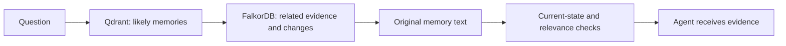
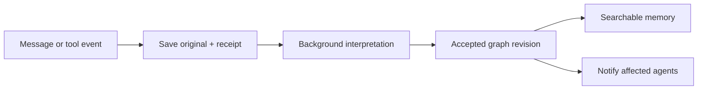

# Research conclusion: graph memory, live ingestion and fast shared retrieval

Checked October 13, 2026. This research uses official documentation, release-tagged source and a read-only snapshot of the migration happening in parallel. It does not install a competing framework, run a hosted service, benchmark latency or change the migration. Caching is deliberately outside this investigation.

## The recommendation

Build one controlled memory service for all authorized agents. Let the graph govern accepted memories, their evidence, changes and related work. Use meaning and word search to find candidates, then check those candidates against current graph state. Save original events promptly; interpret them separately; make readiness visible.

Keep the current migration's graph/vector choice distinct from a later consolidation decision. The code now selects Qdrant for meaning search and FalkorDB for graph memory. Graph-contained vector search remains a possible alternative to test, not a change already agreed or implemented.

## What the three systems actually do

| System | Graph and vector relationship | Useful lesson | Limit for our goal |
| --- | --- | --- | --- |
| Current Mem0 self-hosted | Fact memories and an entity-to-memory index use vector collections; external KG integration was removed from the inspected current release. | Compact facts, batched fact processing and scoped retrieval. | This does not automatically supply typed accepted changes, dependency-linked decisions or handoffs. |
| Current hosted Mem0 | A built-in entity/mention graph helps rank memories with semantic and word signals. | Entity connections can improve lookup without asking an LLM for every read. | Its public graph description does not create typed entity-to-entity facts; private storage internals are not disclosed. |
| MemPalace | Searchable original-text memories default to Chroma; an actual temporal KG is a separate SQLite store, connected through evidence/source references. Room/wing navigation is another structure. | Preserve original material, retain factual history, and use a distinct coordination stream. | Its normal drawer search does not automatically query the temporal KG. Automatic contradiction processing is documented as planned/experimental. |
| Graphiti | With its FalkorDB backend, facts/entities and embedding properties live in the graph; full-text and similarity searches return graph records. | Connect episodes to derived facts and validity history, and combine multiple discovery methods. | The inspected FalkorDB similarity path calculates scores over matched records rather than calling a native approximate vector index; backend support alone does not prove fast lookup at scale. |
| Hosted Zep | Its current documented managed graph service is Konig, with asynchronous graph construction and graph-scope search. Public docs do not disclose every physical search store. | Explicit processing status, completion notifications, and personal/shared scopes. | It is not interchangeable with installing open Graphiti on FalkorDB. A received or processed episode can still require further time to become searchable. |

Sources: [Mem0 current migration guide](https://docs.mem0.ai/migration/oss-v2-to-v3), [Mem0 Platform graph](https://docs.mem0.ai/platform/features/graph-memory), [MemPalace temporal KG](https://mempalaceofficial.com/concepts/knowledge-graph.html), [MemPalace contradiction status](https://mempalaceofficial.com/concepts/contradiction-detection.html), [Graphiti release-pinned FalkorDB search source](https://raw.githubusercontent.com/getzep/graphiti/v0.30.2/graphiti_core/driver/falkordb/operations/search_ops.py), [Zep Context Lake](https://help.getzep.com/v3/context-lake), [Zep processing status](https://help.getzep.com/v3/check-data-ingestion-status).

The versions matter. The local optional research requirements name Mem0 2.2.1, MemPalace 3.10.0 and zep-cloud 3.30.0. A dependency pin is not an installed service or an executed comparison. Older Mem0 papers/tutorials describe an external graph architecture that differs from the inspected current release. A hosted SDK pin also does not freeze the hosted server behavior.

Detailed primary-source notes: [Mem0](mem0.md), [MemPalace](mempalace.md), [Zep and Graphiti](zep.md).

## How the current project's graph and vectors connect

Think of one memory having a tracking number. The vector store keeps searchable text with that number. The graph keeps its people/concepts, observations, relationships and change links, with a reference back to the same number.

Current retrieval asks Qdrant for related memories, uses their entity references to follow the FalkorDB graph, then retrieves the original memory text and checks explicit time/change information. The application joins the two representations; the databases do not automatically make that connection on their own.

This is the observed current path, not a claim that every needed interpretation/authority check is already implemented. See [the migration audit](migration_audit.md) and [the source snapshot manifest](migration_snapshot.json).

## What has been decided in the migration

The code/configuration now point to a FalkorDB service while retaining embedded Qdrant. The service definition pins FalkorDB server v4.20.7 and enables persistent data plus append-only logging. The Python client pin is a different version number. The entity/observation/change model is mostly being preserved.

To preserve caught-failure recovery across two stores, the current coordinator edits a private graph copy and publishes it only when the write succeeds. Cooperating readers and writers share one lock. This avoids exposing partially published application work, but it is not a crash-atomic transaction across both databases.

The inspected architecture documents still described Kuzu, so the source/config snapshot is more current evidence for this migration. The broader memory-service architecture remains proposed: automatic field-level accepted changes, task ownership, handoffs, durable processing notifications and authenticated user routing are not created merely by the database swap.

## The largest speed issue found in our code

The current application makes full saves and searches hold the same shared lock. A save computes embeddings and optional interpretation while holding it. Consequently a slow save can make other agents' searches wait, even though FalkorDB itself supports concurrent read queries.

The code also copies the graph for each coordinated write, reads all observations when resolving candidate ownership for conflicts, scans relationship metadata during cleanup, and performs repeated graph/vector lookups before deduplication. These are source-confirmed structural issues to measure; this research does not claim measured delays or a particular speedup.

A suitable redesign would keep expensive understanding outside the short state change, update only the affected nodes/relationships, and resolve candidate evidence through targeted reads. Simply removing the existing lock would risk mixed graph/vector versions and lost changes. It needs a replacement current-version and recovery contract first.

Source evidence and qualifications are in [the migration audit](migration_audit.md). FalkorDB's documented parallel reads, single-query atomicity and per-graph serialized writes describe database capabilities, not the current wrapper's measured throughput. [Concurrency reference](https://docs.falkordb.com/design/concurrency), [graph copy reference](https://docs.falkordb.com/commands/graph.copy).

## How to ingest live data with lower delay

There are at least three clocks: time until the original event is safely saved, time until its interpreted memory is accepted, and time until that memory is discoverable by search. A fast receipt is not a fast completed correction.

The proposed flow is:

1. Save the original event and its owner, source, session and unique identity first. An acknowledged event should satisfy the chosen durable-storage promise, not merely exist in a worker's memory.
2. Process meaningful message/tool/action boundaries. Do not create an independent memory for every generated word.
3. For structured agent/tool outputs, validate and use the supplied fields without asking a model to rediscover them unnecessarily. Free-form text can use background interpretation.
4. Run independent preparation work together when appropriate, but apply conflicting accepted changes in a controlled order after checking current state, scope and authority.
5. Commit a small accepted change with its source, history and affected-work markers. Do not describe a queued candidate as an accepted current fact.
6. Track pending, ready, disputed and failed work. If an important instruction is pending, affected actions must wait or explicitly reconcile the original instruction; ordinary unrelated searches need not stop.
7. Notify the relevant agents after the commit, and retain delivery/progress information so interruption and repeated messages do not silently duplicate or lose work.

Hosted Mem0 distinguishes queued interpretation from its synchronous verbatim path. Zep distinguishes submitted episodes, processing status and searchable readiness. MemPalace provides incremental memory operations and a separate coordination stream. These are patterns to learn from, not measured guarantees for our implementation. [Mem0 add API](https://docs.mem0.ai/api-reference/memory/add-memories), [Zep readiness](https://help.getzep.com/v3/check-data-ingestion-status), [MemPalace coordination stream](https://mempalaceofficial.com/concepts/agent-logstream.html).

Making a function asynchronous does not automatically create a durable queue, eliminate model time, preserve event order or prevent duplicate effects. A proposed background worker needs saved work identities, explicit results and a recovery path.

## How memory should be shared

Agents working for one authorized user/workspace use a shared memory service. They should not each open the same local vector files or independently decide what the latest accepted fact is.

Keep the memory owner separate from the producing agent. A common user constraint belongs in shared user/workspace memory; the fact that Agent A recorded it is provenance. Restricting every fact to Agent A's private scope would prevent Agent B from finding it. Conversely, sharing every agent note with every user would violate the intended boundary.

Other users need separate protected spaces. Authenticate the caller, derive allowed scope from that identity, and enforce it for original episodes, derived facts, summaries, graph expansion and updates. A supplied user identifier or graph label is not authorization. In the current source, one graph name and document filters are storage/search choices; they do not implement this service boundary.

A handoff should carry the current task, owner, completed/pending work, evidence used, accepted memory revision, conflicts and any action whose outcome is unknown. The receiving agent acknowledges the handoff and checks that its evidence remains current. Shared searchable facts alone are not this coordination protocol.

MemPalace's shared hub serializes writes and its event stream supplies coordination signals. Zep separates personal graphs from shared context and exposes documented access controls. Graphiti explicitly places namespace authorization in the application. Learn these boundaries without assuming a label or library instance proves isolation. [MemPalace shared hub](https://mempalaceofficial.com/guide/shared-brain.html), [Zep sharing](https://help.getzep.com/v3/how-to-share-context-across-users-using-graphs), [Graphiti namespacing](https://help.getzep.com/v3/graphiti/core-concepts/graph-namespacing).

Local Qdrant also prevents separate clients opening the same persistent directory concurrently. One controlled service can own the current instance; independent distributed workers need a service-backed vector store or another tested arrangement. [Official Qdrant local source](https://github.com/qdrant/qdrant-client/blob/master/qdrant_client/local/qdrant_local.py).

## How retrieval can be faster without abandoning evidence

- Narrow user/workspace/task scope before searching. A small graph walk after a global mixed-user search is not the same as safe scoped discovery.
- For a known task, accepted constraint or exact identifier, read its current graph state directly rather than interpreting the question with a model every time.
- Let meaning search and exact-word search independently nominate candidates. Run independent discovery work together; graph expansion that requires returned candidates necessarily follows them.
- Gather only the related fields, evidence, policies and changes needed to interpret those candidates. Avoid broad “everything about this person” expansion.
- Deduplicate memory owners early and collect graph observations/vector payloads in batches, rather than loading the same document repeatedly.
- Resolve current eligibility and disputes using indexed candidate ownership and explicit change links; avoid whole-graph scans for a small result set.
- Use richer reranking only on a bounded shortlist when its quality benefit warrants its added delay.
- Check the actual search plan. Storing embedding arrays on nodes does not establish that an indexed vector-search operation is being used.

FalkorDB offers native vector indexes. Its indexed node/relationship query path is different from fetching candidate graph objects and computing all their similarities. The inspected Graphiti FalkorDB driver uses the latter pattern; do not assume installing it will select the former. [FalkorDB vector indexes](https://docs.falkordb.com/cypher/indexing/vector-index), [inspected Graphiti search](https://raw.githubusercontent.com/getzep/graphiti/v0.30.2/graphiti_core/driver/falkordb/operations/search_ops.py).

## Two storage routes still worth comparing

**Keep Qdrant plus FalkorDB:** least disruption to the current migration; make FalkorDB authoritative for accepted state, and use Qdrant for discovery. Preserve immutable source/version identities so a delayed vector update cannot silently supply an obsolete fact. Test a central service owning local vectors or move vectors to a server when the workload demands independent clients.

**Use FalkorDB for graph and indexed vectors:** fewer database synchronization boundaries, but requires actual index-backed retrieval, equivalent quality checks, user routing, persistence and release compatibility tests. One database does not remove the interpretation/acceptance/action correctness problem.

Recommendation: finish and verify the existing backend migration as a baseline. Improve its ingestion/read/write boundaries and targeted retrieval. Then compare those storage routes with the same inputs, embedding model, scope, evidence budget and concurrent workload before choosing consolidation. Do not silently replace a pending Wayfinder architecture choice with a research recommendation.

## What to measure next

Measure saved-event latency, accepted-memory latency, searchable visibility, retrieval latency, correction-to-dependent-work delay and handoff readiness separately. Include typical and slow-tail results under simultaneous reads/writes, not only one-user averages.

Alongside time, check incomplete evidence, outdated-claim use, unsupported answers, cross-user access, duplicate effects, failed/unknown actions and restart recovery. Change graph size and include irrelevant histories. Compare the current copy/publication strategy with an incremental transition strategy under equivalent failure requirements.

No defensible numerical speed promise follows from this source review. Vendor-reported benchmarks are not our measurements. Earlier tiny hand-prepared retrieval scores do not prove automatic ingestion, high concurrency or correct final actions.

The repository's optional comparison wrappers also cover only parts of the products: Mem0 uses verbatim add, MemPalace uses mining/drawer search, and Zep uses episode retrieval. They do not establish full upstream graph-memory or handoff quality. Version/API details need repair/validation before publishing a product-level comparison; those findings are in the three research notes.

## Connection to the paused topics

Fuzzy acceptance and protected memories belong after a correct current-state, scope and authority model. Upstream relevance scores or stored confidence fields are not automatically our proposed decay/protection controller. A disputed protected claim still needs its dispute shown, and a score must not grant access or task ownership.

Retrieval improvements belong in the scoped discovery and evidence-check path. Better wording matching cannot substitute for accepted-change checks; preserved history cannot substitute for finding the relevant evidence. Both remain design inputs to the reusable service, rather than features already supplied by the migration.

Caching remains a deferred topic; no cache research, implementation or performance assumptions were used in these conclusions.
