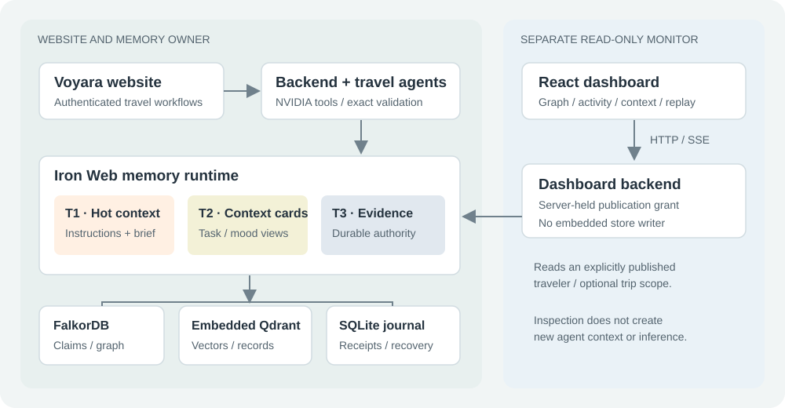
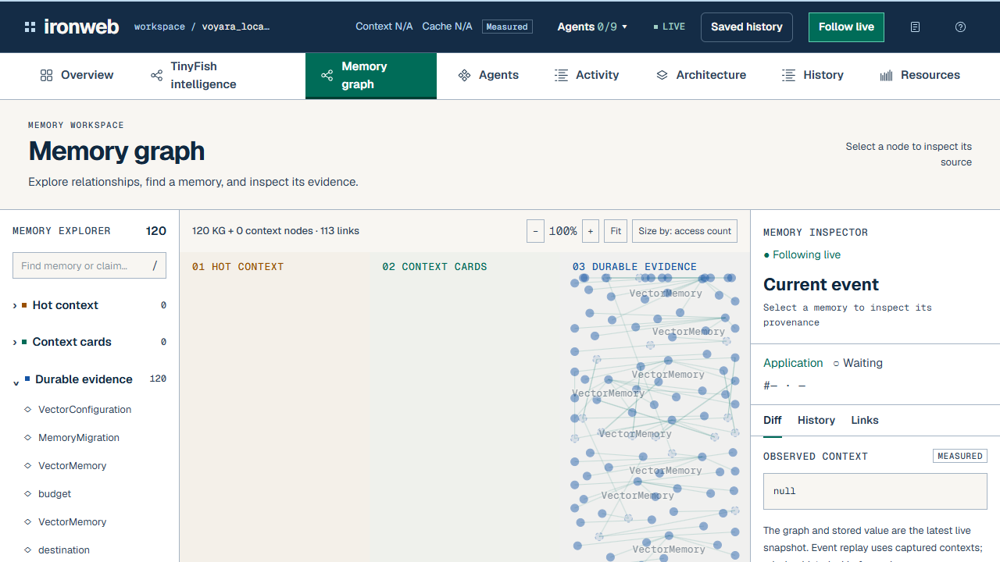

# Iron Web

## System report: shared memory, travel agents, and live observability

**Prepared:** 18 October 2026 · Asia/Kolkata

**Historical source baseline:** `245829251f5222fbabe0d1c25b00170e9edabd1c`

**Finalisation addendum:** local `finalise/2026-10-18` through `eb3bf8e`, including recovery `3091669` and stream fix `9633f65`, plus accompanying documentation/evidence. Not yet published to GitHub.
**Purpose:** Explain the complete system for its builders, hackathon judges, and future maintainers.

This report describes the repository and retained verification evidence. It separates implemented behavior, historical measurements, local acceptance and remaining work. Finalisation found a persisted FalkorDB restart crash, then recovered an isolated copy and activated it with separate explicit approval. The original and pristine backup remain preserved. Fresh hosted acceptance, consistency checks and controlled database/relay recovery passed after cutover. This supports a local demonstration, not production durability or a new performance benchmark. Updated evidence is in sections 12.4 and 14.4 and `report/finalisation_20261018/README.md`.

### Reading guide

1. Executive overview and terminology
2. The problem and product experience
3. System architecture and technology
4. Travel agents and orchestration
5. Three-tier memory architecture
6. Durable knowledge, retrieval, and consistency
7. Corrections, conflicts, forgetting, and work dependencies
8. Shared service and context contracts
9. Live dashboard and event semantics
10. Identity, credentials, and publication boundaries
11. Research and evaluation
12. Verification evidence and current status
13. Deployment and operations
14. Limitations, priorities, and demonstration guide
15. Source map and glossary

## 1. Executive overview

Iron Web is a memory infrastructure project demonstrated through Voyara, a travel planning application. Multiple specialized agents use a common, scoped record of the traveler's requirements. A separate dashboard makes those memory reads, changes, relationships, and captured contexts inspectable.

The central idea is to preserve the evidence behind an agent's working context. A budget, date, dietary rule, or instruction is more useful when the system can identify who supplied it, which trip it belongs to, whether it is current, and which completed work depends on it. When the user changes that information, the system can detect stale context and require review rather than silently keep using an earlier value.

There are three related products in this repository:

| Name used in this report | Responsibility |
| --- | --- |
| **Website** | Voyara: traveler identity, discovery, trip details, chat, selections, itineraries, Travel Books, and booking requests. |
| **Memory system** | Iron Web: source events, claims, temporal evidence, graph/vector retrieval, context compilation, and dependency checks. |
| **Dashboard** | A separate read-only interface for observing the memory used by the website and its agents. |

The current integrated demonstration uses real application memory and real hosted agent calls when NVIDIA mode is active. Supplier listings and rates are synthetic catalog data. The presence of real agents does not make the inventory live or imply that a reservation has been made. [S1–S4]

## 2. Problem and product experience

### 2.1 Why shared memory matters

A travel conversation often spans several tasks: finding a destination, choosing stays, checking meals, arranging a daily schedule, and estimating cost. Independent agents can otherwise reuse old budgets, miss restrictions, repeat work, or interpret an agent-generated suggestion as a user-approved fact.

Iron Web addresses these problems through scoped evidence and explicit state. It distinguishes a saved message from an interpreted requirement, a proposed assertion from an accepted fact, and a historical observation from a current instruction. The dashboard exposes those distinctions so a reviewer can inspect the system's behavior.

### 2.2 Traveler-facing features

The website combines destination discovery, stays, food, experiences, sample transport, favorites, saved trips, and authenticated trip conversations. Structured trip details confirm destination, dates, duration, party size, budget, and pace. A conversational journey flow can collect pending details and manual selections before explicit confirmation invokes specialist planning.

The itinerary editor retains plan versions. Changes to details or selections can invalidate a current outline until it is regenerated. The Travel Book turns a private, owned trip snapshot into HTML/PDF output with dated plans, selections, estimates, and edit links. Downloaded PDFs remain fixed snapshots; an edit link does not grant public access to a private trip.

The latest imported source adds unified nine-page Kashmir and Kerala catalog documents, illustrated regional maps, regional catalog handling, and booking-review presentation. These are present in the reviewed source. This report does not claim they received a new end-to-end acceptance run after the latest merge.

Booking-request creation is separate from model planning. The reviewed booking API writes requests with `status="requested"` and calculates line items from stored catalog objects. This is an application record, not evidence of supplier confirmation or payment. [S3, S5, S6]

## 3. System architecture and technology



### 3.1 Responsibility and process boundaries

The website backend owns its authenticated travel workflows and the memory runtime. It accesses embedded Qdrant, private receipt journals, and named FalkorDB graphs. The separate dashboard backend reads a deliberately published scope over HTTP; it does not open the same embedded stores or become a second writer.

The React dashboard connects to the relay through HTTP and Server-Sent Events. The relay authenticates to the website's read-only inspection adapter using a server-held publication grant. The website remains the authority for the selected memory scope. Local startup uses one website process per embedded runtime.

There are also older, separate interfaces: the standalone memory server in `server.py`/`web/`, and the authenticated shared-memory service in `shared_server.py`. Their existence does not mean the normal travel demonstration needs every server running.

### 3.2 Technology map

| Layer | Technology and role |
| --- | --- |
| Dashboard UI | React, Vite, Tailwind integration, D3 force layout, Framer Motion, Geist fonts. |
| Website UI | The supplied JavaScript/CSS travel frontend, with application and catalog views. It is a separate frontend from the React dashboard. |
| Application and relay APIs | Python, FastAPI, HTTPX, Uvicorn; application persistence uses SQLAlchemy. |
| Agent coordination | LangGraph workflow and typed agent/request/result schemas. |
| Hosted inference | NVIDIA NIM through an OpenAI-compatible HTTP interface. |
| Semantic retrieval | Embedded Qdrant with configured local embeddings. |
| Knowledge and evidence | FalkorDB named graphs, including claims, relationships, histories, and dependencies. |
| Receipts and application records | SQLite journals for memory processing; application SQL tables for travelers, trips, plans, selections, and exports. |
| Optional acceleration | CPU models by default; selected CUDA embedding/reranking/card-matching paths when explicitly configured. |

The configured core embedding model is `BAAI/bge-small-en-v1.5`, with 384 dimensions. The optional reranker is `BAAI/bge-reranker-base`; reranking is disabled in the default core configuration. Hosted extraction is also explicitly selected, with the default core extraction policy set to `none`. [S1, S7, S8]

## 4. Travel agents and orchestration

### 4.1 The team

| Actor | Role | Grounded operation |
| --- | --- | --- |
| Mira · trip consultant | Inspect requirements and identify gaps. | Inspect the confirmed brief. |
| Atlas · explore agent | Discover matching destinations. | Query destination records. |
| Haven · stay agent | Compare lodging options and alternatives. | Compare catalog stays. |
| Saffron · food guide | Select meals within supported dietary constraints. | Find matching food records. |
| Roam · tour guide | Match experiences to interests and pace. | Find experiences and attractions. |
| Weaver · itinerary planner | Assemble and review a daily schedule. | Build and validate a schedule. |
| Ledger · budget agent | Calculate and explain indicative costs. | Run exact budget calculations. |
| Anchor · support agent | Review preparation and changes. | Inspect preparation evidence. |
| Orchestration memory reader | Obtain the workflow's current memory context. | Read context; it is counted separately from the eight specialist roles. |

Nine registered memory actors therefore do not mean nine hosted specialists execute on every request. A normal full plan schedules seven specialists; support is conditional. Registration, observed use, recent activity, and currently outstanding memory reads are distinct dashboard counts.

### 4.2 Execution sequence

1. Authenticate the traveler and bind the conversation to an explicit trip.
2. Parse the request and choose agents from the page and requested intent.
3. Retrieve current evidence and inspect the confirmed requirements.
4. Ask for material missing information, or resolve the catalog destination.
5. Run selected research specialists, with their own contexts and working state.
6. Collect findings, build the itinerary, and calculate the budget.
7. Validate the result, perform bounded revision where supported, and revalidate context freshness.
8. Persist and return an eligible result, or expose a pause/failure requiring clarification.

The connected workflow uses `checkpoint=False`; its durable traveler memory is separate from LangGraph execution checkpoints. Standalone orchestration has its own checkpoint adapter.

### 4.3 What makes the agents grounded

Hosted agents have distinct instructions, sampling temperatures, tool schemas, bounded turns, and execution traces. They choose tools, observe actual tool results, and select from those returned candidates. Candidate indices are validated; invented identifiers or observations are not accepted as catalog results. The itinerary role must review its draft before completing it.

A malformed provider tool action can be retried within the existing turn budget. A successful catalog operation is not automatically repeated merely because a later action is malformed. Failure remains visible if the budget is exhausted. The loop is not unrestricted autonomous execution and has no booking/payment tool.

The reviewed agent defaults still name `openai/gpt-oss-20b`. Environment values can override them. An imported setup document discusses a different model, but prose is not proof of the running configuration. The retained successful live run recorded `openai/gpt-oss-20b`; no new GLM-model acceptance result is established here. [S9–S11]

## 5. Three-tier memory architecture

The tiers organize how durable evidence becomes bounded working context. They are not three independent sources of truth, and they do not automatically move records between RAM, GPU, and disk according to a learned policy.

| Tier | Contents | Residence | Authority |
| --- | --- | --- | --- |
| **1 · Hot context** | Agent instructions and current traveler essentials in equal bounded halves. | RAM / compiled prompt text. | Derived from profiles and eligible evidence. |
| **2 · Context cards** | Task and explicit mood cards with source claim IDs. | CPU RAM; optional CUDA card-vector matching. | Disposable evidence-backed views. |
| **3 · Durable shared memory** | Sources, claims, lifecycle history, relationships, record vectors, receipts, and work dependencies. | FalkorDB, embedded Qdrant, and the receipt journal. | Retained evidence; graph rules decide claim eligibility. |

### 5.1 Tier 1: a bounded working brief

One half contains application-owned agent instructions; the other contains the traveler's current essentials. Mandatory rules cannot be silently displaced by optional material. If required content cannot fit the permitted budget, the system reports a capacity error instead of pretending the context is complete.

### 5.2 Tier 2: source-derived cards

The context compiler selects readable task/mood cards backed by current claims. Supported task profiles include flight, hotel, and itinerary. Configured defaults allow up to three cards. Cards are rebuilt from retained sources rather than accumulated as duplicate durable persona files.

Mood is based on an explicit claim. Session and trip scopes have defined inheritance behavior; an expired, disputed, or retracted session mood does not silently revive an older trip mood. The documented derivative lifetime is at most 30 minutes from its source, subject to an earlier validity end.

Optional CUDA matching holds normalized card vectors and performs matrix matching. The original selected text still reaches the consumer. This is not a generative KV cache or a GPU-resident durable knowledge database.

### 5.3 Budgets and accounting

The context contract defaults are 1,024 units per hot half, 512 per card, up to three cards, an 8,192-unit context limit, and 1,024 reserved output units. These are policy defaults, not a claim about every configured runtime.

Units depend on the actual consumer. The connected default consumer, `voyara-deterministic-utf8-v1`, counts exact UTF-8 bytes. A configured local tokenizer can instead supply its own identity and accounting. Neither establishes hosted chat-template/tool overhead automatically. Provider-reported input/output tokens are measured separately.

The documented host cache is bounded to 256 entries and 32 MiB of accounted payload. The optional device path has explicit admission/owned-tensor limits and CPU fallback. Total process RSS, CUDA library workspace, and provider billing are different quantities. [S12, S13]

## 6. Durable knowledge, retrieval, and consistency

### 6.1 What each store does

**Qdrant** stores vectors and memory record payloads for semantic discovery. Point identity derives deterministically from the memory identifier. The embedded configuration uses exact search; server-only indexing controls are not presented as effective local tuning.

**FalkorDB** holds graph observations and relationships, plus structured claim evidence and lifecycle/dependency records. Similar meaning in vector space is not sufficient to authorize a protected-rule replacement. Eligible graph evidence is reconciled with retrieved records.

**SQLite receipt journals** retain submitted source events, processing states, notification acknowledgments, and recovery information. They are not interchangeable with the website's SQL tables, which store product data such as conversations and itinerary versions.

### 6.2 Retrieval pipeline

The core exposes vector, graph, hybrid, selected ablation, and no-memory modes. Vector retrieval embeds the query. Graph retrieval links it to existing entities and traverses a bounded neighborhood. Hybrid retrieval gathers both candidate sets before time/scope checks, explicit conflict handling, optional reranking, and final scoring.

Default graph expansion is two hops and at most 50 nodes; vector candidate selection is bounded. Ranking combines configured semantic, graph, recency, importance, entity, historical, and contradiction signals. The ranking value is not a calibrated confidence probability. Explicit query-time modes distinguish all validity periods, currently valid evidence, and historical evidence.

### 6.3 Coordinated writes and their cost

The engine serializes cooperating operations using thread locks and renewed Redis leases. A write preserves affected vector state, applies graph changes to staging, and publishes the graph with revision/ownership checks and a recovery copy. Caught failures can compensate graph and vector changes, including an ambiguous publication response.

This is not a durable cross-database transaction. A process or machine failure may still require recovery/reconciliation. Copying a graph during coordinated writes also makes ingestion and frequent updates expensive as graph size grows. A submitted batch is not one all-or-nothing transaction across all its records. [S7, S8, S14]

## 7. Corrections, conflicts, forgetting, and dependencies

### 7.1 Claim lifecycle

Claims carry a subject, predicate, value, scope, source information, applicability, and lifecycle history. A trip-specific budget must not overwrite another trip's budget. Profile inheritance is explicit and restricted; a hard profile rule conflicting with a trip field can require clarification.

Ordinary claim scores use transparent freshness, source-quality, corroboration, and agreement inputs, with a default 90-day half-life. They range below 1. Explicit applicable user-confirmed rules/instructions can be protected at 1. These fuzzy scores are explanation mechanisms with declared defaults, not truth probabilities or access controls.

A conflicting assertion can create a dispute instead of replacing an accepted claim. Confirmations apply to the specified value and scope. Repetition by one author is not independent corroboration; agent echoes do not become fresh user evidence. Accepted correction/supersession retains history and can transfer protection.

### 7.2 Work and handoffs

Work records identify the exact claim versions and prerequisites they used. A relevant change can flag dependent work and downstream prerequisites for review. Completed work retains its completion record rather than being silently re-executed. Ownership uses execution leases and fencing; another agent does not receive the original agent's completion credential through a public handoff.

These are core capabilities. The travel website uses context/current-evidence validation, but this report does not claim every planner step uses the full shared-service task-lease API or every core feature has a dedicated live dashboard animation.

### 7.3 Forgetting and maintenance

Event forgetting removes retained evidence from the owned graph/vector state and scrubs original journal text. Replaying the same forgotten event ID must not recreate it. Dashboard captured histories are purged for forgotten scopes. Separate backups and previously downloaded exports need their own retention policy.

Explicit maintenance supports age-based importance decay, conservative exact-context deduplication, and extractor-dependent episodic consolidation. These are not established as continuously running background jobs in the travel flow. Similarity alone is not permission to delete a record. [S15, S16]

## 8. Shared service and context contracts

The authenticated shared service adds private user spaces and durable event receipts to the core. Credentials determine tenant and actor; a JSON field cannot confer another user's identity. Each space has its own graph/vector namespace and request gate.

Receipt states distinguish queued, interpreting, ready, and failed. A quick acknowledgment means the source was saved, not that its meaning has been accepted. Relevant pending, failed, or unclear changes block use of old requirements. Explicitly unrelated trip work can proceed; global or unscoped changes retain conservative gating.

The conservative travel interpreter accepts a bounded grammar. Unsupported, conflicting, or conditional input does not result in silent partial semantic acceptance. Structured fields provide a more reliable path for unsupported wording. The separate conversational journey layer can call a hosted model to collect pending facts, but confirmation and field validation remain application responsibilities.

Context packets contain instructions, traveler text, cards, exact evidence IDs, accounting, expiry, readiness, residency/cache diagnostics, and actor-bound proofs. After generation, the application checks freshness and discards outdated output. Bounded rebuilding is response-generation behavior, not a safe way to retry an external payment.

| Interface family | Representative operations |
| --- | --- |
| Core Python facade | `add`, `search`, `get`, `update`, `delete`, maintenance, status, claim recall, and dependency operations. |
| Shared `/v1` service | Events/status/retry/withdraw/forget, identity/history, recall/search, work ownership/completion, handoff, notifications, context/validation. |
| Website assistant | Owner-scoped conversations, messages, confirmed requirements, event history and deletion. |
| Dashboard relay | Read-only snapshots, agents, tiers, graph, shared memory, vectors, masked credential metadata, and SSE. |

The in-process `MemoryToolAdapter` is not itself an MCP protocol server. [S7, S12, S16]

## 9. Live dashboard and event semantics

### 9.1 Views and synchronized interaction

The dashboard has a 56-pixel top bar, explorer, central stage, inspector, and one bottom replay dock. At narrower widths the side panels become drawers. Search, agent filters, selection, view changes, and URL state synchronize the interface.

| View | What it explains |
| --- | --- |
| Memory graph | Real KG nodes/relationships plus explicitly derived captured context/card links; tier colors, access-count sizes, neighbors, fit/pan/zoom, and selected labels. |
| Agent wiring | Registered agents and their memory/tool connections, with event-linked activity. |
| Activity | Actual agent rows and event cells that jump to the corresponding observation. |
| Architecture | All three tiers, their responsibilities, budgets, and captured usage. |
| Resources | Context composition, cache accounting, provider usage, supported memory/device readings, and observed latency. |

The inspector offers Diff, History, and Links. It shows observed before/after values where captured, agent/action metadata, source evidence, and history navigation. Source inspection can show actual Qdrant payloads/numeric vectors and receipt state. API keys and proof tokens are not normal inspector content.

Keyboard controls include Space for play/pause, arrows for stepping, 1–5 for views, F for follow-live, slash for search, and Escape for clearing/closing. Reduced-motion preferences suppress movement. Agent cursors and pulses map to observations rather than an idle simulation.



### 9.2 What replay means

The default React entry point consumes the real feed. `events.json` and legacy mock components remain for compatibility fixtures; they do not drive normal live execution.

Observations retain a maximum of 500 events per traveler and up to 256 latest context entries. They reset with the owner process. Captured context can be replayed, but the KG/store display remains a latest snapshot; it is not a complete event-sourced historical database. A graph node's displayed size reflects accesses in retained observations, not lifetime popularity.

The relay emits SSE snapshots every two seconds and has a short read cache. It reports unavailable/stale data rather than substituting demonstration records. Pagination and edge/vector limits mean a displayed page is not necessarily the whole database. A health endpoint proves process/configuration status, not complete database correctness.

### 9.3 Honest measurement

Provider requests, successful HTTP responses, and provider-reported token usage are process-scoped. A successful HTTP response does not by itself prove a valid tool decision; protocol validation remains separate. A configured credential alone is not evidence of use.

RAM, available VRAM observations, cache payload, and context bytes have different scopes. Missing GPU-utilization history, provider-cache splits, durable byte quotas, no-memory prompt baselines, or cost savings remain unavailable. A dashboard should not turn these missing measurements into invented optimization claims. [S2, S17–S19]

## 10. Identity, credentials, and publication boundaries

The website provides authenticated ownership checks for trips, private drafts, selections, and exports. Its local developer login is an explicitly enabled loopback feature using a dedicated ordinary account, strict request checks, and a strong session secret. It should not be treated as a public login method.

Memory principals bind actors to user spaces on the server. Context and execution proofs are separate from user facts. The dashboard's publication grant selects one intended viewing account, optionally one trip plus inherited profile data. It is not a cross-tenant administrator console.

The website-to-relay credential is server-held, and normal dashboard metadata exposes only masked provider identity/fingerprint. Finalisation added a separate viewer gate for HTTP and SSE: direct loopback can omit a viewer secret, while remote requests fail closed without a strong configured secret. React exchanges it for a signed, eight-hour HttpOnly cookie; expiry and rotation also apply to streams. CORS uses exact origins and is not authorization. A sanitized published demonstration scope remains available behind the remote gate. Cross-site cookie and streaming behavior on the intended cloud domains remains unverified.

**Credential exposure found and mitigated in the working tree:** the imported `MULTIAGENT_GLM_REQUIREMENTS_AND_CHANGES.md` had a hardcoded NVIDIA key, and an old launcher had a fixed session secret. Maintained plaintext values were removed. The equivalent repository/history scan reports zero current findings and two historical secret blobs introduced in `b905b56a08d2153d9009df92652bb8e496fc082d`. Values are intentionally omitted. The configured provider key differs from the exposed guide key; validity of the exposed key was not probed. Revoke it if active, rotate any deployed old signing secret, and coordinate history cleanup separately. No credential rotation or history rewrite was performed. Twenty-six referenced historical Markdown notes under `.scratch/` remain tracked; active env/session files were not found tracked.

The report itself contains no copied credentials, publication grants, private session files, or raw traveler snapshots. [S20, S21]

## 11. Research and evaluation

The repository includes local DMR/MSC-derived, LoCoMo, and LongMemEval workflows. Retained question slices keep complete selected histories, use provenance/configuration fingerprints, and preserve historical run records. Retrieval is evaluated by explicit document identity and local metrics.

The ordinary evaluator uses a first-context-line answer generator. These results are not official upstream answer scoring or proof that a production conversational model answers every question correctly. Optional real-package adapters for Mem0, Zep, and MemPalace are separate from project-owned research mechanisms; naming a mechanism after an external product would not establish an implementation of that product.

One retained graph-backend experiment measured 5,373 queries across 27 dataset/profile/backend combinations. It reported identical retained rankings/predictions/local metrics across graph backends for each profile, while optimized warm hybrid retrieval was faster than its Kùzu reference in those cohorts.

| Historical cohort | Warm hybrid mean latency change | Fresh ingestion time ratio |
| --- | --- | --- |
| DMR | −29.82% | 3.19× slower than Kùzu reference |
| LoCoMo | −24.66% | 2.09× slower |
| LongMemEval | −31.40% | 14.30× slower |

These figures belong to the recorded older experiment and its hardware/configuration. They are not measurements of the latest travel website. Vector-only and reranked retrieval were not universally improved. The graph-copy write path remained a significant tradeoff, and the same integration optimizations were not applied to the Kùzu reference. [S22–S24]

## 12. Verification evidence and current status

### 12.1 Recorded real website → agents → memory run

The retained live report records a Goa trip for 1–3 December 2026, two travelers, and a total INR 100,000 budget, submitted through the website planner after local developer sign-in.

| Recorded result | Value and interpretation |
| --- | --- |
| Application result | HTTP 200; `agents_connected`; workflow `ok`; itinerary saved. |
| Hosted specialists | Seven completed successfully; support was not required. |
| Memory actors | Eight observed out of nine registered, including orchestration. |
| Retained observations / contexts | 29 / 8. |
| Graph | 63 KG nodes and 150 KG relationships. |
| Claims/history records | 36 in the recorded inspection. |
| Qdrant | Six points on the inspected page, not a universal lifetime total. |
| Provider | NVIDIA NIM, `openai/gpt-oss-20b`. |
| Process usage | 18 requests, 18 successful HTTP responses; 30,739 input and 1,418 output tokens reported. |
| Browser result | Zero recorded page errors in the completed full flow. |

Earlier failed protocol behavior is retained alongside the successful run. This is useful trace evidence for one demonstrated flow, not a reliability rate over a representative user population.

### 12.2 Regression and startup checks

Before PR #4, a broader selected suite passed 42 backend/application tests, 12 frontend tests, two real-feed browser tests, and the production dashboard build. Backend regression used explicit offline provider mode with isolated stores; this is different from the separate real NVIDIA flow.

The subsequent blank-screen issue was reproduced as `React is not defined`. A correctly configured frontend restart restored rendering. PR #5 made startup reproducible through the explicit frontend launcher, Vite configuration, dependency refresh, and strict dashboard port. Its build, 12 unit tests, and two real-feed browser tests passed.

After those checks, local `main` fast-forwarded to `2458292`, importing additional website/catalog changes. This report reviews that source but does not reuse earlier test passes as proof that the new merge passed an equivalent full acceptance suite. The earlier checkpoint-serializer warning in dashboard documentation is also historical: the current source has since changed its serializer argument; it was not independently retested here.

### 12.3 Read-only status at initial report preparation

On 18 October 2026 at approximately 02:08 IST, the website on port 8000, dashboard frontend on 5174, and relay health endpoint on 8200 returned HTTP 200. The live snapshot reported online status, nine registered actors, eight observed actors, 29 retained observations, and no currently outstanding memory read. These are point-in-time observations, not fixed product totals.

A long-running Python service can retain earlier loaded code after a Git pull. HTTP availability and the checked-out Git revision therefore do not establish that every imported backend change is active. No new planning run, supplier action, deployment, or full test suite was initiated for this report. [S19, S25]

### 12.4 Finalisation acceptance and later restart failure

Finalisation restarted services and rebuilt both frontends before fresh Kerala planning through ordinary developer sign-in. A first hosted acceptance passed before the persistence failure. A second fresh acceptance after approved recovery passed all seven NVIDIA specialists using unchanged `openai/gpt-oss-20b`; a current saved plan, 553,676-byte Travel Book PDF, both Kashmir/Kerala catalogs and requested Kashmir booking were verified. The dashboard recorded 29 trip observations, nine registered/eight observed actors, and zero page errors. Process usage at this capture was 17 responses, 30,480 input/1,816 output tokens, including the optional one-model booking review and preceding later revalidation requests. These are dated counts, not reliability or savings estimates.

Final offline suites passed 397 root/agent tests (two skipped, six deselected) and 51 website tests. Frontend tests passed 13; three real-feed browser tests, both production frontends and the relay Docker image passed. Backend tests used separate nonpersistent real FalkorDB on 6389 with isolated embedded stores. Live checks showed budget staleness, conflict pause, stranger denial, UI forgetting and an INR 80,000 hosted rebuild across actual website/dashboard data. Same-ID replay remains isolated service coverage because the website cannot inject IDs. A separate viewer-gate browser check passed. Fresh archived-source startup passed after fixing the default SQLite directory, reusing Python dependencies with no copied private config and zero provider calls. Live services were then restored, seven NVIDIA specialists completed again and all three browser tests passed. All 28 live preflight checks passed. Fresh Python installation/cloud deployment remain unverified; local Edge/Playwright was used after the browser plugin failed to start.

The original outage drill failed database recovery: v4.20.7 exits 139 replaying persisted `GRAPH.EFFECT` on fixture keys. A byte-identical backup was verified; explicitly approved trial filters eventually recovered replay after omitting fixture-only log commands. Every other command byte remained unchanged. A separate approved activation copied that validated trial into a new live volume, keeping the original and backup untouched. The same-image activation passed restart and retained current claims. A real relay disconnect exposed stale/live misreport when the proxy held SSE open; a ten-second heartbeat watchdog now marks stale and reconnects. Both a controlled transport regression and real relay stop/reconnect passed. Exact semantic equivalence to the unstartable original and a general engine durability fix are not proved. See `report/finalisation_20261018/post_recovery/`, recovery records and the complete finalisation report.

## 13. Deployment and operations

### 13.1 Current local layout

| Component | Local endpoint | Role |
| --- | --- | --- |
| Website | `http://127.0.0.1:8000/` | Product frontend/API and memory owner. |
| Dashboard UI | `http://127.0.0.1:5174/` | Live React interface. |
| Dashboard relay | `http://127.0.0.1:8200/` | Read-only HTTP/SSE monitoring backend. |
| FalkorDB | `127.0.0.1:6379` | Graph service. |

On the recovered workstation start each application service in a separate terminal from the repository root. Keep the explicit override: plain Compose still names the preserved failing original. A fresh installation uses base Compose; the recovery override requires the already-prepared external activation volume:

```powershell
docker compose -f compose.yaml -f compose.recovery.yaml up -d --wait falkordb
.\.venv\Scripts\python.exe scripts/preflight.py --mode start
.\.venv\Scripts\python.exe scripts/run_live_dashboard.py website
.\.venv\Scripts\python.exe scripts/run_live_dashboard.py dashboard
.\.venv\Scripts\python.exe scripts/run_live_dashboard.py frontend
```

The final command explicitly loads the project's Vite configuration even when invoked from another working directory. It refreshes optimized dependencies and fails if port 5174 is occupied. Required dependencies must already be installed. The local launcher's private grant/session file stays in ignored `.scratch/ironweb-live/.env`. Run preflight with `--mode running` afterward. It checks configuration/dependency/port readiness, not provider validity or complete agent execution. Exact demo and isolated-test steps are in `DEMO.md` and `README.md`.

### 13.2 Intended Railway/Vercel split

The intended hosting model is two backends on Railway and separate website/dashboard frontends on Vercel. The dashboard already has a Dockerfile, Railway settings, and Vercel frontend configuration. This is preparation, not evidence of a deployed cloud system.

Set the dashboard's public `VITE_DASHBOARD_API_URL` to its relay origin. Keep the relay source URL, publication grant, provider key and `DASHBOARD_VIEWER_TOKEN` on the backend. Configure explicit CORS origins, HTTPS/cookies/OAuth for the website, persistent application/vector/journal storage, and a durable reachable FalkorDB service. Prefer same-site viewer/API domains or a same-origin proxy when third-party cookie policies prevent cross-site sessions.

The embedded runtime currently expects one owner. Multiple replicas sharing its files are not a supported horizontal scaling strategy. Database backups must account for both graph and embedded stores; the shared-service cold snapshot utility requires a stopped owner and private handling of exported credentials/data. SSE proxy behavior, viewer access controls, retention, and recovery need cloud acceptance testing. [S2, S16, S17, S26]

## 14. Limitations, priorities, and demonstration guide

### 14.1 What is implemented versus what remains

| Area | Implemented | Remaining evidence or work |
| --- | --- | --- |
| Multi-agent planning | Scoped contexts, real hosted tool loops, grounded catalog/calculations, validation. | Representative reliability tests after the latest merge and provider/model changes. |
| Memory | Evidence, lifecycle, scoped retrieval, caches, proofs; approved fixture-filtered recovery and controlled restart. | Prove underlying engine defect resolved; coordinated backups/restores; larger write-heavy workloads. |
| Observability | Real read-only feed, captured context, graph/vector/receipt inspection, replay. | Durable event history and more complete operational measurements. |
| GPU | Optional real card matching and selected neural paths. | Acceptance evidence for the deployed application/hardware; no invented utilization/savings. |
| Travel inventory | Functional synthetic catalog, selections, drafts, estimates, requests. | Real supplier inventory, verified accessibility/availability, full quotes, reservations/payment integration. |
| Hosting | Fresh local hosted flow after recovery; viewer gate; Docker image/build configuration. | Actual Railway/Vercel deployment, cloud cookie/SSE/restore drills and durable single-owner storage. |

### 14.2 Recommended priorities

1. Revoke any active exposed NVIDIA credential and rotate deployed copies of the old signing secret. Maintained values are removed; history rewrite is proposed only.
2. Preserve the original/backup and use the approved recovery override. Establish coordinated restore drills and an engine-level persistence fix before production claims.
3. Add explicit browser acceptance for provider protocol failure and exhausted turn budgets; existing guard tests are not a substitute for every UI failure scenario.
4. Deploy only with deliberate publication/viewer configuration, persistent storage, one memory owner and verified cloud streaming/cookies/reconnect behavior.
5. Measure graph-copy write costs, cache behavior, context composition, and a controlled no-memory baseline before claiming scale or token/cost improvements.

These remaining steps are not completed by the passing earlier acceptance or by writing this report.

### 14.3 A useful hackathon demonstration

Start with the website and dashboard side by side. Sign in locally as the dedicated developer, create a fresh trip with clear structured requirements, and submit a full plan. Follow the real actors in the Activity and Agent views; inspect the same trip's evidence, source IDs, and captured context in the graph/inspector.

Then make a supported explicit change, such as lowering the budget, and show the resulting memory observation and revised context. Explain which facts are shared, which are trip-specific, and what must be revalidated. If demonstrating conflict or forgetting, show the actual resulting event and state rather than relying on the old fixture's synthetic conflict.

Finish with Resources and Architecture: show the three tiers, consumer-byte accounting, observed provider token usage, and the fields that are honestly unavailable. The strongest supported claim is that this implementation makes shared evidence and agent memory use inspectable while enforcing explicit current-state checks. It does not establish novel memory research, unlimited scale, or guaranteed travel fulfillment.

### 14.4 Finalisation changes and remaining limitations

Separate commits remove maintained secret literals, gate viewers/developer access, reject unsupported cabins, restore newsletter acknowledgment, remove nine unused import names, add startup preflight/isolated smoke and consistency tests, correct overlapping CUDA capture totals, and make fresh regional browser checks reproducible. With explicit user approval, fabricated booking-review fallback content was removed: failed or partial hosted review now visibly returns unavailable, and success is labeled one-model catalog review rather than supplier verification. Referenced fixtures, older interfaces, research adapters and historical evidence were retained. No memory-model/default-provider/hosted-tool contract rewrite occurred.

The strongest unresolved risk is underlying persistence durability. A related upstream crash is a diagnostic lead, not proof of the same defect. The repaired active volume passed local restart and fresh hosted/browser acceptance; this is not proof of an engine fix. Fresh archived-source npm installs/builds and all three launchers passed with existing Python dependencies after a documented SQLite directory fix. A complete fresh Python installation was not verified. GPU/cloud behavior, representative provider reliability, real inventory/payment, scalable embedded multi-owner use and measured no-memory savings remain unsupported. Detailed commits, suites, removals, security actions and recovery evidence are in `report/finalisation_20261018/README.md`.

## 15. Source map and glossary

### 15.1 Repository evidence

Paths below are relative to the repository root. Source links in the companion HTML/PDF point to the historical baseline revision. Finalisation changes are local on the dated branch, with commit/evidence references in the finalisation report; historical GitHub links do not pretend to include unpublished changes.

| ID | Primary evidence |
| --- | --- |
| S1 | `README.md`; `config.yaml`. |
| S2 | `dashboard/README.md`. |
| S3 | `docs/application_memory_integration.md`. |
| S4 | `docs/hackathon_travel_plan.md`; `agents/agentic.py`. |
| S5 | `docs/travel_chat_catalog.md`; `backend/app/journey.py`, `plan_drafts.py`, and `travel_book.py` under the travel application. |
| S6 | `stitch_ai_travel_booking_platform/backend/app/routers/bookings.py`; `catalog/`; source merge `2458292`. |
| S7 | `docs/specification.md`; `memory/engine.py`; `memory/tool_adapter.py`. |
| S8 | `docs/architecture.md`; `memory/storage.py`; `memory/graph/falkordb_store.py`; `memory/vector_store/qdrant_store.py`. |
| S9 | `agents/orchestration/graph.py`; `agents/orchestration/routing.py`. |
| S10 | `agents/agentic.py`; `agents/tests/test_tool_protocol_retry.py`; `agents/resource_manager/model_registry.py`. |
| S11 | `agents/config.py`; `stitch_ai_travel_booking_platform/backend/app/agent_runtime.py`. |
| S12 | `docs/three_tier_memory_usage.md`; `memory/context/contracts.py`; `memory/context/runtime.py`. |
| S13 | `memory/cache/`; `memory/context/tokens.py`; `memory/dashboard.py`. |
| S14 | `memory/retrieval/hybrid.py`; `memory/ranking/scorer.py`; `memory/storage.py`. |
| S15 | `docs/memory_evolution.md`; `memory/lifecycle/`; `memory/maintenance/maintenance.py`. |
| S16 | `docs/shared_memory_service.md`; `memory/shared/`; `shared_server.py`. |
| S17 | `dashboard/backend/main.py`; `dashboard/backend/README.md`. |
| S18 | `dashboard/frontend/src/LiveApp.jsx`, `LiveGraph.jsx`, `LivePanels.jsx`, `LiveResources.jsx`, `liveData.js`. |
| S19 | `memory/observability.py`; `memory/dashboard.py`; `report/dashboard_live/README.md` and `summary.json`. |
| S20 | `stitch_ai_travel_booking_platform/backend/app/routers/auth.py`, `dashboard.py`, `google_auth.py`; `security.py`. |
| S21 | Imported `stitch_ai_travel_booking_platform/MULTIAGENT_GLM_REQUIREMENTS_AND_CHANGES.md`; credential value not reproduced. |
| S22 | `report/full20_graph_analysis_20261013/report.md`. |
| S23 | `datasets/README.md`; `memory/evaluation/`. |
| S24 | `research/README.md`; `research/upstream/`. |
| S25 | PR #4, PR #5, retained live report, and local read-only service checks on 18 October 2026. |
| S26 | `scripts/run_live_dashboard.py`; `dashboard/railway.toml`; `dashboard/backend/Dockerfile`; `dashboard/frontend/vercel.json`. |

### 15.2 Key terms

| Term | Meaning in this system |
| --- | --- |
| Source event | Immutable submitted evidence with an identifier and processing receipt. |
| Claim | Structured assertion about a subject, field, value, and scope. |
| Scope | The user/profile/trip/session boundary in which evidence applies. |
| Receipt | Durable acknowledgment and processing state; not proof that a requirement is accepted. |
| Context packet | Bounded compiled instructions, traveler facts, cards, evidence IDs, and diagnostics. |
| Protected rule | An applicable explicitly confirmed instruction with special lifecycle protection. |
| Context proof | Actor/runtime/state-bound evidence used to check that a packet remains current. |
| Work dependency | The exact claims/prerequisites used by a task, enabling targeted review after changes. |
| Observation | Sanitized runtime activity retained for live inspection and bounded replay. |
| Hosted tool agent | A model-directed bounded loop that calls allowed tools and validates observed results. |
| Read-only relay | The independent dashboard backend that forwards inspection data without owning store writers. |
| Historical measurement | Evidence for a recorded source/configuration/run, not an automatic guarantee about current source. |

**Report boundary:** The initial source review was read-only. The subsequent authorised finalisation performed real hosted acceptance, a synthetic requested booking, isolated regression tests and approved recovery-copy diagnostics. Original production data is preserved. No payment, cloud deployment, credential rotation, Git history rewrite or GitHub publication was performed. Rendering this report makes no provider call.
